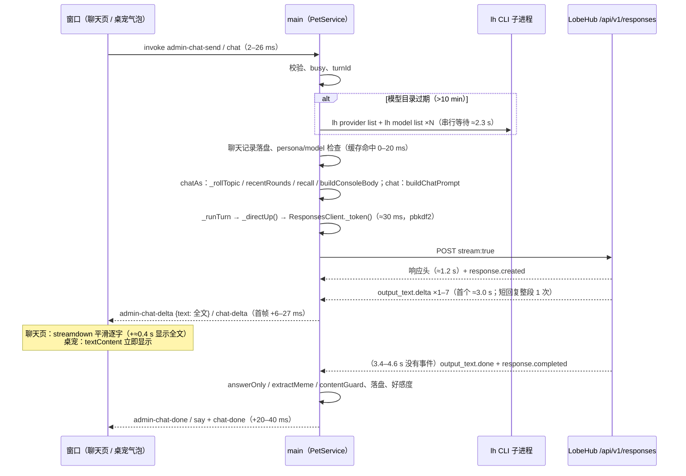

# 聊天窗口 vs 桌面对话：链路对比、基线测速与根因（T-2815）

> 分支 `perf/admin-chat-latency`（基于 canary `00252f9`）。本文只做测量和根因定位，不改聊天行为；优化项留给后续任务。
> 「聊天窗口」= 设置窗口 → 聊天（`PetService#chatAs`，`admin-chat-send` / `admin-chat-delta`，`admin/src/console/pages/Chat.tsx`）；
> 「桌面」= 桌宠气泡对话（`PetService#chat`，`chat` / `chat-delta`，`src/renderer/app.js`）。

## 0. 结论

在**同一角色（大肥鱼）、同一模型（DeepSeek V4.1 Flash，`lobehub:deepseek-flash`）、同一话题、同一缓存状态**下实测：

- **网络和主进程层面，聊天窗口并不比桌面慢。** 热态 TTFT（点击发送 → 首字上屏）中位数：聊天窗口 3075 ms，桌面 2777 ms。不经过 app、从 node 直接发 Responses API 的「地板值」是 3068 ms。P90 反而是聊天窗口更低（3352 vs 5836 ms）。两条链路 100% 走直连 SSE（`via=direct`），没有回退。主进程准备耗时都是 30–60 ms，IPC 2–26 ms。
- **聊天窗口独有的开销只有一项**：Markdown 流式平滑显示（`animated: true` → streamdown `balanced` 预设）。长回复（约 250 字）时，全文上屏比主进程推出最后一段晚 **397 ms（P90 427 ms）**；桌面气泡直接 `textContent` 显示，只晚 8 ms。首字上屏多约 10 ms（16–18 ms vs 6–9 ms）。
- **用户觉得「慢」的主要时间，是两条链路共有、但在聊天窗口里看得见的两段：**
  1. **服务端收尾**：最后一个文字 delta 到 `response.completed` 之间，服务端 3.4–4.6 s 不发任何事件。这段时间约占一轮总耗时的 47%（聊天窗口 p50 3513 / 7506 ms）。桌面上文字已经在气泡里，看不出来；聊天窗口在这段时间一直显示「正在回复」，按钮停在「停止」，最终消息（带模型标签）要等这段结束才落定。
  2. **模型目录缓存过期（冷态）**：`MODELS_TTL_MS` 是 10 分钟，过期后的第一轮要先串行跑 `refreshModels`（多个 `lh` 子进程），**+2.3 s**。冷态 TTFT 5607 ms，热态 3075 ms，多了 82%。聊天窗口里隔十几分钟回来接着聊，正好每轮都踩到这一段。
- 回退路径 `lh agent run` 要等整段跑完才吐文字，TTFT 等于总耗时，为 7.3–10.0 s。本次测量没有触发，但一旦直连失败，`LOCAL_RETRY_MS` 时间窗内的每一轮都会走它，两条链路一样受影响。

### 按贡献排序的根因（聊天窗口用户实际等待的时间）

| # | 根因 | 只影响聊天窗口？ | 量化贡献（p50 / p90） | 证据 |
|---|---|---|---|---|
| R1 | 服务端：文字发完后要 3.4–4.6 s 才发 `output_text.done`/`response.completed`；聊天窗口在这段时间保持「正在回复 / 停止」 | 两条都有，**聊天窗口可见** | 3513 / 4565 ms，约占总耗时 47% | §3.3 的 SSE 事件时间线；`responses-client.js:247` 读到 terminal 事件才结束；`Chat.tsx:360` 收到 done 才清掉 live |
| R2 | 模型目录过期，`refreshModels` 串行阻塞请求（`pet-service.js:1210`，桌面在 `:542`） | 两条都有 | +2302 / +2408 ms TTFT | 冷态 `prep` 2335 ms，热态 33 ms；`marks.models` 2264–2457 ms |
| R3 | 服务端首字延迟：请求 → 响应头 1.2 s，→ 首个文字 3.0 s；短回复只发 1–2 个 delta（整段一次给） | 两条都有 | 3010 / 3591 ms | raw 地板 3047 / 3213 ms，与 app 内一致 |
| R4 | 聊天页 Markdown 平滑显示（`Chat.tsx:805` `animated: true`，streamdown `balanced`：maxCps 72 / maxActiveCps 132） | **只有聊天窗口** | 全文上屏 +397 / +427 ms（长回复）；首帧 +10 ms | `revealLag` admin 397 ms，desktop 8 ms |
| R5 | 回退 `lh agent run`（不流式） | 两条都有（本次未触发） | TTFT 7.3–10.0 s（比直连多 4–7 s） | §3.4 |
| — | 4 小时换话题带上 recentRounds | 只有聊天窗口 | prompt 500 → 2660–3215 字，TTFT 在噪声内（4175 ms vs 热态 4946 ms） | §3.2 的 fresh 行 |
| — | IPC 推全文、主进程同步开销、渲染 | — | IPC ≤ 26 ms；每轮推送 1–7 次、≤ 3.6 KB；`chatCharacters` 17 ms；60 fps、0 个 long task | §3.1、§4 |

**结论一句话**：同等条件下，聊天窗口比桌面多出的只有约 0.4 s 的平滑显示（R4）。用户感到的「慢」主要来自：服务端 3.5 s 的收尾在聊天窗口里看得见（R1），以及隔 10 分钟以上再聊时串行刷新模型目录多出的 2.3 s（R2）。这两项桌面同样存在，只是桌面上不容易察觉。

## 1. 两条链路逐段对照



| 步骤 | 桌面 `chat()` | 聊天窗口 `chatAs()` | 实测差异 |
|---|---|---|---|
| IPC 入口 | `main.js:500` `chat`（保存粘贴图片） | `main.js:751` `admin-chat-send`（校验、保存图片） | 点击 → main：桌面 15 ms，聊天窗口 2 ms（p50） |
| 模型目录 | `_ensureReady` → `_doEnsureReady` → `refreshModels`（`pet-service.js:542`） | 直接 `await this.refreshModels()`（`pet-service.js:1210`），在记录用户消息之前 | 两边相同：冷 2.2–2.5 s，热 0 ms |
| persona / 模型 | `_ensurePersona(_c())`、`_applyModel()`；还会等启动预热（`_readying`）和 `_verifyLocal`（本地能力开启时） | `_ensurePersona(c)`、`_applyModel(c)`，不等 `_readying` | 缓存命中时两边都 ≈0 ms；本次 `waitedReady` 都为 false |
| 话题 | 一直沿用 `c.topicId` | `_rollTopic`（`pet-service.js:1154`）：超过 4 h 换新话题，并带上 `recentRounds`（≤ 8000 字，`admin-chat.js:28`） | 新话题时 prompt 2660–3215 字（平时 500 字），TTFT 无可测差异 |
| recall | 无 | 问到「之前…」时 `pickRecall`（≤ 6000 字） | 本次消息未触发；同步耗时 2.8 ms（§4） |
| prompt | `persona.buildChatPrompt(body)` | `buildConsoleBody` → `buildChatPrompt` | 平时两边都是 498–502 字 |
| 发送 | `_runTurn(…, stream)` | `_runTurn(…, stream, { plain: true })`，不带本地工具 | 本地能力关闭时两边都是 `via=direct`、`tools=0` |
| 流式处理 | `_openStream`：contentGuard + `memes.streamingText`，emit `chat-delta`（全文） | onDelta：contentGuard + `answerOnly(memes.streamingText)`，`admin-chat-delta`（全文，`main.js:764`） | 两边每轮都是 1–7 次、≤ 3.6 KB；处理耗时 0 ms（`firstTextToShown`） |
| 前端显示 | `app.js:1008` `b.textContent = text` | `Chat.tsx:357` `setLive` → `ChatItem markdownProps={{ animated: true }}`（`:805`），streamdown `balanced` 平滑 | 首帧：6–9 ms vs 16–27 ms；全文：8 ms vs 397 ms |
| 结束 | `say` + `chat-done`，气泡去掉 caret | `admin-chat-done`（`main.js:768`），live 气泡换成最终消息 | 流结束 → 窗口 done：两边都是 16–31 ms |
| 节流/缓冲 | 没有（每个 delta 都推） | 前端没有节流；平滑本身就是缓冲 | — |

## 2. 埋点（默认关闭）

- `src/core/latency.js`：设置 `PIXELPET_LATENCY=1` 才生效，否则返回 no-op trace，不产生任何开销。每轮在结束时写一行 JSON，写到 `PIXELPET_LATENCY_FILE`（app 默认是 `<userData>/latency.jsonl`），同时以 `[latency] {…}` 打到 stdout。
- 打点位置：`pet-service.js` 的 `chat()`、`chatAs()`、`_doEnsureReady()`、`_runTurn()`、`_openStream()`；`responses-client.js` 的 `run()`。
- 字段：
  - 各阶段标记 `marks`：`models / logged / persona / applyModel / prompt / ready / runStart / token / reqSent / headers / firstByte / firstText / firstDelta / firstShown / lastShown / runEnd / doneSent / end`，单位是距 main 收到这一轮的 ms。
  - 其他字段：`via`（`direct` / `lh-run` / `lh-run-fallback` / `direct-tools` / `lh-connect…`）、`fallbackReason`、`modelsCached`、`waitedReady`、`promptChars`、`bodyChars`、`textChars`、`replyChars`、`topicFresh`、`recentMsgs`、`recallMsgs`、`convMsgs`、`deltas`、`ipcBytes`、`streamed`、`steps`、`ok`、`error`。
- 窗口侧（首帧、全文上屏、结束）由测速脚本在两个窗口里注入 rAF 探针，用同一时钟（`Date.now()`）测量。产品代码不改。
- 仅测试模式下加了一个 IPC `debug-expire-models`（`window.pet.debugExpireModels()`），让模型目录按 TTL 过期处理，用来造冷态。

单测：`test/latency.test.js` 覆盖了四点：默认不写；开启后字段和标记正确；`ResponsesClient` 的各个标记；开启时两条链路各写一行，且回复内容不变。

## 3. 实测

环境：Linux（xvfb），真实 LobeHub 账号 rdmclin2，`lh` 登录，直连 SSE 打开，`lh connect` 关闭，本地能力关闭，主动发言关闭。
每次运行都新领养大肥鱼并选 DeepSeek V4.1 Flash，结束后删除 agent。两条链路逐轮交替发送相同消息，先后顺序轮流（奇数轮桌面先，偶数轮聊天窗口先），抵消网络漂移；两条链路共用同一话题。

复现命令（场景名 `latency`，不在 `all` 里，会消耗真实 token；埋点开关 `PIXELPET_LATENCY=1` 由脚本自动设置，写到 `PIXELPET_LATENCY_FILE`；第二个参数是结果文件名 label；`node e2e/chat-latency.js <label>` 等价）：

```bash
unset ELECTRON_RUN_AS_NODE
# 基线：10 轮 × 2 条链路（第 1/4/7/10 轮冷态），再加 5 轮 raw（node 直连，无 app）
LAT_ROUNDS=10 xvfb-run -a node e2e/run.js latency baseline
# 长回复（约 400 字）+ 第 3/6 轮聊天窗口换新话题（带 recentRounds）
LAT_LONG=1 LAT_ROUNDS=6 LAT_COLD_EVERY=0 LAT_FRESH_EVERY=3 LAT_RAW=3 xvfb-run -a node e2e/run.js latency long
# SSE 事件时间线（raw 3 轮）
LAT_ROUNDS=1 LAT_COLD_EVERY=0 LAT_RAW=3 xvfb-run -a node e2e/run.js latency events
# 回退路径 lh agent run（3 轮）
LAT_ROUNDS=1 LAT_COLD_EVERY=0 LAT_RAW=0 LAT_LHRUN=3 xvfb-run -a node e2e/run.js latency lhrun
# 汇总表、主进程同步开销
node scripts/latency-report.js out/e2e/chat-latency/{baseline,long,events}.json
node scripts/bench-chat-turn.js
```

产物：`out/e2e/chat-latency/<label>.json`（每轮明细，含 marks 和窗口采样）、`<label>-latency.jsonl`（main 埋点原始行），以及截图。本文所用的四次运行已复制到 [`docs/data/admin-chat-latency/`](data/admin-chat-latency/)，包括 `baseline/long/events/lhrun` 的 `.json` 和 `-latency.jsonl`、`bench-chat-turn.json`、`report-tables.md`（`scripts/latency-report.js` 的完整输出），以及两张流式截图：`long-admin-streaming.png` 能看到聊天页正在渐显的文字，`baseline-desktop-streaming.png` 是桌宠气泡。

### 3.1 基线（短回复约 50 字；ms，p50 / p90）

| 链路 · 状态 | n | TTFT 点击→首字上屏 | 总耗时 点击→最终回复 | main 准备（到请求发出） | 其中 refreshModels | 请求→响应头 | 请求→首个文字 | main→窗口首帧 | 最后文字→流结束 |
|---|---|---|---|---|---|---|---|---|---|
| 桌面 · 冷 | 4 | 5581 / 11289 | 10125 / 15582 | 2267 / 2427 | 2233 / 2393 | 1232 / 1519 | 3181 / 8998 | 7 / 14 | 3982 / 4743 |
| 桌面 · 热 | 6 | 2777 / 5836 | 7008 / 9597 | 31 / 33 | 0 / 0 | 1155 / 3766 | 2707 / 5784 | 9 / 14 | 3779 / 4476 |
| 聊天窗口 · 冷 | 4 | 5607 / 6364 | 9253 / 10286 | 2335 / 2464 | 2295 / 2429 | 1080 / 1244 | 3154 / 4000 | 17 / 34 | 3430 / 4219 |
| 聊天窗口 · 热 | 6 | 3075 / 3352 | 6951 / 7506 | 33 / 56 | 0 / 0 | 1274 / 1703 | 3010 / 3293 | 16 / 22 | 3627 / 4593 |
| raw（node 直连）· 热 | 5 | 3068 / 3233 | 6676 / 8287 | 23 / 31 | — | 1266 / 1308 | 3047 / 3213 | — | 3698 / 5200 |
| 桌面 · 全部 | 10 | 4278 / 8590 | 8056 / 11958 | 33 / 2297 | | | | | |
| 聊天窗口 · 全部 | 10 | 3352 / 5969 | 7506 / 9959 | 56 / 2375 | | | | | |

其他指标（两条链路一致）：
- `via=direct` 20/20，`fallbackReason` 为空，prompt 498–501 字。
- 每轮推送 1–2 次、128–228 B。
- 点击 → main：桌面 10–26 ms，聊天窗口 2–5 ms。
- 窗口 60 fps，long task 0。

桌面热态 P90 偏高，来自第 6 轮（请求→首字 7988 ms）；桌面冷态 P90 来自第 10 轮（11338 ms）。两轮都是服务端抖动，不是 app 造成的。

逐轮原始输出（baseline）：

```
#1 desktop cold via=direct prompt=498 ipcIn=23 prep=2492 req→1st=3537 shown→paint=16 TTFT=6068 streamEnd=11103 total=11121 reply=45
#1 admin   cold via=direct prompt=498 ipcIn=5 prep=2310 req→1st=4204 shown→paint=41 TTFT=6561 streamEnd=9873 total=9904 reply=45
#2 admin   warm via=direct prompt=501 ipcIn=5 prep=51 req→1st=3507 shown→paint=19 TTFT=3582 streamEnd=7013 total=7037 reply=52
#2 desktop warm via=direct prompt=501 ipcIn=15 prep=30 req→1st=3580 shown→paint=5 TTFT=3630 streamEnd=7828 total=7850 reply=45
#3 desktop warm via=direct prompt=499 ipcIn=13 prep=31 req→1st=2452 shown→paint=10 TTFT=2506 streamEnd=6406 total=6424 reply=39
#3 admin   warm via=direct prompt=499 ipcIn=1 prep=30 req→1st=3003 shown→paint=13 TTFT=3047 streamEnd=7288 total=7308 reply=44
#4 admin   cold via=direct prompt=498 ipcIn=3 prep=2153 req→1st=2453 shown→paint=11 TTFT=4620 streamEnd=8115 total=8142 reply=41
#4 desktop cold via=direct prompt=498 ipcIn=5 prep=2275 req→1st=2638 shown→paint=8 TTFT=4926 streamEnd=8245 total=8262 reply=50
#5 desktop warm via=direct prompt=499 ipcIn=5 prep=28 req→1st=2433 shown→paint=8 TTFT=2474 streamEnd=6083 total=6092 reply=50
#5 admin   warm via=direct prompt=499 ipcIn=2 prep=31 req→1st=2533 shown→paint=16 TTFT=2582 streamEnd=6086 total=6099 reply=48
#6 admin   warm via=direct prompt=498 ipcIn=2 prep=30 req→1st=3078 shown→paint=12 TTFT=3122 streamEnd=6843 total=6864 reply=47
#6 desktop warm via=direct prompt=498 ipcIn=14 prep=35 req→1st=7988 shown→paint=5 TTFT=8042 streamEnd=11337 total=11343 reply=53
#7 desktop cold via=direct prompt=498 ipcIn=4 prep=2258 req→1st=2825 shown→paint=6 TTFT=5093 streamEnd=9112 total=9128 reply=42
#7 admin   cold via=direct prompt=498 ipcIn=2 prep=2509 req→1st=2784 shown→paint=16 TTFT=5311 streamEnd=8575 total=8602 reply=41
#8 admin   warm via=direct prompt=498 ipcIn=2 prep=34 req→1st=2685 shown→paint=15 TTFT=2736 streamEnd=7652 total=7704 reply=37
#8 desktop warm via=direct prompt=498 ipcIn=28 prep=31 req→1st=2657 shown→paint=16 TTFT=2732 streamEnd=6363 total=6382 reply=51
#9 desktop warm via=direct prompt=498 ipcIn=23 prep=31 req→1st=2757 shown→paint=11 TTFT=2822 streamEnd=7559 total=7591 reply=51
#9 admin   warm via=direct prompt=498 ipcIn=1 prep=60 req→1st=3016 shown→paint=25 TTFT=3102 streamEnd=6404 total=6447 reply=53
#10 admin   cold via=direct prompt=501 ipcIn=2 prep=2360 req→1st=3523 shown→paint=18 TTFT=5903 streamEnd=10409 total=10449 reply=45
#10 desktop cold via=direct prompt=501 ipcIn=14 prep=2169 req→1st=11338 shown→paint=5 TTFT=13526 streamEnd=17460 total=17494 reply=45
```

main 埋点原始行示例（`baseline-latency.jsonl`，冷态聊天窗口这一轮）：

```json
{"kind":"admin","modelsCached":false,"model":"lobehub:deepseek-flash","marks":{"models":2264,"logged":2281,"persona":2281,"applyModel":2282,"prompt":2282,"runStart":2282,"token":2310,"reqSent":2310,"headers":3372,"firstByte":3381,"firstText":6514,"firstDelta":6515,"firstShown":6515,"runEnd":9868,"end":9882}}
```

### 3.2 长回复与换话题（约 250 字；ms，p50 / p90）

| 链路 · 状态 | n | TTFT | 总耗时 | 最后一段→全文上屏 | 最后文字→流结束 | prompt 字 | 回复字 | 推送次数 / 字节 |
|---|---|---|---|---|---|---|---|---|
| 桌面 · 热 | 6 | 3984 / 4663 | 9092 / 11442 | **8 / 12** | 4099 / 5992 | 500 | 213 / 274 | 5 / 1844 B |
| 聊天窗口 · 热 | 4 | 4946 / 6293 | 9970 / 12451 | **397 / 427** | 4631 / 4981 | 500 | 262 / 289 | 4 / 1900 B |
| 聊天窗口 · 新话题 | 2 | 4175 / 5332 | 9141 / 11473 | 240 / 422 | 4036 / 4470 | **2660 / 3104** | 188 / 302 | 4 / 2064 B |
| raw · 热 | 3 | 4386 / 8452 | 10517 / 14735 | — | 4546 / 4578 | 499 | 335 / 345 | 7 |

这组里聊天窗口的 TTFT 高于桌面，原因在服务端，不在 app：请求→首字的中位数是 4879 vs 3927 ms，main 准备都在 50 ms 以内，raw 地板 p50 4386 ms、p90 8452 ms。

长回复里服务端每约 300 ms 推一块约 50 字（约 170 字/s）。这超过了 streamdown `balanced` 的 maxActiveCps 132，所以聊天页的显示会持续落后。

### 3.3 服务端 SSE 事件时间线（raw，node 直连）

```
1057ms response.created | 1057ms response.in_progress | 2480ms output_item.added | 2480ms content_part.added | 2982-3072ms output_text.delta×2(61字) | 6411ms output_text.done | 6411ms content_part.done | 6411ms output_item.done | 6412ms response.completed
1269ms response.created | 1270ms response.in_progress | 2923ms output_item.added | 2923ms content_part.added | 2923-2943ms output_text.delta×2(58字) | 7564ms output_text.done | … | 7564ms response.completed
1058ms response.created | 1059ms response.in_progress | 2499ms output_item.added | 2499ms content_part.added | 2499-2548ms output_text.delta×2(51字) | 5941ms output_text.done | … | 5942ms response.completed
```

从最后一个 delta 到 `output_text.done` 隔了 3.3–4.6 s，中间没有任何事件。`output_text.done` 和 `completed` 几乎同时到达，客户端没法提前判断回复已经结束（R1）。短回复的文字只来 1–2 个 delta，说明服务端是整段或大块推送的（R3）。

### 3.4 回退路径 `lh agent run --json`

```
#2 lhrun warm via=lh-run prompt=501 first text=7324 total=7337 reply=75
#3 lhrun warm via=lh-run prompt=499 first text=7360 total=7367 reply=69
#4 lhrun warm via=lh-run prompt=498 first text=10009 total=10020 reply=69
```

同一轮里直连的 TTFT 是 2806 ms（聊天窗口）和 3349 ms（桌面）。

## 4. 主进程同步开销（`node scripts/bench-chat-turn.js`，满额 3000 条、1089 KB 的聊天记录）

| 操作 | p50 / p90 ms | 每轮次数 |
|---|---|---|
| `conversationOf`（chatAs） | 4.3 / 7.3 | 1 |
| `log.append`（同步写整份文件） | 2.8 / 7.6 | 2 |
| `chatCharacters`（`admin-chat-changed` 触发） | 16.9 / 19.0 | 聊天窗口 2，桌面 1 |
| `recentRounds`（新话题时） | 0.04 / 0.12 | 0–1，带上 4727 字 |
| `pickRecall`（问到以前的事时） | 2.8 / 3.0 | 0–1 |

合计每轮不超过约 50 ms，而且大部分发生在等网络期间，对 TTFT 没有可测影响。

## 5. 建议的优化项（交给后续任务，本任务不实施）

1. **模型目录改为 stale-while-revalidate**（对应 R2，预计冷态 TTFT 少 2.3 s）：已有缓存时，`chatAs`（`pet-service.js:1210`）和 `_doEnsureReady`（`:542`）不再等待 `refreshModels`，先用旧目录发请求，后台刷新；目录变了下一轮再 `_applyModel`。打开聊天页或开始输入时也可以预热一次。
2. **把服务端收尾的问题报给 LobeHub Responses API**（对应 R1，约 3.5 s）：查清文字发完后 3.4–4.6 s 的后处理是什么（持久化、用量、标题等），请服务端先发 `output_text.done`，再做后处理。客户端可以选择：收到 `output_text.done` 就把气泡标为完成、恢复「发送」，最终 id 和用量晚到再补上。
3. **聊天页平滑显示改为 `realtime` 或关闭**（对应 R4，全文上屏约快 0.4 s）：`Chat.tsx:805` 设 `streamSmoothingPreset: 'realtime'`（maxCps 96 / maxActiveCps 180，targetBuffer 40 ms），或者回复较短时 `animated: false`。
4. **回退可见、可诊断**（对应 R5）：埋点已经记录了 `via` 和 `fallbackReason`。建议在聊天页的模型标签旁提示「本轮走了 lh agent run」，并在日志里统计，避免用户在不知情的情况下一直走 7–10 s 的慢路径。
5. **服务端流式颗粒度**（对应 R3）：短回复只有 1–2 个 delta，首字要等整块生成完。这需要服务端改进，客户端无能为力。
6. 低优先级：`admin-chat-delta` 只推增量；`chatCharacters` 加缓存。目前收益都小于 20 ms。

## 6. 局限

- 测量机器是 Linux + xvfb（软件渲染，60 fps），用户截图里是 macOS。渲染和 IPC 的结论在 Mac 上可能有几十 ms 的差别，但不影响秒级的 R1、R2。用户本机可以用 `PIXELPET_LATENCY=1` 启动 app，按同样的字段直接对比。
- 本任务没有复现「同等条件下聊天窗口明显更慢」：网络和主进程层面没有差异。如果用户本机差异明显，优先用埋点看 `via` / `fallbackReason`（是否走了回退）和 `modelsCached`（是否冷态）。
