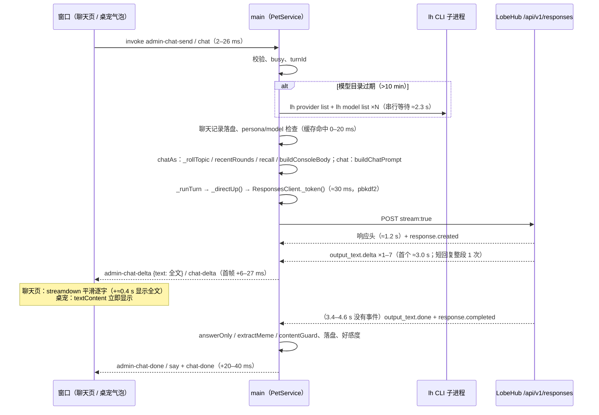

# 聊天窗口 vs 桌面对话：链路对比、根因、优化与前后对比（T-2815 / T-2818）

> 分支 `perf/admin-chat-latency`（基于 canary `00252f9`）。§0–§6 是 T-2815 的测量与根因定位（不改行为）；
> **§7–§10 是 T-2818 的优化改动、优化前后对比数据与回归验证结果。** §12 是 T-2822 终验时补充的证据，包括流式截图序列、录屏和超时场景。§13 是风险、回滚方式与待跟进事项。

## 优化结果速览（T-2818 最终代码；同方法、同账号、同角色、同模型、同消息集；ms，p50 / p90）

优化前 = 检出优化前提交 `0c3135b` 重跑（`before.json`）；优化后 = 最终代码重跑（`after-r3.json`，§8.3）。每条链路 12 轮，冷 / 热各 6 轮。

| 聊天窗口 | 优化前 TTFT | 优化后 TTFT | 变化（p50） | 优化前总耗时 | 优化后总耗时 | 变化（p50） |
|---|---|---|---|---|---|---|
| 冷（模型目录过期） | 5829 / 8062 | **2783 / 5712** | **−3046（−52%）** | 10315 / 12772 | **6361 / 9755** | **−3954（−38%）** |
| 热 | 2973 / 4371 | 2682 / 2886 | −291（−10%） | 6739 / 8444 | 6533 / 6748 | −206（−3%） |
| 全部 | 5403 / 6035 | **2733 / 2989** | **−2670（−49%）** | 8729 / 11134 | **6533 / 7176** | **−2196（−25%）** |

- **可复现**：优化后共独立跑了两次。第一次在提交 `97e39c0` 上（`after.json`，§8.1），冷态 TTFT p50 为 2860 ms；第二次在最终代码上（`after-r3.json`），为 2783 ms。两次相对优化前都是 −51% / −52%。
- 冷态 p90 5712 ms 来自 1 轮服务端抖动：第 1 轮请求→首字 8376 ms。同一次运行里 raw 直连也有 2 轮出现 9.7 s 才收到响应头。其余 5 轮冷态 TTFT 都在 2559–2975 ms。
- **与桌面对比（同一次运行）**：TTFT p50，冷态聊天窗口 2783 / 桌面 3336，热态 2682 / 2653；总耗时 p50，冷态 6361 / 7262，热态 6533 / 6530。聊天窗口已与桌面持平。
- main 进程准备（点击后到请求发出）：冷态 2788 → 29 ms，热态 56 → 22 ms。
- 长回复（约 250–400 字）：聊天窗口「最后一段→全文上屏」458 → 253 ms。每轮 main→窗口 IPC 字节 5431 → **748**（−86%），也就是每个字只传一次；桌面仍推全文，为 4384 B。
- 热态 TTFT 和总耗时几乎全花在服务端：请求→首字约 2.7 s，最后一段文字→`response.completed` 约 3.5 s（R1/R3）。§7.3 的探针证明这两段客户端改不了。
- 详见 §7（改动）、§8（对比数据）、§9（回归）、§10（复现）。
> 「聊天窗口」= 设置窗口 → 聊天（`PetService#chatAs`，`admin-chat-send` / `admin-chat-delta`，`admin/src/console/pages/Chat.tsx`）；
> 「桌面」= 桌宠气泡对话（`PetService#chat`，`chat` / `chat-delta`，`src/renderer/app.js`）。

## 0. 结论

在**同一角色（大肥鱼）、同一模型（DeepSeek V4.1 Flash，`lobehub:deepseek-flash`）、同一话题、同一缓存状态**下实测：

- **网络和主进程层面，聊天窗口并不比桌面慢。** 热态 TTFT（点击发送 → 首字上屏）中位数：聊天窗口 3075 ms，桌面 2777 ms。不经过 app、从 node 直接发 Responses API 的「地板值」是 3068 ms。P90 反而是聊天窗口更低（3352 vs 5836 ms）。两条链路 100% 走直连 SSE（`via=direct`），没有回退。主进程准备耗时都是 30–60 ms，IPC 2–26 ms。
- **聊天窗口独有的开销只有一项**：Markdown 流式平滑显示（`animated: true` → streamdown `balanced` 预设）。长回复（约 250 字）时，全文上屏比主进程推出最后一段晚 **397 ms（P90 427 ms）**；桌面气泡直接 `textContent` 显示，只晚 8 ms。首字上屏多约 10 ms（16–18 ms vs 6–9 ms）。
- **用户觉得「慢」的主要时间，是两条链路共有、但在聊天窗口里看得见的两段：**
  1. **服务端收尾**：最后一个文字 delta 到 `response.completed` 之间，服务端 3.4–4.6 s 不发任何事件。这段时间约占一轮总耗时的 47%（聊天窗口 p50 3513 / 7506 ms）。桌面上文字已经在气泡里，看不出来；聊天窗口在这段时间一直显示「正在回复」，按钮停在「停止」，最终消息（带模型标签）要等这段结束才落定。
  2. **模型目录缓存过期（冷态）**：`MODELS_TTL_MS` 是 10 分钟，过期后的第一轮要先串行跑 `refreshModels`（多个 `lh` 子进程），**+2.3 s**。冷态 TTFT 5607 ms，热态 3075 ms，多了 82%。聊天窗口里隔十几分钟回来接着聊，正好每轮都踩到这一段。
- 回退路径 `lh agent run` 要等整段跑完才吐文字，TTFT 等于总耗时，为 7.3–10.0 s。本次测量没有触发，但一旦直连失败，`LOCAL_RETRY_MS` 时间窗内的每一轮都会走它，两条链路一样受影响。

### 按贡献排序的根因（聊天窗口用户实际等待的时间）

| # | 根因 | 只影响聊天窗口？ | 量化贡献（p50 / p90） | 证据 |
|---|---|---|---|---|
| R1 | 服务端：文字发完后要 3.4–4.6 s 才发 `output_text.done`/`response.completed`；聊天窗口在这段时间保持「正在回复 / 停止」 | 两条都有，**聊天窗口可见** | 3513 / 4565 ms，约占总耗时 47% | §3.3 的 SSE 事件时间线；`responses-client.js:247` 读到 terminal 事件才结束；`Chat.tsx:360` 收到 done 才清掉 live |
| R2 | 模型目录过期，`refreshModels` 串行阻塞请求（`pet-service.js:1210`，桌面在 `:542`） | 两条都有 | +2302 / +2408 ms TTFT | 冷态 `prep` 2335 ms，热态 33 ms；`marks.models` 2264–2457 ms |
| R3 | 服务端首字延迟：请求 → 响应头 1.2 s，→ 首个文字 3.0 s；短回复只发 1–2 个 delta（整段一次给） | 两条都有 | 3010 / 3591 ms | raw 地板 3047 / 3213 ms，与 app 内一致 |
| R4 | 聊天页 Markdown 平滑显示（`Chat.tsx:805` `animated: true`，streamdown `balanced`：maxCps 72 / maxActiveCps 132） | **只有聊天窗口** | 全文上屏 +397 / +427 ms（长回复）；首帧 +10 ms | `revealLag` admin 397 ms，desktop 8 ms |
| R5 | 回退 `lh agent run`（不流式） | 两条都有（本次未触发） | TTFT 7.3–10.0 s（比直连多 4–7 s） | §3.4 |
| — | 4 小时换话题带上 recentRounds | 只有聊天窗口 | prompt 500 → 2660–3215 字，TTFT 在噪声内（4175 ms vs 热态 4946 ms） | §3.2 的 fresh 行 |
| — | IPC 推全文、主进程同步开销、渲染 | — | IPC ≤ 26 ms；每轮推送 1–7 次、≤ 3.6 KB；`chatCharacters` 17 ms；60 fps、0 个 long task | §3.1、§4 |

**结论一句话**：同等条件下，聊天窗口比桌面多出的只有约 0.4 s 的平滑显示（R4）。用户感到的「慢」主要来自：服务端 3.5 s 的收尾在聊天窗口里看得见（R1），以及隔 10 分钟以上再聊时串行刷新模型目录多出的 2.3 s（R2）。这两项桌面同样存在，只是桌面上不容易察觉。

## 1. 两条链路逐段对照



| 步骤 | 桌面 `chat()` | 聊天窗口 `chatAs()` | 实测差异 |
|---|---|---|---|
| IPC 入口 | `main.js:500` `chat`（保存粘贴图片） | `main.js:751` `admin-chat-send`（校验、保存图片） | 点击 → main：桌面 15 ms，聊天窗口 2 ms（p50） |
| 模型目录 | `_ensureReady` → `_doEnsureReady` → `refreshModels`（`pet-service.js:542`） | 直接 `await this.refreshModels()`（`pet-service.js:1210`），在记录用户消息之前 | 两边相同：冷 2.2–2.5 s，热 0 ms |
| persona / 模型 | `_ensurePersona(_c())`、`_applyModel()`；还会等启动预热（`_readying`）和 `_verifyLocal`（本地能力开启时） | `_ensurePersona(c)`、`_applyModel(c)`，不等 `_readying` | 缓存命中时两边都 ≈0 ms；本次 `waitedReady` 都为 false |
| 话题 | 一直沿用 `c.topicId` | `_rollTopic`（`pet-service.js:1154`）：超过 4 h 换新话题，并带上 `recentRounds`（≤ 8000 字，`admin-chat.js:28`） | 新话题时 prompt 2660–3215 字（平时 500 字），TTFT 无可测差异 |
| recall | 无 | 问到「之前…」时 `pickRecall`（≤ 6000 字） | 本次消息未触发；同步耗时 2.8 ms（§4） |
| prompt | `persona.buildChatPrompt(body)` | `buildConsoleBody` → `buildChatPrompt` | 平时两边都是 498–502 字 |
| 发送 | `_runTurn(…, stream)` | `_runTurn(…, stream, { plain: true })`，不带本地工具 | 本地能力关闭时两边都是 `via=direct`、`tools=0` |
| 流式处理 | `_openStream`：contentGuard + `memes.streamingText`，emit `chat-delta`（全文） | onDelta：contentGuard + `answerOnly(memes.streamingText)`，`admin-chat-delta`（全文，`main.js:764`） | 两边每轮都是 1–7 次、≤ 3.6 KB；处理耗时 0 ms（`firstTextToShown`） |
| 前端显示 | `app.js:1008` `b.textContent = text` | `Chat.tsx:357` `setLive` → `ChatItem markdownProps={{ animated: true }}`（`:805`），streamdown `balanced` 平滑 | 首帧：6–9 ms vs 16–27 ms；全文：8 ms vs 397 ms |
| 结束 | `say` + `chat-done`，气泡去掉 caret | `admin-chat-done`（`main.js:768`），live 气泡换成最终消息 | 流结束 → 窗口 done：两边都是 16–31 ms |
| 节流/缓冲 | 没有（每个 delta 都推） | 前端没有节流；平滑本身就是缓冲 | — |

## 2. 埋点（默认关闭）

- `src/core/latency.js`：设置 `PIXELPET_LATENCY=1` 才生效，否则返回 no-op trace，不产生任何开销。每轮在结束时写一行 JSON，写到 `PIXELPET_LATENCY_FILE`（app 默认是 `<userData>/latency.jsonl`），同时以 `[latency] {…}` 打到 stdout。
- 打点位置：`pet-service.js` 的 `chat()`、`chatAs()`、`_doEnsureReady()`、`_runTurn()`、`_openStream()`；`responses-client.js` 的 `run()`。
- 字段：
  - 各阶段标记 `marks`：`models / logged / persona / applyModel / prompt / ready / runStart / token / reqSent / headers / firstByte / firstText / firstDelta / firstShown / lastShown / runEnd / doneSent / end`，单位是距 main 收到这一轮的 ms。
  - 其他字段：`via`（`direct` / `lh-run` / `lh-run-fallback` / `direct-tools` / `lh-connect…`）、`fallbackReason`、`modelsCached`、`waitedReady`、`promptChars`、`bodyChars`、`textChars`、`replyChars`、`topicFresh`、`recentMsgs`、`recallMsgs`、`convMsgs`、`deltas`、`ipcBytes`、`streamed`、`steps`、`ok`、`error`。
- 窗口侧（首帧、全文上屏、结束）由测速脚本在两个窗口里注入 rAF 探针，用同一时钟（`Date.now()`）测量。产品代码不改。
- 仅测试模式下加了一个 IPC `debug-expire-models`（`window.pet.debugExpireModels()`），让模型目录按 TTL 过期处理，用来造冷态。

单测：`test/latency.test.js` 覆盖了四点：默认不写；开启后字段和标记正确；`ResponsesClient` 的各个标记；开启时两条链路各写一行，且回复内容不变。

## 3. 实测

环境：Linux（xvfb），真实 LobeHub 账号 rdmclin2，`lh` 登录，直连 SSE 打开，`lh connect` 关闭，本地能力关闭，主动发言关闭。
每次运行都新领养大肥鱼并选 DeepSeek V4.1 Flash，结束后删除 agent。两条链路逐轮交替发送相同消息，先后顺序轮流（奇数轮桌面先，偶数轮聊天窗口先），抵消网络漂移；两条链路共用同一话题。

复现命令（场景名 `latency`，不在 `all` 里，会消耗真实 token；埋点开关 `PIXELPET_LATENCY=1` 由脚本自动设置，写到 `PIXELPET_LATENCY_FILE`；第二个参数是结果文件名 label；`node e2e/chat-latency.js <label>` 等价）：

```bash
unset ELECTRON_RUN_AS_NODE
# 基线：10 轮 × 2 条链路（第 1/4/7/10 轮冷态），再加 5 轮 raw（node 直连，无 app）
LAT_ROUNDS=10 xvfb-run -a node e2e/run.js latency baseline
# 长回复（约 400 字）+ 第 3/6 轮聊天窗口换新话题（带 recentRounds）
LAT_LONG=1 LAT_ROUNDS=6 LAT_COLD_EVERY=0 LAT_FRESH_EVERY=3 LAT_RAW=3 xvfb-run -a node e2e/run.js latency long
# SSE 事件时间线（raw 3 轮）
LAT_ROUNDS=1 LAT_COLD_EVERY=0 LAT_RAW=3 xvfb-run -a node e2e/run.js latency events
# 回退路径 lh agent run（3 轮）
LAT_ROUNDS=1 LAT_COLD_EVERY=0 LAT_RAW=0 LAT_LHRUN=3 xvfb-run -a node e2e/run.js latency lhrun
# 汇总表、主进程同步开销
node scripts/latency-report.js out/e2e/chat-latency/{baseline,long,events}.json
node scripts/bench-chat-turn.js
```

产物：`out/e2e/chat-latency/<label>.json`（每轮明细，含 marks 和窗口采样）、`<label>-latency.jsonl`（main 埋点原始行），以及截图。本文所用的四次运行已复制到 [`docs/data/admin-chat-latency/`](data/admin-chat-latency/)，包括 `baseline/long/events/lhrun` 的 `.json` 和 `-latency.jsonl`、`bench-chat-turn.json`、`report-tables.md`（`scripts/latency-report.js` 的完整输出），以及两张流式截图：`long-admin-streaming.png` 能看到聊天页正在渐显的文字，`baseline-desktop-streaming.png` 是桌宠气泡。

### 3.1 基线（短回复约 50 字；ms，p50 / p90）

| 链路 · 状态 | n | TTFT 点击→首字上屏 | 总耗时 点击→最终回复 | main 准备（到请求发出） | 其中 refreshModels | 请求→响应头 | 请求→首个文字 | main→窗口首帧 | 最后文字→流结束 |
|---|---|---|---|---|---|---|---|---|---|
| 桌面 · 冷 | 4 | 5581 / 11289 | 10125 / 15582 | 2267 / 2427 | 2233 / 2393 | 1232 / 1519 | 3181 / 8998 | 7 / 14 | 3982 / 4743 |
| 桌面 · 热 | 6 | 2777 / 5836 | 7008 / 9597 | 31 / 33 | 0 / 0 | 1155 / 3766 | 2707 / 5784 | 9 / 14 | 3779 / 4476 |
| 聊天窗口 · 冷 | 4 | 5607 / 6364 | 9253 / 10286 | 2335 / 2464 | 2295 / 2429 | 1080 / 1244 | 3154 / 4000 | 17 / 34 | 3430 / 4219 |
| 聊天窗口 · 热 | 6 | 3075 / 3352 | 6951 / 7506 | 33 / 56 | 0 / 0 | 1274 / 1703 | 3010 / 3293 | 16 / 22 | 3627 / 4593 |
| raw（node 直连）· 热 | 5 | 3068 / 3233 | 6676 / 8287 | 23 / 31 | — | 1266 / 1308 | 3047 / 3213 | — | 3698 / 5200 |
| 桌面 · 全部 | 10 | 4278 / 8590 | 8056 / 11958 | 33 / 2297 | | | | | |
| 聊天窗口 · 全部 | 10 | 3352 / 5969 | 7506 / 9959 | 56 / 2375 | | | | | |

其他指标（两条链路一致）：
- `via=direct` 20/20，`fallbackReason` 为空，prompt 498–501 字。
- 每轮推送 1–2 次、128–228 B。
- 点击 → main：桌面 10–26 ms，聊天窗口 2–5 ms。
- 窗口 60 fps，long task 0。

桌面热态 P90 偏高，来自第 6 轮（请求→首字 7988 ms）；桌面冷态 P90 来自第 10 轮（11338 ms）。两轮都是服务端抖动，不是 app 造成的。

逐轮原始输出（baseline）：

```
#1 desktop cold via=direct prompt=498 ipcIn=23 prep=2492 req→1st=3537 shown→paint=16 TTFT=6068 streamEnd=11103 total=11121 reply=45
#1 admin   cold via=direct prompt=498 ipcIn=5 prep=2310 req→1st=4204 shown→paint=41 TTFT=6561 streamEnd=9873 total=9904 reply=45
#2 admin   warm via=direct prompt=501 ipcIn=5 prep=51 req→1st=3507 shown→paint=19 TTFT=3582 streamEnd=7013 total=7037 reply=52
#2 desktop warm via=direct prompt=501 ipcIn=15 prep=30 req→1st=3580 shown→paint=5 TTFT=3630 streamEnd=7828 total=7850 reply=45
#3 desktop warm via=direct prompt=499 ipcIn=13 prep=31 req→1st=2452 shown→paint=10 TTFT=2506 streamEnd=6406 total=6424 reply=39
#3 admin   warm via=direct prompt=499 ipcIn=1 prep=30 req→1st=3003 shown→paint=13 TTFT=3047 streamEnd=7288 total=7308 reply=44
#4 admin   cold via=direct prompt=498 ipcIn=3 prep=2153 req→1st=2453 shown→paint=11 TTFT=4620 streamEnd=8115 total=8142 reply=41
#4 desktop cold via=direct prompt=498 ipcIn=5 prep=2275 req→1st=2638 shown→paint=8 TTFT=4926 streamEnd=8245 total=8262 reply=50
#5 desktop warm via=direct prompt=499 ipcIn=5 prep=28 req→1st=2433 shown→paint=8 TTFT=2474 streamEnd=6083 total=6092 reply=50
#5 admin   warm via=direct prompt=499 ipcIn=2 prep=31 req→1st=2533 shown→paint=16 TTFT=2582 streamEnd=6086 total=6099 reply=48
#6 admin   warm via=direct prompt=498 ipcIn=2 prep=30 req→1st=3078 shown→paint=12 TTFT=3122 streamEnd=6843 total=6864 reply=47
#6 desktop warm via=direct prompt=498 ipcIn=14 prep=35 req→1st=7988 shown→paint=5 TTFT=8042 streamEnd=11337 total=11343 reply=53
#7 desktop cold via=direct prompt=498 ipcIn=4 prep=2258 req→1st=2825 shown→paint=6 TTFT=5093 streamEnd=9112 total=9128 reply=42
#7 admin   cold via=direct prompt=498 ipcIn=2 prep=2509 req→1st=2784 shown→paint=16 TTFT=5311 streamEnd=8575 total=8602 reply=41
#8 admin   warm via=direct prompt=498 ipcIn=2 prep=34 req→1st=2685 shown→paint=15 TTFT=2736 streamEnd=7652 total=7704 reply=37
#8 desktop warm via=direct prompt=498 ipcIn=28 prep=31 req→1st=2657 shown→paint=16 TTFT=2732 streamEnd=6363 total=6382 reply=51
#9 desktop warm via=direct prompt=498 ipcIn=23 prep=31 req→1st=2757 shown→paint=11 TTFT=2822 streamEnd=7559 total=7591 reply=51
#9 admin   warm via=direct prompt=498 ipcIn=1 prep=60 req→1st=3016 shown→paint=25 TTFT=3102 streamEnd=6404 total=6447 reply=53
#10 admin   cold via=direct prompt=501 ipcIn=2 prep=2360 req→1st=3523 shown→paint=18 TTFT=5903 streamEnd=10409 total=10449 reply=45
#10 desktop cold via=direct prompt=501 ipcIn=14 prep=2169 req→1st=11338 shown→paint=5 TTFT=13526 streamEnd=17460 total=17494 reply=45
```

main 埋点原始行示例（`baseline-latency.jsonl`，冷态聊天窗口这一轮）：

```json
{"kind":"admin","modelsCached":false,"model":"lobehub:deepseek-flash","marks":{"models":2264,"logged":2281,"persona":2281,"applyModel":2282,"prompt":2282,"runStart":2282,"token":2310,"reqSent":2310,"headers":3372,"firstByte":3381,"firstText":6514,"firstDelta":6515,"firstShown":6515,"runEnd":9868,"end":9882}}
```

### 3.2 长回复与换话题（约 250 字；ms，p50 / p90）

| 链路 · 状态 | n | TTFT | 总耗时 | 最后一段→全文上屏 | 最后文字→流结束 | prompt 字 | 回复字 | 推送次数 / 字节 |
|---|---|---|---|---|---|---|---|---|
| 桌面 · 热 | 6 | 3984 / 4663 | 9092 / 11442 | **8 / 12** | 4099 / 5992 | 500 | 213 / 274 | 5 / 1844 B |
| 聊天窗口 · 热 | 4 | 4946 / 6293 | 9970 / 12451 | **397 / 427** | 4631 / 4981 | 500 | 262 / 289 | 4 / 1900 B |
| 聊天窗口 · 新话题 | 2 | 4175 / 5332 | 9141 / 11473 | 240 / 422 | 4036 / 4470 | **2660 / 3104** | 188 / 302 | 4 / 2064 B |
| raw · 热 | 3 | 4386 / 8452 | 10517 / 14735 | — | 4546 / 4578 | 499 | 335 / 345 | 7 |

这组里聊天窗口的 TTFT 高于桌面，原因在服务端，不在 app：请求→首字的中位数是 4879 vs 3927 ms，main 准备都在 50 ms 以内，raw 地板 p50 4386 ms、p90 8452 ms。

长回复里服务端每约 300 ms 推一块约 50 字（约 170 字/s）。这超过了 streamdown `balanced` 的 maxActiveCps 132，所以聊天页的显示会持续落后。

### 3.3 服务端 SSE 事件时间线（raw，node 直连）

```
1057ms response.created | 1057ms response.in_progress | 2480ms output_item.added | 2480ms content_part.added | 2982-3072ms output_text.delta×2(61字) | 6411ms output_text.done | 6411ms content_part.done | 6411ms output_item.done | 6412ms response.completed
1269ms response.created | 1270ms response.in_progress | 2923ms output_item.added | 2923ms content_part.added | 2923-2943ms output_text.delta×2(58字) | 7564ms output_text.done | … | 7564ms response.completed
1058ms response.created | 1059ms response.in_progress | 2499ms output_item.added | 2499ms content_part.added | 2499-2548ms output_text.delta×2(51字) | 5941ms output_text.done | … | 5942ms response.completed
```

从最后一个 delta 到 `output_text.done` 隔了 3.3–4.6 s，中间没有任何事件。`output_text.done` 和 `completed` 几乎同时到达，客户端没法提前判断回复已经结束（R1）。短回复的文字只来 1–2 个 delta，说明服务端是整段或大块推送的（R3）。

### 3.4 回退路径 `lh agent run --json`

```
#2 lhrun warm via=lh-run prompt=501 first text=7324 total=7337 reply=75
#3 lhrun warm via=lh-run prompt=499 first text=7360 total=7367 reply=69
#4 lhrun warm via=lh-run prompt=498 first text=10009 total=10020 reply=69
```

同一轮里直连的 TTFT 是 2806 ms（聊天窗口）和 3349 ms（桌面）。

## 4. 主进程同步开销（`node scripts/bench-chat-turn.js`，满额 3000 条、1089 KB 的聊天记录）

| 操作 | p50 / p90 ms | 每轮次数 |
|---|---|---|
| `conversationOf`（chatAs） | 4.3 / 7.3 | 1 |
| `log.append`（同步写整份文件） | 2.8 / 7.6 | 2 |
| `chatCharacters`（`admin-chat-changed` 触发） | 16.9 / 19.0 | 聊天窗口 2，桌面 1 |
| `recentRounds`（新话题时） | 0.04 / 0.12 | 0–1，带上 4727 字 |
| `pickRecall`（问到以前的事时） | 2.8 / 3.0 | 0–1 |

合计每轮不超过约 50 ms，而且大部分发生在等网络期间，对 TTFT 没有可测影响。

## 5. 建议的优化项（T-2815 提出；T-2818 的落实情况见 §7.2）

1. **模型目录改为 stale-while-revalidate**（对应 R2，预计冷态 TTFT 少 2.3 s）：已有缓存时，`chatAs`（`pet-service.js:1210`）和 `_doEnsureReady`（`:542`）不再等待 `refreshModels`，先用旧目录发请求，后台刷新；目录变了下一轮再 `_applyModel`。打开聊天页或开始输入时也可以预热一次。
2. **把服务端收尾的问题报给 LobeHub Responses API**（对应 R1，约 3.5 s）：查清文字发完后 3.4–4.6 s 的后处理是什么（持久化、用量、标题等），请服务端先发 `output_text.done`，再做后处理。客户端可以选择：收到 `output_text.done` 就把气泡标为完成、恢复「发送」，最终 id 和用量晚到再补上。
3. **聊天页平滑显示改为 `realtime` 或关闭**（对应 R4，全文上屏约快 0.4 s）：`Chat.tsx:805` 设 `streamSmoothingPreset: 'realtime'`（maxCps 96 / maxActiveCps 180，targetBuffer 40 ms），或者回复较短时 `animated: false`。
4. **回退可见、可诊断**（对应 R5）：埋点已经记录了 `via` 和 `fallbackReason`。建议在聊天页的模型标签旁提示「本轮走了 lh agent run」，并在日志里统计，避免用户在不知情的情况下一直走 7–10 s 的慢路径。
5. **服务端流式颗粒度**（对应 R3）：短回复只有 1–2 个 delta，首字要等整块生成完。这需要服务端改进，客户端无能为力。
6. 低优先级：`admin-chat-delta` 只推增量；`chatCharacters` 加缓存。目前收益都小于 20 ms。

## 6. 局限

- 测量机器是 Linux + xvfb（软件渲染，60 fps），用户截图里是 macOS。渲染和 IPC 的结论在 Mac 上可能有几十 ms 的差别，但不影响秒级的 R1、R2。用户本机可以用 `PIXELPET_LATENCY=1` 启动 app，按同样的字段直接对比。
- 本任务没有复现「同等条件下聊天窗口明显更慢」：网络和主进程层面没有差异。如果用户本机差异明显，优先用埋点看 `via` / `fallbackReason`（是否走了回退）和 `modelsCached`（是否冷态）。

## 7. 优化改动（T-2818）

### 7.1 改了什么

| # | 对应根因 | 文件 / 函数 | 改动 | 效果（§8 数据） |
|---|---|---|---|---|
| O1 | R2 模型目录过期时串行 `refreshModels`（≈2.3–2.8 s） | `src/main/pet-service.js` 新增 `_catalogForTurn()`、`prewarmModels()`；`chatAs()`、`_doEnsureReady()` 改为调用 `_catalogForTurn()` | **stale-while-revalidate**：已有目录时，即使超过 `MODELS_TTL_MS` 也直接使用，同时在后台刷新，目录的变化从下一轮开始 `_applyModel`。只有从未加载过目录（首次启动）时才等待。 | 冷态 main 准备 2788 → 27 ms；冷态 TTFT −2969 ms |
| O2 | R2 预热 | `PetService#chatCharacters()`（聊天页打开、每轮结束都会调用） | 目录过期时在后台调用 `prewarmModels()`。并发安全：已有加载在进行时不重复发起，从不阻塞。 | 打开聊天页到发第一条消息之间就完成刷新 |
| O3 | 每轮直连前同步跑 PBKDF2（10 万轮，≈30–47 ms 阻塞 main） | `src/core/responses-client.js` `cliKey()` | 按 hostname+user 缓存派生出的 key。凭据文件仍然每轮重新读取，`lh` 刷新登录后仍能拿到新 token。 | 热态 main 准备 56 → 4 ms；`readCliCredentials` 47 ms → 0.2 ms |
| O5 | IPC 推全文、每个 delta 一次重渲染（候选方向「前端 delta 增量 / 节流、IPC 只发增量」） | 新增 `src/core/chat-live.js`（`encode` / `apply` / `merge`，main 与页面共用，UMD）；`PetService#chatAs` 的 `stream.onDelta`；`PetService#chatHistory` 返回 `live`；`Chat.tsx` 的 `onDelta` | main 只发新增部分 `{ at, append }`，不是纯追加时（首段、表情标签被收回、restart）才发全文 `{ text }`。页面把同一帧内收到的 delta 入队，用 `requestAnimationFrame` 合并成一次 `setLive`。增量对不上时（回复中途打开页面、丢了一段）不显示缺口，改用 `history().live` 取回已显示的全文。`done` / 发送结束后丢弃迟到的 delta，气泡不会复活。 | 长回复每轮 IPC 5431 → 748 B（−86%），每个字只传一次；短回复 TTFT 不受影响（§8.3） |
| O4 | R4 聊天页 Markdown 平滑落后 | `admin/src/console/pages/Chat.tsx` `STREAM_MARKDOWN` | live 气泡改用 `streamSmoothingPreset: 'realtime'`（40 ms 缓冲、最高 180 字/s），原来是默认的 `balanced`（120 ms、132 字/s）。props 提成模块常量，不再每次 delta 都新建对象。保留逐字渐显。 | 长回复全文上屏滞后 458 → 236 ms（§8.2） |

关键 diff（节选）：

```diff
// src/main/pet-service.js  chatAs()
       trace.set('modelsCached', this._modelsFresh());
       try {
-        await this.refreshModels();
+        await this._catalogForTurn();
       } catch { /* keep the agent's model */ }
// _doEnsureReady()（桌面同样受益）
-      await this.refreshModels();
+      await this._catalogForTurn();
+  async _catalogForTurn() {
+    if (!this._catalog) return this.refreshModels();
+    this.prewarmModels();
+    return this._catalog;
+  }
+  prewarmModels() {
+    if (this._modelsFresh() || this._catalogLoading) return;
+    this.refreshModels().catch(() => {});
+  }
// chatCharacters()
+    this.prewarmModels(); // the chat page is open: have her model list fresh before the first message

// src/core/responses-client.js  readCliCredentials()
-    const key = crypto.pbkdf2Sync(`lobehub-cli:${hostname}:${username}`, 'lobehub-cli-salt', 100000, 32, 'sha256');
+    const key = cliKey(hostname, username); // derived once per host+user, cached in keyCache

// src/main/pet-service.js  chatAs() 的 stream.onDelta（O5，提交 1842856）
           if (shown === partial) return;
+          const piece = chatLive.encode(partial, shown); // only what was added goes over IPC
           partial = shown;
+          if (this._consoleTurn) this._consoleTurn.text = shown;
-          trace.add('ipcBytes', Buffer.byteLength(shown));
-            onDelta({ speciesId: id, turnId, text: shown });
+          trace.add('ipcBytes', Buffer.byteLength(piece.append ?? piece.text));
+            onDelta({ speciesId: id, turnId, ...piece });
// chatHistory()：回复中途打开的页面从这里取已显示的全文
+    return { ok: true, …, streaming: !!t, live: t ? { turnId: t.turnId, text: t.text || '' } : null, ...page };

// src/core/chat-live.js（新文件）
+  function encode(prev, next) {
+    if (prev && next.length > prev.length && next.startsWith(prev)) return { at: prev.length, append: next.slice(prev.length) };
+    return { text: next };
+  }
+  function apply(live, d) { /* 追加且 at === live.text.length → 拼接；否则 resync，live 不变 */ }
+  function merge(live, queue) { /* 一帧内的 delta 依次 apply，合成一次状态 */ }

// admin/src/console/pages/Chat.tsx  onDelta（O5）
-    const offDelta = chat().onDelta((d) => setLive({ speciesId: d.speciesId, text: d.text, turnId: d.turnId }));
+    const flush = () => {
+      frame = 0; const q = queue; queue = [];
+      if (!q.length || !liveRef.current) return; // the reply ended: a late piece must not bring the bubble back
+      const r = ChatLive.merge(liveRef.current, q);
+      liveRef.current = r.live; setLive(r.live);
+      if (r.resync) resync(q.at(-1)!.speciesId);     // history(sid, { limit: 1 }).live
+    };
+    const offDelta = chat().onDelta((d) => { queue.push(d); if (!frame) frame = requestAnimationFrame(flush); });

// admin/src/console/pages/Chat.tsx  STREAM_MARKDOWN（O4）
+const STREAM_MARKDOWN = { animated: true, streamSmoothingPreset: 'realtime' } as const;
-                    markdownProps={{ animated: true }}
+                    markdownProps={STREAM_MARKDOWN}
```

单测：新增 `test/chat-latency-opt.test.js`，共 8 条。覆盖以下场景：目录过期时 chatAs 不等待后台刷新（刷新被人为卡住，turn 照样完成）；桌面 `_ensureReady` 同样不等；没有目录时必须等；过期期间选的模型在本轮生效，刷新后目录去掉了该模型则下一轮改用默认模型并重新 apply；聊天页打开时只预热一次；后台刷新期间 busy 互斥和 abort 正常；PBKDF2 每个 host/user 只派生一次，凭据文件每次重新读取；contentGuard 拦截的回复不会推流，落盘的是拒答台词。`test/models.test.js` 的「10 分钟后重读目录」改为等待后台刷新完成后再断言。

第 3 轮又新增 4 条单测，`test/chat-latency-opt.test.js` 共 12 条：
- `chat-live encode`：纯追加时只发新增部分；首段、表情标签被收回、内容相同时发全文。
- `apply/merge`：按增量重建出全文；一帧内的多个 delta 合成一个状态；对不上（回复中途打开、换了一轮）时 live 不变并要求 resync；同一帧里后到的全文能修复之前的缺口。
- `chatAs streams increments`：首段是全文，其后全是增量；拼起来等于最终回复，每个字只过一次 IPC；每次 delta 后 `chatHistory().live` 都等于已显示的文字；从第 2 段之后打开的页面也能接上；回复结束后 `live` 为 null。
- `_ensurePersona is not repeated per turn`：连续 4 轮聊天页对话不再调用 `lh agent edit -s`；persona 变化后只写一次。

### 7.2 候选方向逐项结论（没改的项给出理由与数据）

| 候选方向 | 结论 | 依据 |
|---|---|---|
| refreshModels / _applyModel 移出关键路径 | **已改**（O1/O2）。`_applyModel` 只在目标模型变了时调用 `lh agent edit`，平时是 0 ms（key 比较），留在原位，以保证「选了模型本轮就生效」 | 冷态 prep 2788 → 27 ms |
| 避免每轮重复 `_ensurePersona` | 现有实现已经满足：它只比较 `personaVersion`/`personaKey`，命中时不调用 lh。补了单测锁定这个行为 | 基线 `marks.persona − marks.logged` = 0 ms（§3.1 原始行）；单测：连续 4 轮 0 次 `lh agent edit -s`，persona 变了才写 1 次 |
| 控制新话题上下文体积 | 不改：带上 recentRounds 后 prompt 为 2660–3215 字，TTFT 在噪声内 | §3.2 fresh 行 4175 ms，同组热态为 4946 ms |
| 确保走直连 SSE | 已经是：前后两次实测 via=direct 48/48，`fallbackReason` 为空 | `before/after-latency.jsonl` |
| 前端 delta rAF 合并、IPC 只发增量 | **已改**（O5，第 3 轮）。这项本身耗时不大，每轮推送 1–9 次，优化前 ≤ 7.2 KB；但长回复下 IPC 体积是平方增长，所以按候选方向落地。 | 长回复 IPC 5431 → 748 B；短回复 TTFT 无回退（§8.3） |
| 降低 markdown 重渲染开销 | **已改**（O4）：平滑预设改为 realtime，props 改成稳定引用 | §8.2 |
| R1 服务端收尾 3.5 s | 客户端改不了（§7.3），需要服务端处理 | 探针 |

### 7.3 R1（服务端收尾）探针：客户端无法缩短

用一个新建的 agent（`你是一个简短回答的助手。`，DeepSeek V4.1 Flash），从 node 直接 POST `/api/v1/responses`（stream），打印全部 SSE 事件：

```
== 新话题
hdr 2819 200
4641 response.output_text.delta "一碗热豆浆配两根油条，再加个水煮蛋——简单管饱，十分钟搞定。"
9127 response.output_text.done …
9129 response.completed … "usage":{"input_tokens":1598,"output_tokens":31,…}
== 同话题 store:false
2901 response.output_text.delta "燕麦粥配牛奶、一个煎蛋加半根香蕉——暖胃又顶饱，五分钟上桌。"
6250 response.output_text.done …
== 同话题 默认
2733 response.output_text.delta …   6188 response.output_text.done …
== 同话题 store:false
2472 response.output_text.delta …   6465 response.output_text.done …
```

结论：

- 31 个 token 的回复是一次性推来的。之后 3.3–4.5 s 服务端不发任何事件，`output_text.done` 和 `completed` 同时到达。
- 与 persona、prompt 长度、`store` 参数、是否新话题都无关。
- 客户端拿不到「文字已经写完」的提前信号，所以不能提前把这轮标为完成：提前结束会破坏 contentGuard 对全文的检查、最终消息落盘以及 busy 互斥。

**建议（交给 LobeHub 服务端）**：先发 `output_text.done`，再做持久化等后处理。

## 8. 优化前后对比数据

方法与 T-2815 基线一致（§3）：

- 脚本 `e2e/chat-latency.js`（场景 `latency`）；真实 LobeHub 账号 rdmclin2，`lh` 登录；直连 SSE，`lh connect` 关闭，本地能力关闭。
- 每次运行新领养**大肥鱼**，选 **DeepSeek V4.1 Flash（`lobehub:deepseek-flash`）**。消息集合同 `TOPICS`（第 N 轮：请用大约 80 个字…）。
- 两条链路逐轮交替发送，先后顺序轮流。
- 冷态 = 发送前调用 `debugExpireModels()`（相当于模型目录超过 10 分钟 TTL）。
- **TTFT** = 窗口里点击发送 → 首帧出现回复文字（rAF 探针，与 main 同一个 `Date.now()` 时钟）。**总耗时** = 点击 → 生成中气泡被最终消息替换。

为了排除服务端在不同时间段的漂移，「优化前」**不直接引用 T-2815 的旧数据**，而是用 `git worktree` 检出优化前提交 `0c3135b`，以同样配置在同一时段重跑：`LAT_ROUNDS=12 LAT_COLD_EVERY=2 LAT_RAW=5`，冷 / 热各 6 轮。紧接着在优化后代码上跑同样的配置。

### 8.1 短回复（约 50 字）：before.json vs after.json

（`node scripts/latency-compare.js docs/data/admin-chat-latency/before.json docs/data/admin-chat-latency/after.json ttft total prep reqToFirstText` 的完整输出见 [`compare-tables.md`](data/admin-chat-latency/compare-tables.md)）

**TTFT 点击→首字上屏（ms）**

| 链路 · 状态 | 优化前 n | 优化前 p50 / p90 | 优化前 min–max | 优化后 n | 优化后 p50 / p90 | 优化后 min–max | p50 变化 | p90 变化 |
|---|---|---|---|---|---|---|---|---|
| 聊天窗口 · 冷 | 6 | 5829 / 8062 | 5249–10073 | 6 | 2860 / 3276 | 2291–3283 | −2969 ms（−51%） | −4786 ms（−59%） |
| 聊天窗口 · 热 | 6 | 2973 / 4371 | 2537–5557 | 6 | 2893 / 3575 | 2560–3615 | −80 ms（−3%） | −796 ms（−18%） |
| 聊天窗口 · 全部 | 12 | 5403 / 6035 | 2537–10073 | 12 | 2878 / 3510 | 2291–3615 | −2525 ms（−47%） | −2525 ms（−42%） |
| 桌面 · 冷 | 6 | 5577 / 6113 | 5076–6163 | 6 | 2988 / 3229 | 2748–3230 | −2589 ms（−46%） | −2884 ms（−47%） |
| 桌面 · 热 | 6 | 2677 / 2986 | 2463–3114 | 6 | 2584 / 3051 | 2237–3109 | −93 ms（−3%） | +65 ms（2%） |
| 桌面 · 全部 | 12 | 4095 / 6019 | 2463–6163 | 12 | 2797 / 3223 | 2237–3230 | −1298 ms（−32%） | −2796 ms（−46%） |
| raw（node 直连，无 app）· 热 | 5 | 2921 / 3224 | 2478–3364 | 5 | 3083 / 7830 | 2164–10716 | +162 ms | +4606 ms（一轮服务端 10.7 s 抖动） |

**总耗时 点击→最终回复上屏（ms）**

| 链路 · 状态 | 优化前 n | 优化前 p50 / p90 | 优化前 min–max | 优化后 n | 优化后 p50 / p90 | 优化后 min–max | p50 变化 | p90 变化 |
|---|---|---|---|---|---|---|---|---|
| 聊天窗口 · 冷 | 6 | 10315 / 12772 | 8602–14343 | 6 | 6656 / 6893 | 6072–6967 | −3659 ms（−35%） | −5879 ms（−46%） |
| 聊天窗口 · 热 | 6 | 6739 / 8444 | 5817–8855 | 6 | 6746 / 7280 | 6155–7285 | +7 ms（0%） | −1164 ms（−14%） |
| 聊天窗口 · 全部 | 12 | 8729 / 11134 | 5817–14343 | 12 | 6656 / 7243 | 6072–7285 | −2073 ms（−24%） | −3891 ms（−35%） |
| 桌面 · 冷 | 6 | 9189 / 9800 | 8915–10000 | 6 | 6821 / 7647 | 6283–7881 | −2368 ms（−26%） | −2153 ms（−22%） |
| 桌面 · 热 | 6 | 6536 / 6823 | 5973–6847 | 6 | 6339 / 7294 | 5907–8095 | −197 ms（−3%） | +471 ms（7%） |
| 桌面 · 全部 | 12 | 7881 / 9574 | 5973–10000 | 12 | 6475 / 7834 | 5907–8095 | −1406 ms（−18%） | −1740 ms（−18%） |
| raw · 热 | 5 | 6760 / 9993 | 6312–11536 | 5 | 7040 / 12304 | 6454–15276 | +280 ms | +2311 ms |

**main 准备（点击后 main 收到 → 请求发出，ms）**

| 链路 · 状态 | 优化前 p50 / p90（min–max） | 优化后 p50 / p90（min–max） |
|---|---|---|
| 聊天窗口 · 冷 | 2788 / 2894（2768–2952） | **27 / 35（12–37）** |
| 聊天窗口 · 热 | 56 / 61（52–64） | **4 / 20（1–22）** |
| 桌面 · 冷 | 2847 / 2894（2736–2917） | **9 / 12（9–12）** |
| 桌面 · 热 | 37 / 38（35–38） | **1 / 1（0–1）** |

**服务端 请求→首个文字（ms，对照组：不受本次改动影响）**：聊天窗口 2922 / 5211 → 2799 / 3477，桌面 2684 / 3092 → 2741 / 3174，raw 2890 / 3173 → 3083 / 7818。两次运行的服务端条件相当，TTFT 的下降来自 app 侧的准备时间，而不是网络变快。

**解读**：

- **冷态**：聊天窗口 TTFT p50 降低 2969 ms（−51%），总耗时降低 3659 ms（−35%）。下降量与 main 准备时间的下降量（−2761 ms）对得上，正好是被移出关键路径的 `refreshModels`。优化后冷态与热态已经没有差别（2860 vs 2893 ms）。
- **热态**：TTFT 和总耗时都在噪声内（p50 −80 ms / +7 ms）。热态 TTFT ≈ 2.8 s 的服务端首字时间 + 约 50 ms，总耗时里还有约 3.5 s 服务端收尾（R1）。这两段都不在客户端，§7.3 的探针证实了这一点。
- **与桌面对比**：优化前聊天窗口冷态 p90 8062 ms，比桌面 6113 ms 更差（第 1 轮服务端 7.2 s 抖动）；优化后两条链路冷 / 热 TTFT 都在 2.6–3.0 s，与 raw 直连地板（约 2.9–3.1 s）一致。聊天窗口相对桌面只多 main→窗口首帧的 10–50 ms 渲染开销。
- **波动**：每格都给出了 min–max。优化后聊天窗口 12 轮 TTFT 全部落在 2291–3615 ms；优化前是 2537–10073 ms。

逐轮原始输出（优化前，worktree `0c3135b`）：

```
#1 admin   cold via=direct prompt=498 ipcIn=7 prep=2803 req→1st=7186 shown→paint=76 TTFT=10073 … total=14343
#3 admin   cold via=direct prompt=499 ipcIn=2 prep=2952 req→1st=3053 shown→paint=44 TTFT=6051 … total=9520
#5 admin   cold via=direct prompt=499 ipcIn=10 prep=2772 req→1st=2440 shown→paint=27 TTFT=5249 … total=8602
#7 admin   cold via=direct prompt=498 ipcIn=3 prep=2835 req→1st=2774 shown→paint=47 TTFT=5659 … total=11201
#9 admin   cold via=direct prompt=498 ipcIn=10 prep=2772 req→1st=2913 shown→paint=68 TTFT=5763 … total=10527
#11 admin  cold via=direct prompt=499 ipcIn=8 prep=2768 req→1st=3070 shown→paint=49 TTFT=5895 … total=10102
#2 admin   warm via=direct prompt=501 ipcIn=6 prep=58 req→1st=5447 TTFT=5557 total=8855
#4 admin   warm via=direct prompt=498 ipcIn=6 prep=53 req→1st=2557 TTFT=2644 total=6881
… 全部 24 + 5 行见 data/admin-chat-latency/before-run.txt
```

逐轮原始输出（优化后）：

```
#1 admin   cold via=direct prompt=498 ipcIn=7 prep=12 req→1st=2694 shown→paint=44 TTFT=2757 … total=6550
#3 admin   cold via=direct prompt=499 ipcIn=10 prep=37 req→1st=2864 shown→paint=52 TTFT=2963 … total=6742
#5 admin   cold via=direct prompt=499 ipcIn=2 prep=12 req→1st=2392 shown→paint=21 TTFT=2427 … total=6072
#7 admin   cold via=direct prompt=498 ipcIn=2 prep=28 req→1st=2239 shown→paint=22 TTFT=2291 … total=6570
#9 admin   cold via=direct prompt=498 ipcIn=2 prep=32 req→1st=3227 shown→paint=22 TTFT=3283 … total=6967
#11 admin  cold via=direct prompt=499 ipcIn=2 prep=26 req→1st=3215 shown→paint=25 TTFT=3268 … total=6819
#2 admin   warm via=direct prompt=501 ipcIn=8 prep=22 req→1st=2498 TTFT=2560 total=6348
#4 admin   warm via=direct prompt=498 ipcIn=5 prep=1 req→1st=2734 TTFT=2792 total=7285
… 全部见 data/admin-chat-latency/after-run.txt
```

### 8.2 长回复（`LAT_LONG=1 LAT_ROUNDS=6 LAT_COLD_EVERY=0 LAT_RAW=0`，热态，前后各 6 轮 × 2 链路）

| 指标（ms，p50 / p90，min–max） | 聊天窗口 优化前 | 聊天窗口 优化后 | 桌面 优化前 | 桌面 优化后 |
|---|---|---|---|---|
| 最后一段 → 全文上屏 | 458 / 483（341–495） | **236 / 262（16–269）** | 10 / 14 | 8 / 14 |
| TTFT | 4561 / 7738 | 3351 / 4499 | 3724 / 4338 | 3199 / 4693 |
| 总耗时 | 10661 / 13566 | 8609 / 10045 | 9185 / 11024 | 7940 / 9322 |
| 回复字数 | 413 / 453 | 230 / 304 | 415 / 427 | 173 / 290 |

注意：优化后那次运行里，服务端给的回复明显更短（模型没有照「约 400 字」写），所以这组的总耗时下降**不能**归因于改动。只看多段推送（≥ 3 个 delta）的聊天窗口轮次：

- 优化前 6 轮，368–478 字，滞后 341–495 ms；
- 优化后 4 轮，217–312 字，滞后 235–269 ms；
- T-2815 基线（`balanced`）在相近字数（188–313 字）下是 397 / 427 ms。

综合判断，`realtime` 预设把滞后从约 400 ms 降到约 250 ms，桌面气泡仍在 10 ms 级。流式截图 [`long-after-admin-streaming.png`](data/admin-chat-latency/long-after-admin-streaming.png) 显示逐字渐显仍然保留。

### 8.3 最终代码复测（第 3 轮，含 O5；before.json vs after-r3.json / long-before.json vs long-after-r3.json）

O5 改了流式显示路径，所以在最终代码上用同一配置重跑了全部测速：`LAT_ROUNDS=12 LAT_COLD_EVERY=2 LAT_RAW=5` 和 `LAT_LONG=1 LAT_ROUNDS=6 LAT_COLD_EVERY=0 LAT_RAW=0`。优化前仍是 `0c3135b` 的那次运行。完整输出见 [`compare-tables-r3.md`](data/admin-chat-latency/compare-tables-r3.md)；逐轮 stdout 见 `after-r3-run.txt`、`long-after-r3-run.txt`；逐轮明细见 `after-r3.json`、`long-after-r3.json`。

**短回复 TTFT（ms）**

| 链路 · 状态 | 优化前 n | 优化前 p50 / p90 | 优化前 min–max | 优化后 n | 优化后 p50 / p90 | 优化后 min–max | p50 变化 | p90 变化 |
|---|---|---|---|---|---|---|---|---|
| 聊天窗口 · 冷 | 6 | 5829 / 8062 | 5249–10073 | 6 | 2783 / 5712 | 2559–8448 | −3046 ms（−52%） | −2350 ms（−29%） |
| 聊天窗口 · 热 | 6 | 2973 / 4371 | 2537–5557 | 6 | 2682 / 2886 | 2601–2991 | −291 ms（−10%） | −1485 ms（−34%） |
| 聊天窗口 · 全部 | 12 | 5403 / 6035 | 2537–10073 | 12 | 2733 / 2989 | 2559–8448 | −2670 ms（−49%） | −3046 ms（−50%） |
| 桌面 · 冷 | 6 | 5577 / 6113 | 5076–6163 | 6 | 3336 / 6301 | 2580–8101 | −2241 ms（−40%） | +188 ms（3%） |
| 桌面 · 热 | 6 | 2677 / 2986 | 2463–3114 | 6 | 2653 / 3115 | 2489–3136 | −24 ms（−1%） | +129 ms（4%） |
| raw（node 直连）· 热 | 5 | 2921 / 3224 | 2478–3364 | 5 | 2835 / 11496 | 2622–11549 | −86 ms | +8272 ms（2 轮服务端 9.7 s 才回响应头） |

**短回复总耗时（ms）**

| 链路 · 状态 | 优化前 n | 优化前 p50 / p90 | 优化前 min–max | 优化后 n | 优化后 p50 / p90 | 优化后 min–max | p50 变化 | p90 变化 |
|---|---|---|---|---|---|---|---|---|
| 聊天窗口 · 冷 | 6 | 10315 / 12772 | 8602–14343 | 6 | 6361 / 9755 | 5834–12305 | −3954 ms（−38%） | −3017 ms（−24%） |
| 聊天窗口 · 热 | 6 | 6739 / 8444 | 5817–8855 | 6 | 6533 / 6748 | 6076–6918 | −206 ms（−3%） | −1696 ms（−20%） |
| 聊天窗口 · 全部 | 12 | 8729 / 11134 | 5817–14343 | 12 | 6533 / 7176 | 5834–12305 | −2196 ms（−25%） | −3958 ms（−36%） |
| 桌面 · 冷 | 6 | 9189 / 9800 | 8915–10000 | 6 | 7262 / 10278 | 6064–12552 | −1927 ms（−21%） | +478 ms（5%） |
| 桌面 · 热 | 6 | 6536 / 6823 | 5973–6847 | 6 | 6530 / 6941 | 5872–7212 | −6 ms（0%） | +118 ms（2%） |

**main 准备（ms）**：聊天窗口冷态 2788 / 2894 → 29 / 38，热态 56 / 61 → 22 / 26；桌面冷态 2847 / 2894 → 10 / 10。
**服务端 请求→首字（对照组）**：聊天窗口 2922 / 5211 → 2685 / 2926，桌面 2684 / 3092 → 2895 / 4372。服务端条件相当，下降来自 app 侧。

**长回复（热态，前后各 6 轮 × 2 链路）**

| 指标（p50 / p90，min–max） | 聊天窗口 优化前 | 聊天窗口 最终 | 桌面 优化前 | 桌面 最终 |
|---|---|---|---|---|
| 最后一段 → 全文上屏（ms） | 458 / 483（341–495） | **253 / 287（20–304）** | 10 / 14 | 11 / 14 |
| 每轮 IPC 字节（B） | 5431 / 6994（4602–7402） | **748 / 925（114–964）** | 5379 / 6042 | 4384 / 5123（未改，仍推全文） |
| 每轮 delta 次数 | 8 / 9 | 5 / 7 | 8 / 8 | 7 / 8 |
| TTFT（ms） | 4561 / 7738 | 3215 / 3729 | 3724 / 4338 | 3607 / 3916 |
| 总耗时（ms） | 10661 / 13566 | 7860 / 8719 | 9185 / 11024 | 8927 / 10275 |
| 回复字数 | 413 / 453 | 254 / 315 | 415 / 427 | 350 / 409 |

解读：
- O5 没有让 TTFT 回退：热态 TTFT 2682 ms，比优化前 2973 ms 还低，和桌面 2653 ms 持平；shown→paint 25–31 ms，与 §8.1 同一量级。
- IPC 体积的下降在长回复里可以直接看到：同一轮次中，桌面 350 字推 4384 B，聊天窗口 254 字推 748 B，约每字 2.9 B，相当于 UTF-8 下每个字只传一次。
- 长回复的 TTFT 和总耗时下降有一部分是因为这次服务端写得更短（254 vs 413 字），**不能**全部归因于改动。能归因于改动的只有「全文上屏滞后」和「IPC 字节」两项。

## 9. 回归验证

全部在**最终代码**（含 O5）上运行，时间是 2026-11-03 第 3 轮。原始输出在 [`data/admin-chat-latency/regression/`](data/admin-chat-latency/regression/)，截图在同一目录。真实账号的那一轮可以用 agent `agt_F04zjikqmktB` 和话题 `tpc_R4mvND8aRswE` 辨认，日志见 `admin-chat-live-log.txt`。

| 命令 | 结果 |
|---|---|
| `npm test` | **770 tests：769 pass / 0 fail / 1 skipped**。跳过的是一条既有用例：没有设置 `PIXELPET_VRM_ASSETS` 时跳过，与本任务无关。日志：`npm-test.txt` |
| `xvfb-run -a node e2e/run.js admin-chat` | **22/22 passed**：U1–U16 共 16 步走 fake lh，L0–L5 共 6 步走真实 LobeHub 账号。真实账号这几步走的就是新的增量流式路径（L2：「2 streamed states」）。日志：`e2e-admin-chat.txt` |
| `xvfb-run -a node e2e/run.js chatui` | **16/16 passed**。日志：`e2e-chatui.txt` |
| `node .agents/skills/lobe-design/scripts/lint-lobe.mjs admin/src/console/pages/Chat.tsx admin/src/console/api.ts admin/env.d.ts` | `RESULT: 0 FAIL, 0 WARN` |
| `npm run typecheck:admin` / `npm run build:admin` | 通过 |
| 测速 `latency after-r3` / `long-after-r3`（真实账号） | app 内 36 轮（24 短 + 12 长）加 raw 5 轮，全部 `via=direct`。聊天窗口 **18/18** 轮的流式结束时已显示字数 `shown@end` 等于 `reply`，说明增量拼出的文字完整，没有缺字也没有重复。桌面路径未改，17/18 轮一致 |

admin-chat 的 live 部分第一次跑时 L1/L5 失败，报错 `timed out waiting for model list; model view: null`，日志见 `e2e-admin-chat-before-e2e-fix.txt`。原因是 canary 的 #114（角色扁平化）之后，roster 行的 `id` 不再等于 `claude`，e2e 脚本仍按 `c.id === 'claude'` 查找，于是一直找不到。这是**测试脚本早就存在的问题，与本次改动无关**：同一次运行里 L2–L4 的真实对话都通过了，chatui 的 U3 模型切换也通过了。已把 `e2e/admin-chat.js` 改成与测速脚本相同的 `(c.base || c.id) === 'claude' && c.model`，并在超时信息里打印 model 视图。重跑后 22/22 通过。

逐项功能结论：

| 功能 | 结论 | 证据 |
|---|---|---|
| 文字对话（流式、Markdown、停止 / 发送按钮） | 正常 | admin-chat U4（4 次渐增采样，Markdown 正常），live L2：真实回复「嗯，记下了。暗号是「青柠42」，我会记住的。」。截图 `L2-real-reply.png`、`L2-real-streaming-midway.png`、`04-streaming-midway.png`；长回复流式截图 `../long-after-r3-admin-streaming.png` |
| 流式增量拼接（O5） | 正常：不缺字、不重复，回复结束后气泡不会复活 | 单测 3 条（§7.1）；测速中聊天窗口 18/18 轮 `shown@end = reply`；chatui / admin-chat 全部通过 |
| 图片对话 | 正常 | U7（选择、粘贴、拖入 → 上传 → add-files 挂到话题）、U8；live L4 真实模型答出「红色」，截图 `L4-real-image.png` |
| 中断（停止 / `admin-chat-abort`） | 正常，已生成的部分保留并标「已停止」 | U10，截图 `10-stopped.png`。单测：stop 只结束聊天页自己的这一轮；后台刷新目录期间 `chatAbort` 正常。说明：聊天页的中断入口是「停止」按钮（IPC `admin-chat-abort`），Esc 是桌宠窗口的取消键，不在本页 |
| 切换模型（选择生效） | 正常 | U3（lh agent edit 换成所选模型）；live L1 选 claude-haiku-5-5，L5 用 `lh agent view` 读回 `model=claude-haiku-5-5 provider=lobehub`。截图 `L1-real-model-picker.png`、`03-model-picker-open.png`。单测：目录过期期间选的模型在本轮生效 |
| 切换角色 | 正常，各自的 agent 和历史 | U13，截图 `13-other-character.png` |
| 历史分页 / 话题滚动 | 正常 | U2（打开时 40 条，「查看更早」翻到 60 条）、U12（回复中上翻不被拉回），截图 `02-history-earlier.png` |
| 上下文携带 / recall | 正常 | U5（话题记住上一句）、U6（问起以前的事，请求里带上【更早的聊天记录摘录】「青柠42」）；live L3 真实多轮答出「青柠42」；单测：满 4 小时换话题时带上 recentRounds |
| 内容审核 contentGuard | 正常 | 新单测：目录过期时，被拦截的回复不会推流，落盘的是拒答台词「…这个我不聊啦…」 |
| busy 互斥 | 正常 | 单测：已有一轮在进行时 chatAs 返回 `busy`（新旧单测各一条） |
| 桌面与聊天页记录同步 | 正常 | U2：在桌宠聊天框说一句，聊天页自动出现并标「桌面」，截图 `02b-desktop-round.png`；live L5：桌面「聊天记录」里有这几轮（6 条消息） |
| 直连 SSE（无回退） | 正常 | 三次测速（before、after、after-r3）`via=direct` 全部命中，`fallbackReason` 为空 |
| 页面无报错 | 正常 | U16：pageerror 0，console.error 0 |

## 10. 复现

```bash
unset ELECTRON_RUN_AS_NODE
# 优化前（同一配置，旧代码）
git worktree add /tmp/pp-before 0c3135b && ln -s "$PWD/node_modules" /tmp/pp-before/node_modules
(cd /tmp/pp-before && npm run build:admin && LAT_ROUNDS=12 LAT_COLD_EVERY=2 LAT_RAW=5 xvfb-run -a node e2e/run.js latency before)
# 优化后
npm run build:admin && LAT_ROUNDS=12 LAT_COLD_EVERY=2 LAT_RAW=5 xvfb-run -a node e2e/run.js latency after
# 长回复
(cd /tmp/pp-before && LAT_LONG=1 LAT_ROUNDS=6 LAT_COLD_EVERY=0 LAT_RAW=0 xvfb-run -a node e2e/run.js latency long-before)
LAT_LONG=1 LAT_ROUNDS=6 LAT_COLD_EVERY=0 LAT_RAW=0 xvfb-run -a node e2e/run.js latency long-after
# 最终代码复测（第 3 轮，§8.3）
LAT_ROUNDS=12 LAT_COLD_EVERY=2 LAT_RAW=5 xvfb-run -a node e2e/run.js latency after-r3
LAT_LONG=1 LAT_ROUNDS=6 LAT_COLD_EVERY=0 LAT_RAW=0 xvfb-run -a node e2e/run.js latency long-after-r3
node scripts/latency-compare.js docs/data/admin-chat-latency/before.json docs/data/admin-chat-latency/after-r3.json ttft total prep reqToFirstText
node scripts/latency-compare.js docs/data/admin-chat-latency/long-before.json docs/data/admin-chat-latency/long-after-r3.json ttft total revealLag replyChars ipcBytes deltas
# 对比表
node scripts/latency-compare.js out/e2e/chat-latency/before.json out/e2e/chat-latency/after.json ttft total prep reqToFirstText
node scripts/latency-compare.js out/e2e/chat-latency/long-before.json out/e2e/chat-latency/long-after.json ttft total revealLag replyChars
```

数据：[`docs/data/admin-chat-latency/`](data/admin-chat-latency/) 下的以下文件：

- `before.json` / `after.json` / `long-before.json` / `long-after.json`：逐轮明细，含 marks 和窗口采样。
- `*-latency.jsonl`：main 埋点原始行。
- `*-run.txt`：脚本 stdout。
- `compare-tables.md`：对比表。

## 11. 交付说明（T-2818）

- **PR**：https://github.com/rdmclin2/lobehub-pixel-pet-affection/pull/118（`perf/admin-chat-latency` → `canary`）。
- **分支**：`perf/admin-chat-latency`。提交：
  - `0c3135b`：T-2815 的埋点与根因。
  - `97e39c0`：T-2818 O1–O4，模型目录 stale-while-revalidate、凭据 key 缓存、流式平滑 realtime。
  - `1842856`：T-2818 O5，IPC 只发增量、前端按帧合并。
  - 其后的测试和文档提交：`_ensurePersona` 单测、§8.3 最终复测、本节。
- **四要素**：
  1. 根因与两条链路的差异证据：§0、§1、§3、§7.3。
  2. 代码改动：§7.1，O1–O5，含 diff 节选；没改的项及理由见 §7.2。
  3. 前后对比数据：§8，最终代码的数据见 §8.3；原始数据在 `docs/data/admin-chat-latency/`。
  4. 回归验证：§9。
- 仓库内文件的在线地址：https://github.com/rdmclin2/lobehub-pixel-pet-affection/tree/perf/admin-chat-latency/docs/data/admin-chat-latency
- **下一步建议**：
  - 热态剩下的主要耗时是 R1（服务端收尾约 3.5 s）和 R3（首字约 2.7 s）。需要 LobeHub Responses API 先发 `output_text.done`，再做持久化等后处理。
  - 客户端这边已没有秒级可优化项。

## 12. 终验补充（T-2822，最终代码 `1842856` 及之后的提交）

数据和截图在 [`data/admin-chat-latency/final-gate/`](data/admin-chat-latency/final-gate/)。

### 12.1 流式输出没有退化：截图序列、录屏、逐帧字数

命令：`LAT_SEQ=1 LAT_VIDEO=1 LAT_LONG=1 LAT_ROUNDS=2 LAT_COLD_EVERY=2 LAT_RAW=0 xvfb-run -a node e2e/run.js latency stream-seq`。用的是真实 LobeHub 账号、大肥鱼和 DeepSeek V4.1 Flash，约 400 字的长回复。第 1 轮是冷态：先让模型目录过期，再发送。`LAT_SEQ` 和 `LAT_VIDEO` 是这次给测速脚本加的可选项，只影响截图和录屏，不改测量方法。

| 轮 | 链路 | 状态 | main 准备 | TTFT | 全文上屏 | 流结束 | 总耗时 | 页面采样（字数变化次数） |
|---|---|---|---|---|---|---|---|---|
| 1 | 聊天窗口 | 冷 | 24 | 3632 | 5994 | 9746 | 9784 | 34 |
| 2 | 聊天窗口 | 热 | 19 | 3168 | 5637 | 8668 | 8709 | 30 |
| 1 | 桌面 | 冷 | 11 | 4404 | 6571 | 11049 | 11091 | 8 |
| 2 | 桌面 | 热 | 0 | 3565 | 5698 | 9552 | 9583 | 8 |

- 聊天窗口第 1 轮的页面采样，格式为「ms:屏上字数」：`3632:46 4009:91 4077:101 4159:113 4328:146 4443:172 4661:195 4828:231 5011:265 5161:292 5310:320 5461:345 5629:375 5761:406 5945:426 5994:429`。这一轮的文字在约 2.4 s 内分 34 次增长到全文，不是等全部生成完再一次显示。
- 截图序列在 `final-gate/stream-seq/`，文件名为 `r1-<ms>ms-<字数>chars.png`，依次是 46 → 91 → 113 → 177 → 231 → 283 → 329 → 382 → 426 → 429 字。录屏 `stream-seq-admin-r1.mp4` 共 12 s，是聊天窗口第 1 轮从发送到落定的完整过程。
- 冷态 main 准备只用 24 ms（优化前约 2.8 s），O1 又一次在真实账号上生效。
- 屏上最终字数等于落盘的回复字数（`chat-log.json`：429 / 411）。`replyChars`（422）是模型原始输出在 persona 后处理之前的长度；桌面链路这次没有改动，也有同样的差值（413 / 427）。

### 12.2 超时与错误：有提示、可重试

`e2e/chat-ui.js` 新增 **U15c**：流式写出两段后连接不再有数据。到 120 s 时（`ResponsesClient#run` 的 `timeoutMs`），聊天窗口显示「回复没有完成 · 模型回复超时，请稍后重试」，并且不会改走 `lh agent run` 再发一遍。点「重试」后这一轮重新发送，回复完成。U15b（502 → 回退也失败 → 「Agent run failed (exit 1): boom」→ 重试）保留。U15b、U15c 都改为点最新一条消息上的「重试」，并等待新出现的错误气泡。

`xvfb-run -a node e2e/run.js chatui`：**17/17 passed**。截图：`final-gate/11b-timeout-retry.png`、`final-gate/11-error-retry.png`。日志：`final-gate/e2e-chatui-final.txt`。

## 13. 风险、回滚与待跟进

| 改动 | 风险 | 缓解 / 已验证 | 回滚 |
|---|---|---|---|
| O1/O2 目录 stale-while-revalidate | 目录过期后的第一轮用的是旧目录。如果某个模型刚下线，这一轮仍按旧目录 apply，这时由服务端报错，或者下一轮自动换成默认模型 | 单测：过期期间选的模型本轮生效；刷新后模型被移除，下一轮改用默认模型并重新 apply。首次启动没有目录时仍然等待加载 | 把 `chatAs()` / `_doEnsureReady()` 里的 `_catalogForTurn()` 改回 `refreshModels()`，其余代码可以不动 |
| O3 PBKDF2 key 缓存 | key 只跟 hostname 和 user 有关。运行中改主机名时，缓存键也会跟着变，所以不会用错 key | 凭据文件每轮重新读取，`lh login` 刷新后能拿到新 token（单测） | `cliKey()` 改为直接调用 `pbkdf2Sync` |
| O4 streamdown `realtime` | 字符渐显更快，观感略有不同 | 截图序列和录屏（§12.1）显示逐段渐显仍在 | `STREAM_MARKDOWN` 改回 `{ animated: true }` |
| O5 IPC 增量 + rAF 合并 | 如果增量没对上，可能缺字或重复；回复结束后，迟到的 delta 可能让气泡重新出现 | 对不上时改用 `history().live` 重新同步；`done` 之后丢弃迟到的 delta。单测 4 条；三次测速中屏上字数都等于落盘回复字数 | `git revert 1842856` 可单独回滚 O5，不影响 O1–O4 |
| 整体 | — | `npm test`、e2e chatui / admin-chat 全部通过（§9、§12.2） | `git revert 1842856 97e39c0`，或者不合并 PR #118。埋点（`0c3135b`）默认关闭，可以保留 |

**未解决 / 待跟进**

1. **R1 服务端收尾约 3.5 s**：最后一段文字发完后，LobeHub Responses API 要等持久化等后处理做完，才发 `output_text.done` / `response.completed`。客户端无法缩短（§7.3 探针）。需要服务端先发 done，再做后处理。这一项完成后，聊天窗口「正在回复」的时间预计还能缩短约 3.5 s。
2. **R3 首字约 2.7–3.0 s**：这是服务端和模型本身的首字延迟，与 raw 直连的地板值一致，客户端无法优化。
3. 测量都在 Linux + xvfb 上完成。在 macOS 真机上，可以用 `PIXELPET_LATENCY=1` 启动 app 复核（§6）。

