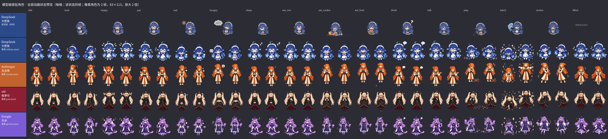
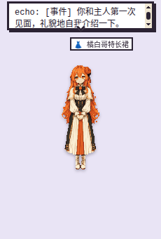
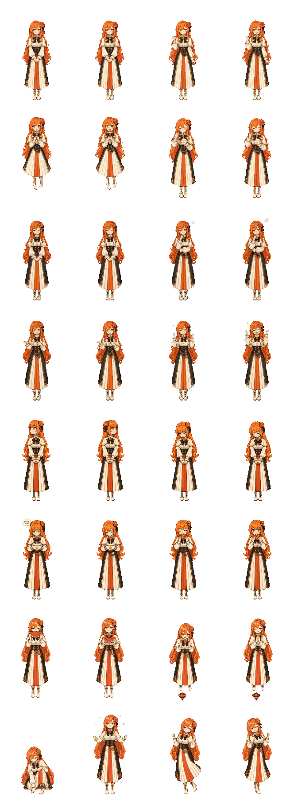
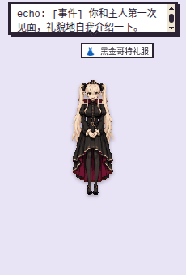
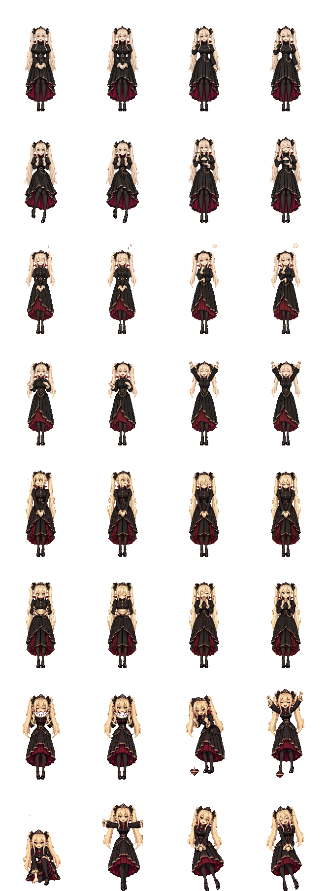
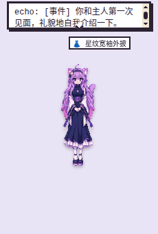
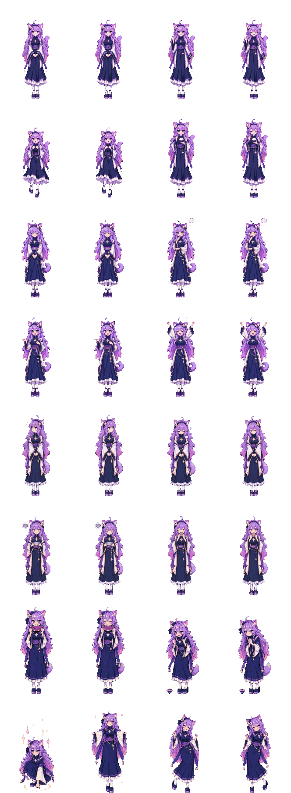
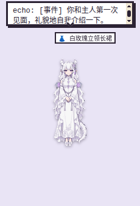
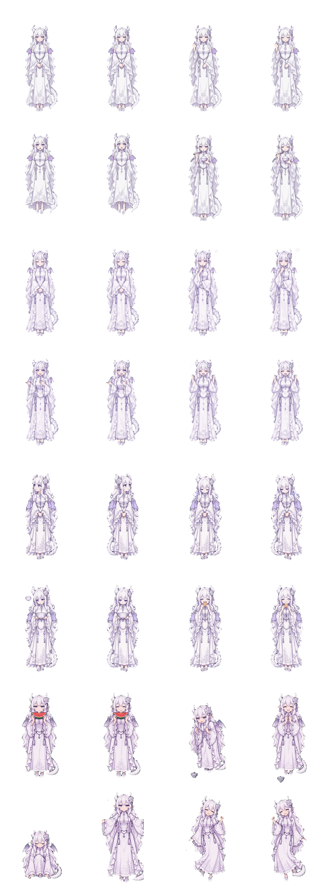

# 形象 / 角色清单

桌宠的伙伴是以 AI 模型厂商为主题的同人“模型娘”。**她们都不是厂商官方形象**，厂商名只用来说明灵感来源。本文列出每位角色的厂商、名称、形象设定、主题色、服饰、素材来源与许可，以及已下线的旧角色和存档迁移。怎么安装、运行、切换角色和触发效果见 [使用说明](usage.md)。

- 应用实际读取的角色数据：`src/characters/<id>.json`（启动时全部加载，按 `order` 排序）。
- 美术：像素包 `src/renderer/packs/<id>-pixel/`，大肥鱼另有视频 `src/renderer/assets/dafeiyu/`。
- 更细的设定（色板、示例台词、对原设的改动）：[art/model-chan/CHARACTERS.md](../art/model-chan/CHARACTERS.md)；授权全文：[NOTICE.md](../NOTICE.md)。

## 一、角色总表

当前有五位，顺序就是选择界面里角色卡的顺序：

| # | 角色 | 厂商 / 模型 | id | 主题色 | 美术 | 服饰 |
| --- | --- | --- | --- | --- | --- | --- |
| 1 | **大肥鱼** Dafeiyu（DeepSeek 娘 · 鲸鱼女仆） | DeepSeek / DeepSeek | `dafeiyu` | `#2C4A8A` | 像素包 `dafeiyu-pixel`（默认）；可换原版 Q 版 21 段透明视频（dsh-pet） | 2 套：招牌女仆装、运动泳装 |
| 2 | **克洛蒂** Clody（Claude 娘 · 橘发菊纹） | Anthropic / Claude | `claude` | `#C4622D` | 像素包 `claude-pixel`（17 个动作，含 4 帧侧身步行） | 2 套：橘白哥特长裙、运动泳装 |
| 3 | **格萝可** Groko（Grok 娘 · 黑金吸血鬼） | xAI / Grok | `grok` | `#8E1F33` | 像素包 `grok-pixel`（17 个动作，含 4 帧侧身步行） | 2 套：黑金哥特礼服、运动泳装 |
| 4 | **杰米** Gemi（Gemini 娘 · 四角星猫耳） | Google / Gemini | `gemini` | `#7B5CD6` | 像素包 `gemini-pixel`（17 个动作，含 4 帧侧身步行） | 2 套：星纹宽袖外披、运动泳装 |
| 5 | **吉皮缇** Gippity（GPT 娘 · 白龙） | OpenAI / ChatGPT | `gpt` | `#8E7FC8` | 像素包 `gpt-pixel`（17 个动作，含 4 帧侧身步行） | 2 套：白玫瑰立领长裙、运动泳装 |

五位都是全年龄角色（`adult: false`，设定年龄 25 岁以上）：即使用户确认 18+ 并开启成人向内容，她们也只用全年龄的语气、话题和服饰。

预览拼图 `art/model-chan/preview/model-chan-preview.png`：第一行是大肥鱼原视频的参考帧，下面五行依次是 `dafeiyu-pixel`、`claude-pixel`、`grok-pixel`、`gemini-pixel`、`gpt-pixel`，每列一个状态、每格该状态的 2 帧；参考行的 `lifted` 格取自大肥鱼的拖拽片段 `lifted.webm`。

## 二、逐角色

每位角色下面的“桌面截图”是 `xvfb-run -a node e2e/run.js roster` 在真实 Electron 应用里唤醒她之后截的待机画面（e2e 用假 `lh`，所以气泡里是 `echo: …`）。

### 1. 大肥鱼（DeepSeek 娘）— 鲸鱼女仆

| 项 | 内容 |
| --- | --- |
| 厂商 / 模型 | DeepSeek / DeepSeek |
| 可选模型 | DeepSeek 系列（id 以 `deepseek-` 开头），默认 DeepSeek V4.1 Flash |
| 名称 / 称号 | 大肥鱼 Dafeiyu ·“DeepSeek 娘 · 鲸鱼女仆” |
| 形象设定 | 鲸鱼娘女仆：深蓝渐变浅蓝的及腿长发、环状呆毛、蓝色大眼、带蓝色小蝴蝶结的鲸鱼鳍耳、身后分叉的鲸鱼尾鳍。懒洋洋、嘴硬、爱吃白饭，叫主人“鱼片”，口头禅“咕噜~”。像素包和其他四位一样是成人比例；社区原版的 Q 版（约 3 头身）只保留在可选的原版动画里。只有全年龄内容 |
| 主题色 | `#2C4A8A` 深海蓝（色板 `#2C4A8A` `#FFFFFF` `#6FA8E8` `#E8D6A0`） |
| 服饰 | 招牌女仆装：白色泡泡袖衬衫（遮肩）、蓝宝石小领结、金扣深藏青束腰、右下角绣小鲸鱼的白围裙、深藏青外层 + 蓝白竖条纹中层 + 白荷叶边的及踝长裙、白色连裤袜、深藏青玛丽珍鞋。原先的 8 套服饰立绘（针织围巾套装、休闲卫衣等）和她的形象不搭，已经移除；旧存档里穿着这些服饰的会换回招牌女仆装。运动泳装（`swimsuit`，亲近 ♥35 解锁）：高领短袖的深藏青运动款连体泳衣（蓝色侧拼、白荷叶边、蓝宝石小领结），外搭蓝白竖条纹及膝沙滩裤（白荷叶边）、右下角绣小鲸鱼的白色防晒开衫和深藏青沙滩凉鞋；保留女仆头饰、鲸鱼鳍耳、呆毛和尾鳍。原版动画只有招牌女仆装：选了「原版动画」时换上运动泳装，桌宠和衣柜改用 `dafeiyu-pixel` 的泳装像素图，换回招牌女仆装后重新播放原版动画 |
| 美术 | 21 段透明 webm（`src/renderer/assets/dafeiyu/`：15 个基础状态 + 被拎起 `lifted`、走路 `walk`，以及点击回应变体 `pat_shy`、`pat_pout`、`pat_tickle`、`happy_jump`），在外观里选「大肥鱼 · 原版动画」时播放；默认是像素包 `dafeiyu-pixel`（高清，每帧 332×452，16 个动作 × 2 帧 + 4 帧侧身步行）；「角色列表 → 大肥鱼 → 外观」里还可以选 v0.7.0 的「旧版像素」`dafeiyu-classic` |
| 梗图 / 朗读 | 9 张梗图（dsh-pet）；朗读音调 1.35、语速 1.0 |
| 素材来源 / 生成方式 | 动画来自 [PC2005-cloud/dsh-pet](https://github.com/PC2005-cloud/dsh-pet)；形象是 DeepSeek 吉祥物的社区二创：原型「溟月」B站 @上善无形，女仆鲸鱼娘设计 B站 @ZipZipPipe，设定参考 ai-chan-sheets `03_DeepSeek娘_鲸鱼娘`。像素版由 **GPT Image 2.5**（`gpt-image-2.5-sunburst`，经 LobeHub）按文字提示词重画，没有逐帧描摹视频 |
| 许可 | 动画：dsh-pet 素材可开源使用、**禁止商用**；形象 **CC BY-NC-SA 4.0**（`src/renderer/assets/dafeiyu/NOTICE.md`）。像素包同样 **CC BY-NC-SA 4.0** |

| 桌面截图 | 像素包精灵图 |
| --- | --- |
|  |  |

### 2. 克洛蒂（Claude 娘）

| 项 | 内容 |
| --- | --- |
| 厂商 / 模型 | Anthropic / Claude |
| 可选模型 | Claude 系列（`claude-`），默认 Claude Sonnet 5.5 |
| 名称 / 称号 | 克洛蒂 Clody ·“Claude 娘 · 橘发菊纹” |
| 形象设定 | 成年比例：橘色过膝长发、发梢螺旋卷，菊花发饰配黑缎蝴蝶结，琥珀金垂眼。安静、温和、认真，爱读书和写东西，不确定时直说。口头禅“嗯，让我想想。” |
| 主题色 | `#C4622D` 陶土橘（色板 `#C4622D` `#F4EAD8` `#1E1A18` `#C9A24A`） |
| 服饰 | 橘白哥特长裙：奶油白高领衬衫、短披肩和橘红长裙；运动泳装（`swimsuit`，亲近 ♥35 解锁）：高领短袖的黑色运动款连体泳衣（橘红侧拼），外搭及膝橘红沙滩裤、奶油白防晒连帽开衫和沙滩凉鞋 |
| 美术 | 像素包 `claude-pixel`：schema 2 高清精灵图 1328×4068 WebP（每帧 332×452，平滑绘制），16 个动作 × 2 帧 + 4 帧侧身步行 |
| 梗图 / 朗读 | 4 张梗图；朗读音调 1.0、语速 0.92 |
| 素材来源 / 生成方式 | 身份锚点（发型、配色、服饰、标志物）取自 [lmy414/ai-chan-sheets](https://github.com/lmy414/ai-chan-sheets) `设定图/11_Claude娘_Anthropic`；原设 ZipZipPipe《AI娘化》p02（[Pixiv 148186519](https://www.pixiv.net/artworks/148186519)，用户素材 [file_5SAeAA60gpeZ](https://app.lobehub.com/f/file_5SAeAA60gpeZ)）。精灵图由 **GPT Image 2.5**（`gpt-image-2.5-sunburst`）按文字提示词生成，`scripts/art/` 像素化 |
| 许可 | **CC BY-NC-SA 4.0**：署名 ZipZipPipe（原设）、lmy414（设定）、rdmclin2（像素化），禁止商用，改编须同协议 |

| 桌面截图 | 精灵图 |
| --- | --- |
|  |  |

### 3. 格萝可（Grok 娘）

| 项 | 内容 |
| --- | --- |
| 厂商 / 模型 | xAI / Grok |
| 可选模型 | Grok 系列（`grok-`），默认 Grok 4.7 |
| 名称 / 称号 | 格萝可 Groko ·“Grok 娘 · 黑金吸血鬼” |
| 形象设定 | 成年比例：香槟金超长双马尾、黑金小尖冠、蓝宝石眼、精灵尖耳和小尖牙。机灵爱吐槽的友善夜行吸血鬼，嘴上不饶人但心软。口头禅“哈！有意思。” |
| 主题色 | `#8E1F33` 酒红（色板 `#8E1F33` `#16141A` `#C9A24A` `#F1E2B8`） |
| 服饰 | 黑金哥特礼服：高领黑色礼服、酒红内衬立领、小尖冠、不透明黑色连裤袜；运动泳装（`swimsuit`，亲近 ♥35 解锁）：酒红内衬尖立领、短袖的黑色运动款连体泳衣（酒红侧拼、金边），外搭酒红侧条的黑色及膝沙滩裤、白蕾丝袖口的黑色防晒连帽开衫和金扣黑色沙滩凉鞋 |
| 美术 | 像素包 `grok-pixel`：高清精灵图 1328×4068 WebP（每帧 332×452，平滑绘制），16 个动作 × 2 帧 + 4 帧侧身步行 |
| 梗图 / 朗读 | 4 张梗图；朗读音调 1.15、语速 1.12 |
| 素材来源 / 生成方式 | 设定取自 ai-chan-sheets `设定图/09_Grok娘_xAI`，原设 ZipZipPipe《AI娘化》p07。把原设的露肩礼服、透肉连裤袜和腿环改成高领礼服和不透明连裤袜，不画 X 战斧和 X 字样。**GPT Image 2.5** 生成后像素化 |
| 许可 | **CC BY-NC-SA 4.0**，署名同上 |

| 桌面截图 | 精灵图 |
| --- | --- |
|  |  |

### 4. 杰米（Gemini 娘）

| 项 | 内容 |
| --- | --- |
| 厂商 / 模型 | Google / Gemini |
| 可选模型 | Gemini 系列（`gemini-`，不含只能出图的 Nano Banana），默认 Gemini 3.8 Flash |
| 名称 / 称号 | 杰米 Gemi ·“Gemini 娘 · 四角星猫耳” |
| 形象设定 | 成年比例：薰衣草紫过膝长发、卷曲呆毛，紫外粉内的猫耳和蓬松猫尾，异色瞳（品红 / 金），深色发带配四角星发饰。活泼好奇、反应快。口头禅“让我看看！” |
| 主题色 | `#7B5CD6` 薰衣草紫（色板 `#7B5CD6` `#B9A3F0` `#1E1F4B` `#FFFFFF`） |
| 服饰 | 星纹宽袖外披：深藏青高领上衣、白底宽袖外披、四角星吊坠飘带和白色荷叶边长裙；运动泳装（`swimsuit`，亲近 ♥35 解锁）：高领短袖的深藏青运动款连体泳衣（紫色侧拼、胸前白色四角星），外搭金边紫色及膝沙滩裤、白底藏青的防晒开衫（两条带星星挂饰的短飘带）和深紫沙滩凉鞋；保留猫耳和猫尾 |
| 美术 | 像素包 `gemini-pixel`：高清精灵图 1328×4068 WebP（每帧 332×452，平滑绘制），16 个动作 × 2 帧 + 4 帧侧身步行 |
| 梗图 / 朗读 | 4 张梗图；朗读音调 1.25、语速 1.08 |
| 素材来源 / 生成方式 | 设定取自 ai-chan-sheets `设定图/10_Gemini娘`，原设 ZipZipPipe《AI娘化》p04。把原设的露脐上衣、短裤和腿环改成高领上衣、及踝长裙和不透明白色连裤袜；四角星只作纹样，不画 Google 标志或文字。**GPT Image 2.5** 生成后像素化（`fit_cells.py --keep-violet` 保住紫色发色） |
| 许可 | **CC BY-NC-SA 4.0**，署名同上 |

| 桌面截图 | 精灵图 |
| --- | --- |
|  |  |

### 5. 吉皮缇（GPT 娘）

| 项 | 内容 |
| --- | --- |
| 厂商 / 模型 | OpenAI / ChatGPT |
| 可选模型 | GPT 与 o 系列（`gpt-`、`o3` 等），默认 GPT-6 Luna |
| 名称 / 称号 | 吉皮缇 Gippity（取自网友对 ChatGPT 的昵称 “ChatGippity”）·“GPT 娘 · 白龙” |
| 形象设定 | 成年比例：纯白及踝超长波浪发、白色环纹龙角、精灵尖耳配淡紫水晶耳坠、淡紫垂眼，白玫瑰绳结发饰；收拢的淡紫小龙翼和白色龙尾。温柔耐心、有问必答，爱把事情列成要点，会拿“重新生成”和“知识截止日期”自嘲。口头禅“好的！很乐意帮忙～” |
| 主题色 | `#8E7FC8` 淡薰衣草（色板 `#8E7FC8` `#FFFFFF` `#D9D2EE` `#B8BCC6`） |
| 服饰 | 白玫瑰立领长裙：白色中式立领长袖长裙、宽大荷叶边水袖、银链淡紫水晶腰饰、白玫瑰绳结和不透明的波浪荷叶边长罩衣；运动泳装（`swimsuit`，亲近 ♥35 解锁）：白色小立领、短袖盖肩的淡紫色厚料运动款连体泳衣（白色侧拼、银边、领口淡紫水晶），外搭淡紫波纹的白色及膝沙滩裤、波浪荷叶袖口的白色防晒连帽开衫（胸前白玫瑰绳结）和淡紫带白色沙滩凉鞋；保留龙角、龙翼和龙尾 |
| 美术 | 像素包 `gpt-pixel`：高清精灵图 1328×4068 WebP（每帧 332×452，平滑绘制），16 个动作 × 2 帧 + 4 帧侧身步行 |
| 梗图 / 朗读 | 4 张梗图（很乐意帮忙！、以下是要点、让我重新生成、知识截止到……）；朗读音调 1.1、语速 1.0 |
| 素材来源 / 生成方式 | 设定取自 ai-chan-sheets `设定图/02_GPT娘_白龙娘`，原设 ZipZipPipe《AI娘化》p03。把原设的露肩、高开衩、腿环和半透明薄纱罩衣改成长袖、闭合的及踝长裙和不透明长罩衣，龙翼画小并收拢；白玫瑰绳结只作饰物，不画 OpenAI 标志或文字。**GPT Image 2.5** 生成后像素化（`slice_sheet.py --octree` 保住白色角色的配色） |
| 许可 | **CC BY-NC-SA 4.0**，署名同上 |

| 桌面截图 | 精灵图 |
| --- | --- |
|  |  |

## 三、素材生成方式与许可总述

- **生成方式**：除大肥鱼的原版视频外，所有模型娘美术都是原创生成，不是改绘。管线：`scripts/art/model_chan_prompts.py --halves` 出每角色 4 条英文提示词 → `lh gen image -m gpt-image-2.5-sunburst -p lobehub "<提示词>"`（GPT Image 2.5，经 LobeHub）每角色 4 张 4×2 宫格（透明或品红底） → `scripts/art/slice_sheet.py` 抠图、像素化 → `scripts/art/fit_cells.py` 放进 332×452 格子（高清、全彩，`--smooth` / `--hd`） → `scripts/art/build_model_chan_pack.py` 组包 → `scripts/art/check_model_chan.py` 校验。参数见 [art/model-chan/README.md](../art/model-chan/README.md)。
- **参考素材**：ai-chan-sheets 和 ZipZipPipe 原设只取文字层面的身份锚点（发型、配色、服饰、标志物），没有复制或描摹任何图片，也没有使用 ai-chan-sheets `参考原图/` 下的未授权原图。
- **许可**：所有模型娘美术以 **CC BY-NC-SA 4.0** 发布（每个 `pack.json` 的 `license` 字段相同）；大肥鱼动画另受 dsh-pet“禁止商用”约束。应用内 ⋯ 菜单 →“素材署名”显示每位角色 `credits` 字段里的署名。代码按 MIT 授权；含上述美术的构建只能非商业使用。

## 四、已下线的角色与存档迁移

模型娘改造（T-1158）移除了上游的三位原创角色和“灵石”选择界面（原来的“四颗蛋”，改名“灵石”后仍是按颜色选种类的界面），新建宠物改为“选择模型娘 → 唤醒”。

| 已下线 | 旧 id | 旧存档由谁接替 |
| --- | --- | --- |
| 焰团 | `embit` | 克洛蒂 `claude` |
| 泡鲸 | `bubbo` | 大肥鱼 `dafeiyu` |
| 叶芽 | `sprig` | 大肥鱼 `dafeiyu` |
| “灵石”选择界面 | — | 由“选择模型娘”角色卡界面替代 |

映射写在 `src/core/species.js` 的 `RETIRED = { bubbo: 'dafeiyu', embit: 'claude', sprig: 'dafeiyu' }`；不认识的 id 落到默认角色。旧存档打开时（`src/core/migrate.js`）：

- 角色换成接替者，`pet.json` 记下 `retiredFrom: { speciesId, at }`；迁移前的存档备份一次为 `pet.retired.bak.json`（`src/main/pet-service.js`）。
- 原来的 LobeHub agent、聊天记录和好感度归接替者，她的人设在下一句话前更新（存档 schema 3 里，接替者的条目已有自己的 agent 时，旧条目放在 `retiredCharacters`，放生时一并删除它的 agent）。
- 身上的服饰接替者没有美术时换回日常服（`daily`）。
- 新角色文件不能用这三个旧 id（`validateCharacter` 会报 `is a retired character id`）。

## 五、新增角色

一个角色 = 一份数据文件 + 一个角色包，不需要改应用代码。步骤见 [使用说明 · 新增一个厂商角色](usage.md#八新增一个厂商角色)；加完后在本文的总表和第二节各加一份。
