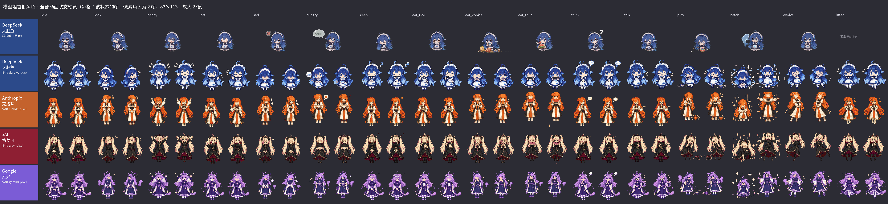
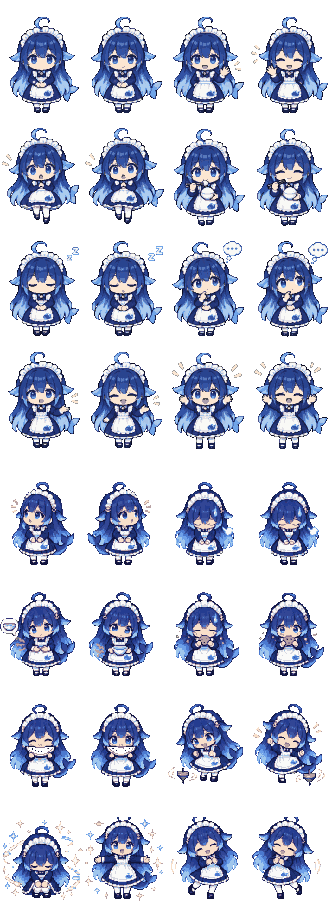
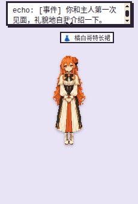
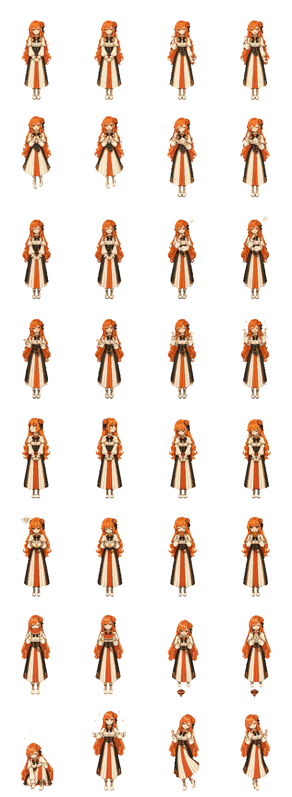
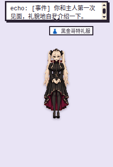
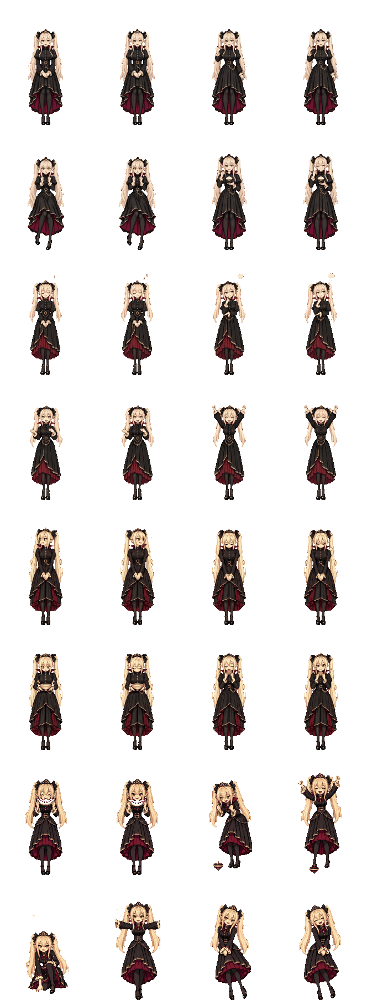
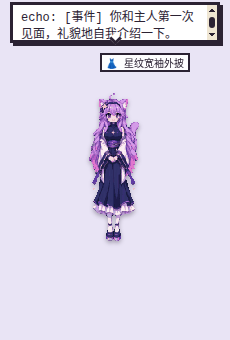
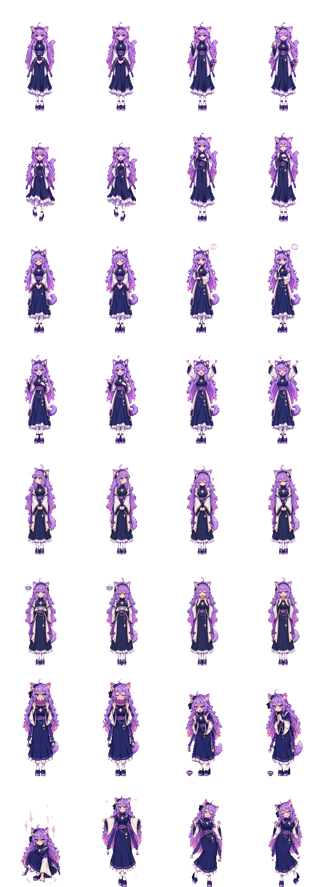
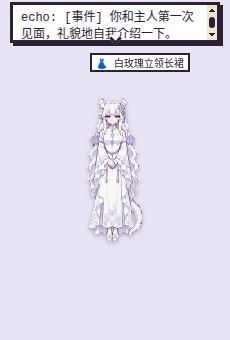
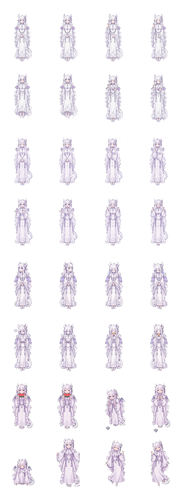

# 形象 / 角色清单

桌宠的伙伴是以 AI 模型厂商为主题的同人“模型娘”。**她们都不是厂商官方形象**，厂商名只用来说明灵感来源。本文列出每位角色的厂商、名称、形象设定、主题色、服饰、素材来源与许可，以及已下线的旧角色和存档迁移。怎么安装、运行、切换角色和触发效果见 [使用说明](usage.md)。

- 应用实际读取的角色数据：`src/characters/<id>.json`（启动时全部加载，按 `order` 排序）。
- 美术：随应用自带的只有 5 个像素包 `src/renderer/packs/<id>-pixel/`；其余形象（旧版像素、全动态、Live2D、成年版、大肥鱼的原版动画视频）在 `catalog/` 里，用户在角色图鉴下载后才能使用，见下面「内置与下载」。
- 更细的设定（色板、示例台词、对原设的改动）：[art/model-chan/CHARACTERS.md](../art/model-chan/CHARACTERS.md)；授权全文：[NOTICE.md](../NOTICE.md)。

## 一、角色总表

当前有五位，顺序就是选择界面里角色卡的顺序：

| # | 角色 | 厂商 / 模型 | id | 主题色 | 美术 | 服饰 |
| --- | --- | --- | --- | --- | --- | --- |
| 1 | **大肥鱼** Dafeiyu（DeepSeek 娘 · 鲸鱼女仆） | DeepSeek / DeepSeek | `dafeiyu` | `#2C4A8A` | 像素包 `dafeiyu-pixel`（默认）；可换原版 Q 版 21 段透明视频（dsh-pet） | 13 套：招牌女仆装 + 12 套全年龄服饰 |
| 2 | **克洛蒂** Clody（Claude 娘 · 橘发菊纹） | Anthropic / Claude | `claude` | `#C4622D` | 像素包 `claude-pixel`（17 个动作，含 4 帧侧身步行） | 13 套：橘白哥特长裙 + 12 套全年龄服饰 |
| 3 | **格萝可** Groko（Grok 娘 · 黑金吸血鬼） | xAI / Grok | `grok` | `#8E1F33` | 像素包 `grok-pixel`（17 个动作，含 4 帧侧身步行） | 13 套：黑金哥特礼服 + 12 套全年龄服饰 |
| 4 | **杰米** Gemi（Gemini 娘 · 四角星猫耳） | Google / Gemini | `gemini` | `#7B5CD6` | 像素包 `gemini-pixel`（17 个动作，含 4 帧侧身步行） | 13 套：星纹宽袖外披 + 12 套全年龄服饰 |
| 5 | **吉皮缇** Gippity（GPT 娘 · 白龙） | OpenAI / ChatGPT | `gpt` | `#8E7FC8` | 像素包 `gpt-pixel`（17 个动作，含 4 帧侧身步行） | 13 套：白玫瑰立领长裙 + 12 套全年龄服饰 |

五位都是全年龄角色（`adult: false`，设定年龄 18 岁）：即使用户确认 18+ 并开启成人向内容，她们也只用全年龄的语气和话题。另外每位都有一个 18+ 成年版角色包 `<id>-adult`（2026-10-31）：20 岁的成年形象，有日常服和 11 套成人向服饰；只有确认年满 18 岁并开启成人向内容后才能在“外观”里选，选了以后衣柜换成这 12 套。

预览拼图 `art/model-chan/preview/model-chan-preview.png`：第一行是大肥鱼原视频的参考帧，下面五行依次是 `dafeiyu-pixel`、`claude-pixel`、`grok-pixel`、`gemini-pixel`、`gpt-pixel`，每列一个状态、每格该状态的 2 帧；参考行的 `lifted` 格取自大肥鱼的拖拽片段 `lifted.webm`。

## 二、逐角色

每位角色下面的“桌面截图”是 `xvfb-run -a node e2e/run.js roster` 在真实 Electron 应用里唤醒她之后截的待机画面（e2e 用假 `lh`，所以气泡里是 `echo: …`）。

### 1. 大肥鱼（DeepSeek 娘）— 鲸鱼女仆

| 项 | 内容 |
| --- | --- |
| 厂商 / 模型 | DeepSeek / DeepSeek |
| 可选模型 | DeepSeek 系列（id 以 `deepseek-` 开头），默认 DeepSeek V4.1 Flash |
| 名称 / 称号 | 大肥鱼 Dafeiyu ·“DeepSeek 娘 · 鲸鱼女仆” |
| 形象设定 | 鲸鱼娘女仆：深蓝渐变浅蓝的及腿长发、环状呆毛、蓝色大眼、带蓝色小蝴蝶结的鲸鱼鳍耳、身后分叉的鲸鱼尾鳍。懒洋洋、嘴硬、爱吃白饭，叫主人“鱼片”，口头禅“咕噜~”。像素包和其他四位一样是成人比例；社区原版的 Q 版（约 3 头身）只保留在可选的原版动画里。只有全年龄内容 |
| 主题色 | `#2C4A8A` 深海蓝（色板 `#2C4A8A` `#FFFFFF` `#6FA8E8` `#E8D6A0`） |
| 服饰 | 招牌女仆装：白色泡泡袖衬衫（遮肩）、蓝宝石小领结、金扣深藏青束腰、右下角绣小鲸鱼的白围裙、深藏青外层 + 蓝白竖条纹中层 + 白荷叶边的及踝长裙、白色连裤袜、深藏青玛丽珍鞋。原先的 8 套服饰立绘（针织围巾套装、休闲卫衣等）和她的形象不搭，已经移除；旧存档里穿着这些服饰的会换回招牌女仆装。运动泳装（`swimsuit`，亲近 ♥35 解锁）：高领短袖的深藏青运动款连体泳衣（蓝色侧拼、白荷叶边、蓝宝石小领结），外搭蓝白竖条纹及膝沙滩裤（白荷叶边）、右下角绣小鲸鱼的白色防晒开衫和深藏青沙滩凉鞋；保留女仆头饰、鲸鱼鳍耳、呆毛和尾鳍。原版动画只有招牌女仆装：选了「原版动画」时换上运动泳装，桌宠和衣柜改用 `dafeiyu-pixel` 的泳装像素图，换回招牌女仆装后重新播放原版动画；沙滩比基尼（`bikini`，知己 ♥60 解锁，全年龄）：白色两层荷叶边上衣（高圆领、深藏青细边、海军领小蝴蝶结）、到膝盖上方的深藏青两层荷叶边泳裙、领口系一颗扣的白色短开衫（下摆绣小鲸鱼），保留女仆头饰、鲸鱼鳍耳和尾鳍；另有 10 套全年龄日常服饰（针织围巾套装、休闲卫衣、贝雷帽画家装、偶像演出服、毛绒睡衣、猫耳家居服、浴衣、长旗袍、情侣卫衣、花冠长裙），款式五位相同，配色按她的色板（见 `art/model-chan/CHARACTERS.md`） |
| 美术 | 21 段透明 webm（`catalog/clips/dafeiyu-clips/`：15 个基础状态 + 被拎起 `lifted`、走路 `walk`，以及点击回应变体 `pat_shy`、`pat_pout`、`pat_tickle`、`happy_jump`），在外观里选「大肥鱼 · 原版动画」时播放；默认是像素包 `dafeiyu-pixel`（高清，每帧 332×452，16 个动作 × 2 帧 + 4 帧侧身步行）；「角色列表 → 大肥鱼 → 外观」里还可以选 v0.7.0 的「旧版像素」`dafeiyu-classic` |
| 梗图 / 朗读 | 9 张梗图（dsh-pet）；朗读音调 1.35、语速 1.0 |
| 素材来源 / 生成方式 | 动画来自 [PC2005-cloud/dsh-pet](https://github.com/PC2005-cloud/dsh-pet)；形象是 DeepSeek 吉祥物的社区二创：原型「溟月」B站 @上善无形，女仆鲸鱼娘设计 B站 @ZipZipPipe，设定参考 ai-chan-sheets `03_DeepSeek娘_鲸鱼娘`。像素版由 **GPT Image 2.5**（`gpt-image-2.5-sunburst`，经 LobeHub）按文字提示词重画，没有逐帧描摹视频 |
| 许可 | 动画：dsh-pet 素材可开源使用、**禁止商用**；形象 **CC BY-NC-SA 4.0**（`catalog/clips/dafeiyu-clips/NOTICE.md`）。像素包同样 **CC BY-NC-SA 4.0** |

| 桌面截图 | 像素包精灵图 |
| --- | --- |
|  |  |

### 2. 克洛蒂（Claude 娘）

| 项 | 内容 |
| --- | --- |
| 厂商 / 模型 | Anthropic / Claude |
| 可选模型 | Claude 系列（`claude-`），默认 Claude Sonnet 5.5 |
| 名称 / 称号 | 克洛蒂 Clody ·“Claude 娘 · 橘发菊纹” |
| 形象设定 | 成年比例：橘色过膝长发、发梢螺旋卷，菊花发饰配黑缎蝴蝶结，琥珀金垂眼。安静、温和、认真，爱读书和写东西，不确定时直说。口头禅“嗯，让我想想。” |
| 主题色 | `#C4622D` 陶土橘（色板 `#C4622D` `#F4EAD8` `#1E1A18` `#C9A24A`） |
| 服饰 | 橘白哥特长裙：奶油白高领衬衫、短披肩和橘红长裙；运动泳装（`swimsuit`，亲近 ♥35 解锁）：高领短袖的黑色运动款连体泳衣（橘红侧拼），外搭及膝橘红沙滩裤、奶油白防晒连帽开衫和沙滩凉鞋；沙滩比基尼（`bikini`，知己 ♥60 解锁，全年龄）：奶油白两层荷叶边上衣（高圆领、橘红细边、橘色小花）、到膝盖上方的橘白格纹两层荷叶边泳裙、领口系一颗扣的奶油白短开衫，保留菊花发饰；另有 10 套全年龄日常服饰（针织围巾套装、休闲卫衣、贝雷帽画家装、偶像演出服、毛绒睡衣、猫耳家居服、浴衣、长旗袍、情侣卫衣、花冠长裙），款式五位相同，配色按她的色板（见 `art/model-chan/CHARACTERS.md`） |
| 美术 | 像素包 `claude-pixel`：schema 2 高清精灵图 2656×8136 WebP（每帧 664×904，平滑绘制），16 个动作 × 2 帧 + 4 帧侧身步行 |
| 梗图 / 朗读 | 4 张梗图；朗读音调 1.0、语速 0.92 |
| 素材来源 / 生成方式 | 身份锚点（发型、配色、服饰、标志物）取自 [lmy414/ai-chan-sheets](https://github.com/lmy414/ai-chan-sheets) `设定图/11_Claude娘_Anthropic`；原设 ZipZipPipe《AI娘化》p02（[Pixiv 148186519](https://www.pixiv.net/artworks/148186519)，用户素材 [file_5SAeAA60gpeZ](https://app.lobehub.com/f/file_5SAeAA60gpeZ)）。精灵图由 **GPT Image 2.5**（`gpt-image-2.5-sunburst`）按文字提示词生成，`scripts/art/` 像素化 |
| 许可 | **CC BY-NC-SA 4.0**：署名 ZipZipPipe（原设）、lmy414（设定）、rdmclin2（像素化），禁止商用，改编须同协议 |

| 桌面截图 | 精灵图 |
| --- | --- |
|  |  |

### 3. 格萝可（Grok 娘）

| 项 | 内容 |
| --- | --- |
| 厂商 / 模型 | xAI / Grok |
| 可选模型 | Grok 系列（`grok-`），默认 Grok 4.7 |
| 名称 / 称号 | 格萝可 Groko ·“Grok 娘 · 黑金吸血鬼” |
| 形象设定 | 成年比例：香槟金超长双马尾、黑金小尖冠、蓝宝石眼、精灵尖耳和小尖牙。机灵爱吐槽的友善夜行吸血鬼，嘴上不饶人但心软。口头禅“哈！有意思。” |
| 主题色 | `#8E1F33` 酒红（色板 `#8E1F33` `#16141A` `#C9A24A` `#F1E2B8`） |
| 服饰 | 黑金哥特礼服：高领黑色礼服、酒红内衬立领、小尖冠、不透明黑色连裤袜；运动泳装（`swimsuit`，亲近 ♥35 解锁）：酒红内衬尖立领、短袖的黑色运动款连体泳衣（酒红侧拼、金边），外搭酒红侧条的黑色及膝沙滩裤、白蕾丝袖口的黑色防晒连帽开衫和金扣黑色沙滩凉鞋；沙滩比基尼（`bikini`，知己 ♥60 解锁，全年龄）：黑色两层荷叶边上衣（高圆领、白蕾丝边、酒红蝴蝶结）、到膝盖上方的黑色三层荷叶边泳裙（酒红衬里）、酒红内衬尖立领的黑色短波蕾罗，保留小尖冠和双马尾；另有 10 套全年龄日常服饰（针织围巾套装、休闲卫衣、贝雷帽画家装、偶像演出服、毛绒睡衣、猫耳家居服、浴衣、长旗袍、情侣卫衣、花冠长裙），款式五位相同，配色按她的色板（见 `art/model-chan/CHARACTERS.md`） |
| 美术 | 像素包 `grok-pixel`：高清精灵图 2656×8136 WebP（每帧 664×904，平滑绘制），16 个动作 × 2 帧 + 4 帧侧身步行 |
| 梗图 / 朗读 | 4 张梗图；朗读音调 1.15、语速 1.12 |
| 素材来源 / 生成方式 | 设定取自 ai-chan-sheets `设定图/09_Grok娘_xAI`，原设 ZipZipPipe《AI娘化》p07。把原设的露肩礼服、透肉连裤袜和腿环改成高领礼服和不透明连裤袜，不画 X 战斧和 X 字样。**GPT Image 2.5** 生成后像素化 |
| 许可 | **CC BY-NC-SA 4.0**，署名同上 |

| 桌面截图 | 精灵图 |
| --- | --- |
|  |  |

### 4. 杰米（Gemini 娘）

| 项 | 内容 |
| --- | --- |
| 厂商 / 模型 | Google / Gemini |
| 可选模型 | Gemini 系列（`gemini-`，不含只能出图的 Nano Banana），默认 Gemini 3.8 Flash |
| 名称 / 称号 | 杰米 Gemi ·“Gemini 娘 · 四角星猫耳” |
| 形象设定 | 成年比例：薰衣草紫过膝长发、卷曲呆毛，紫外粉内的猫耳和蓬松猫尾，异色瞳（品红 / 金），深色发带配四角星发饰。活泼好奇、反应快。口头禅“让我看看！” |
| 主题色 | `#7B5CD6` 薰衣草紫（色板 `#7B5CD6` `#B9A3F0` `#1E1F4B` `#FFFFFF`） |
| 服饰 | 星纹宽袖外披：深藏青高领上衣、白底宽袖外披、四角星吊坠飘带和白色荷叶边长裙；运动泳装（`swimsuit`，亲近 ♥35 解锁）：高领短袖的深藏青运动款连体泳衣（紫色侧拼、胸前白色四角星），外搭金边紫色及膝沙滩裤、白底藏青的防晒开衫（两条带星星挂饰的短飘带）和深紫沙滩凉鞋；保留猫耳和猫尾；沙滩比基尼（`bikini`，知己 ♥60 解锁，全年龄）：淡紫两层荷叶边上衣（高圆领、白色小星星、深藏青大蝴蝶结）、到膝盖上方的深藏青星星两层荷叶边泳裙、带猫耳兜帽的白色短开衫，保留猫耳和猫尾；另有 10 套全年龄日常服饰（针织围巾套装、休闲卫衣、贝雷帽画家装、偶像演出服、毛绒睡衣、猫耳家居服、浴衣、长旗袍、情侣卫衣、花冠长裙），款式五位相同，配色按她的色板（见 `art/model-chan/CHARACTERS.md`） |
| 美术 | 像素包 `gemini-pixel`：高清精灵图 2656×8136 WebP（每帧 664×904，平滑绘制），16 个动作 × 2 帧 + 4 帧侧身步行 |
| 梗图 / 朗读 | 4 张梗图；朗读音调 1.25、语速 1.08 |
| 素材来源 / 生成方式 | 设定取自 ai-chan-sheets `设定图/10_Gemini娘`，原设 ZipZipPipe《AI娘化》p04。把原设的露脐上衣、短裤和腿环改成高领上衣、及踝长裙和不透明白色连裤袜；四角星只作纹样，不画 Google 标志或文字。**GPT Image 2.5** 生成后像素化（`fit_cells.py --keep-violet` 保住紫色发色） |
| 许可 | **CC BY-NC-SA 4.0**，署名同上 |

| 桌面截图 | 精灵图 |
| --- | --- |
|  |  |

### 5. 吉皮缇（GPT 娘）

| 项 | 内容 |
| --- | --- |
| 厂商 / 模型 | OpenAI / ChatGPT |
| 可选模型 | GPT 与 o 系列（`gpt-`、`o3` 等），默认 GPT-6 Luna |
| 名称 / 称号 | 吉皮缇 Gippity（取自网友对 ChatGPT 的昵称 “ChatGippity”）·“GPT 娘 · 白龙” |
| 形象设定 | 成年比例：纯白及踝超长波浪发、白色环纹龙角、精灵尖耳配淡紫水晶耳坠、淡紫垂眼，白玫瑰绳结发饰；收拢的淡紫小龙翼和白色龙尾。温柔耐心、有问必答，爱把事情列成要点，会拿“重新生成”和“知识截止日期”自嘲。口头禅“好的！很乐意帮忙～” |
| 主题色 | `#8E7FC8` 淡薰衣草（色板 `#8E7FC8` `#FFFFFF` `#D9D2EE` `#B8BCC6`） |
| 服饰 | 白玫瑰立领长裙：白色中式立领长袖长裙、宽大荷叶边水袖、银链淡紫水晶腰饰、白玫瑰绳结和不透明的波浪荷叶边长罩衣；运动泳装（`swimsuit`，亲近 ♥35 解锁）：白色小立领、短袖盖肩的淡紫色厚料运动款连体泳衣（白色侧拼、银边、领口淡紫水晶），外搭淡紫波纹的白色及膝沙滩裤、波浪荷叶袖口的白色防晒连帽开衫（胸前白玫瑰绳结）和淡紫带白色沙滩凉鞋；保留龙角、龙翼和龙尾；沙滩比基尼（`bikini`，知己 ♥60 解锁，全年龄）：白色两层荷叶边上衣（高圆领、淡紫细边、白玫瑰绳结）、到膝盖上方的淡紫两层荷叶边泳裙（裙摆绣白玫瑰）、领口系一颗扣的白色短开衫，保留龙角、小龙翼和龙尾；另有 10 套全年龄日常服饰（针织围巾套装、休闲卫衣、贝雷帽画家装、偶像演出服、毛绒睡衣、猫耳家居服、浴衣、长旗袍、情侣卫衣、花冠长裙），款式五位相同，配色按她的色板（见 `art/model-chan/CHARACTERS.md`） |
| 美术 | 像素包 `gpt-pixel`：高清精灵图 2656×8136 WebP（每帧 664×904，平滑绘制），16 个动作 × 2 帧 + 4 帧侧身步行 |
| 梗图 / 朗读 | 4 张梗图（很乐意帮忙！、以下是要点、让我重新生成、知识截止到……）；朗读音调 1.1、语速 1.0 |
| 素材来源 / 生成方式 | 设定取自 ai-chan-sheets `设定图/02_GPT娘_白龙娘`，原设 ZipZipPipe《AI娘化》p03。把原设的露肩、高开衩、腿环和半透明薄纱罩衣改成长袖、闭合的及踝长裙和不透明长罩衣，龙翼画小并收拢；白玫瑰绳结只作饰物，不画 OpenAI 标志或文字。**GPT Image 2.5** 生成后像素化（`slice_sheet.py --octree` 保住白色角色的配色） |
| 许可 | **CC BY-NC-SA 4.0**，署名同上 |

| 桌面截图 | 精灵图 |
| --- | --- |
|  |  |

## 三、素材生成方式与许可总述

- **生成方式**：除大肥鱼的原版视频外，所有模型娘美术都是原创生成，不是改绘。管线：`scripts/art/model_chan_prompts.py --halves` 出每角色 4 条英文提示词 → `lh gen image -m gpt-image-2.5-sunburst -p lobehub "<提示词>"`（GPT Image 2.5，经 LobeHub）每角色 4 张 4×2 宫格（透明或品红底） → `scripts/art/slice_sheet.py` 抠图、像素化 → `scripts/art/fit_cells.py` 放进 332×452 格子（高清、全彩，`--smooth` / `--hd`） → `scripts/art/build_model_chan_pack.py` 组包 → `scripts/art/check_model_chan.py` 校验。参数见 [art/model-chan/README.md](../art/model-chan/README.md)。
- **参考素材**：ai-chan-sheets 和 ZipZipPipe 原设只取文字层面的身份锚点（发型、配色、服饰、标志物），没有复制或描摹任何图片，也没有使用 ai-chan-sheets `参考原图/` 下的未授权原图。
- **许可**：所有模型娘美术以 **CC BY-NC-SA 4.0** 发布（每个 `pack.json` 的 `license` 字段相同）；大肥鱼动画另受 dsh-pet“禁止商用”约束。应用内 ⋯ 菜单 →“素材署名”显示每位角色 `credits` 字段里的署名。代码按 MIT 授权；含上述美术的构建只能非商业使用。

## 四、角色与形象：每个形象就是一个独立角色（T-2764）

从 `characterModel: 2` 起不再有“形象包（appearance pack）”这个面向用户的概念，也没有“一个角色切换多个形象包”的选择逻辑。每个角色包——内置的（`dafeiyu-pixel` / `dafeiyu-live2d` / `dafeiyu-live` / `dafeiyu-classic` / `dafeiyu-adult`、`claude-pixel` / `claude-classic` / `claude-adult` …）和用户导入的（角色包、Live2D、VRM）——都是角色列表里的**一个独立角色**；大肥鱼的原版视频是 `dafeiyu-clips`。代码：`src/core/characters.js`。

- **id**：角色 id 就是她的角色包 id（视频是 `<基础角色>-clips`）。角色包 id 不能与角色文件 id（`dafeiyu`、`claude` …）或已下线 id 相同，也不能以 `-clips` 结尾（`validatePack`），所以旧的“按人设”的 id 与新角色 id 永远不会撞。
- **显示名**：取包的 `name`（内置包已经是「大肥鱼 · 像素」「大肥鱼 · Live2D」这种格式）；不以她名字开头的导入包显示为「克洛蒂 · 我的包名」。
- **顺序**：按角色文件的 `order` 一位一位排；每位先列她角色文件里 `art.packs` 的顺序（默认的在前），再列导入的，最后是视频。18+ 的「成年版」只在确认 18+ 且打开成人向内容后出现。全年龄 13 位，打开成人向后 18 位。
- **基础角色（人设）**：每个角色都站在一个基础角色文件上（`src/characters/<base>.json`），人设、台词、触摸部位、语音、可用模型都从那里继承。

### 共享与隔离（设计决定）

| 数据 | 归属 | 键 | 说明 |
| --- | --- | --- | --- |
| LobeHub agent、聊天记录（topic / `pastTopicIds` / 聊天记录 chat-log）、名字、好感度与解锁、需求（饱食/心情/精力）、已读解锁 | **同一基础角色的各角色共享** | `pet.characters[<base>]` | 「大肥鱼 · 像素」和「大肥鱼 · Live2D」是同一个她换了形象：不重新认识、不新建 agent、聊天不断。切到同基础角色的另一个角色是即时、无声的。 |
| 模型（`settings.models`）、个性化设定（`settings.systemRoles`）、语音包 | 共享 | 基础角色 id | 这些属于她的人设和 agent，不属于形象。 |
| 衣柜：当前服饰、最后一套全年龄服饰 | **每个角色自己的** | `pet.characters[<base>].wardrobes[<角色 id>]` | 衣柜只列她自己包里有美术的服饰（沿用 T-2752）；在一个角色身上换衣服不影响另一个。旧字段 `equippedOutfit` / `lastSafeOutfit` 只镜像当前角色的值（给旧版本读）。 |
| 取景 | 每个角色自己的 | `settings.framings[<角色 id>]` | |
| VRM 姿势 | 每个角色自己的 | `settings.vrmPostures[<角色 id>]` | 角色 id = 包 id，键不变。 |
| 当前角色 | — | `pet.json` 的 `characterId`（`speciesId` 仍在，等于其基础角色） | |
| 同屏伙伴 | 角色 | `settings.visitors[]` 是角色 id | 不能是当前角色的任何形象，同一基础角色最多一位。 |

### 数据迁移方式（`src/core/character-migrate.js`，T-2764 / T-2786）

**什么时候跑**：`PetService` 每次加载 `settings.json` / `pet.json` 时调用 `migrateAll`（先 settings，再 pet.json）。只处理**没有** `characterModel: 2` 标记的文件；迁移后的文件带上这个标记，再加载时原样返回、不再改写（幂等）。迁移是纯函数，落盘由 `PetService` 做：只在有变化时写，写之前各备份一次原文件：

| 原文件 | 备份 | 规则 |
| --- | --- | --- |
| `settings.json` | `settings.characters.bak.json` | 迁移前的原样内容；已存在就不再覆盖 |
| `pet.json` | `pet.characters.bak.json` | 同上。更老的 schema 1 / 2 存档在同一次加载里先升到 schema 3，这时备份是 `pet.v<N>.bak.json`（同样是原样内容），不再另写 `pet.characters.bak.json` |

**旧 key → 新 key 对照**

| 旧 key（按人设 / 按包） | 新 key（按角色） | 规则 |
| --- | --- | --- |
| `pet.speciesId` = `dafeiyu` + `settings.appearance.dafeiyu` = `dafeiyu-pixel` | `pet.characterId` = `dafeiyu-pixel`（`pet.speciesId` 保留，等于基础角色 `dafeiyu`） | 所选包存在且属于她（18+ 的也保留，成人向关着时临时显示默认角色）→ 该包；不存在 / 已删除 / 不是她的 → 她的默认角色（角色文件第一个包，再退到 `fallbackPack`）。已下线人设的选择交给接替者。 |
| `settings.appearance.<base>` | 删除；原值只读保留在 `settings.legacyAppearance` | 给迁移得晚的 `pet.json`（比如从备份恢复的）找旧选择用。 |
| `settings.framings.<base>`（如 `dafeiyu: 'half'`） | `settings.framings.<她的每个角色 id>`（`dafeiyu-pixel`、`dafeiyu-live2d`、导入的 `my-fish` …） | 复制到她的每个角色，包括导入的；已经按角色设过的值不覆盖。 |
| `settings.visitors[]` = `claude` | `claude-pixel`（她当时所选的包对应的角色） | 不认识的 id 丢掉。 |
| `pet.characters.<base>.equippedOutfit` / `lastSafeOutfit` | `pet.characters.<base>.wardrobes.<她的每个角色 id>` = `{ equippedOutfit, lastSafeOutfit }` | 复制到她的每个角色。某个角色的包没有这套衣服的图时，她到场时换回这个包有的日常服并保存（`lastSafeOutfit` 不动）。旧字段继续镜像当前角色的值，给旧版本读。 |
| `settings.vrmPostures.<packId>` | 不变 | 角色 id 就是包 id。 |
| 导入的包（用户数据目录 `packs/<id>/`） | 不变，各自成为一位角色（id = 包 id） | 文件不搬动；她的 `species` 决定她共享谁的 agent / 好感。 |
| `settings.models.<base>`、`settings.systemRoles.<base>`、`pet.characters.<base>`（agent / 聊天 / 名字 / 好感 / 需求 / 解锁）、聊天记录的 `speciesId`、语音包 | 不变 | 同一基础角色的各角色共享（见上面「共享与隔离」）。 |

**共享 / 隔离规则（一句话版）**：她**是谁**（agent、聊天记录、名字、好感与解锁、需求、模型、个性化设定、语音包）按基础角色共享；她**长什么样**（衣柜里正在穿的、最后一套全年龄服饰、取景、VRM 姿势）按角色隔离。所以切到「大肥鱼 · Live2D」不会重新认识、不掉好感，但在「大肥鱼 · 像素」身上换的衣服不会出现在 Live2D 那位身上；不同基础角色（大肥鱼 / 克洛蒂）之间什么都不共享。

旧调用方仍可传人设 id：`switchCharacter('claude')` / `hatch({ speciesId })` / 管理端旧链接 `#/characters/dafeiyu` 都落到该人设当前的（或默认的）角色。

**回退策略**

1. **完整回到迁移前**（推荐，降级到 v0.21 及更早版本时用）：先退出应用，把用户数据目录里的 `settings.characters.bak.json` 复制回 `settings.json`、`pet.characters.bak.json`（或 `pet.v<N>.bak.json`）复制回 `pet.json`，再启动旧版本。迁移之后的改动（新穿的衣服、新涨的好感、新聊天的 topic 指针）会丢；导入的包在 `packs/` 里，不受影响。之后再升级会重新迁移一次（备份已存在，不会被覆盖）。
2. **不恢复备份直接降级**：旧版本能读迁移后的文件——`pet.json` 的 `equippedOutfit` / `lastSafeOutfit` 镜像当前角色、`speciesId` 仍是基础角色，所以好感、agent、聊天和当前衣服都在；`settings.appearance` 已删除，旧版本按默认形象包显示；按角色 id 存的取景对旧版本无效（显示全局取景）。**已知限制**（T-2786 验收实测）：旧版本会把按角色 id 存的 `settings.visitors` 清空（同屏伙伴丢失）；它保留了 `characterModel: 2` 标记，所以在旧版本里重新选的形象包（写回 `settings.appearance`）在再次升级时**不会**被迁移，仍停在降级前的角色，`appearance` 作为无用键留在文件里。需要带着旧版本里的选择回来时，用方式 1，或手动删掉两个文件里的 `characterModel` 后再升级。
3. **只想撤销某一位的形象选择**：不需要回退数据——在设置窗口 → 角色里「切换」到她的另一个角色即可，衣柜各自保留。

**验证**：单元测试 `test/character-model.test.js`（迁移规则、幂等、备份）；真机 `xvfb-run -a node e2e/run.js charmigrate`（旧格式 settings + pet.json + 一个导入包，当前 大肥鱼 + `dafeiyu-pixel`、长旗袍、半身、VRM 姿势、♥72 → 进入「大肥鱼 · 像素」，第二次启动 `settings.json` 逐字节不变，再在角色图鉴 / 衣柜卡片 / 切换角色里检查不串数据；输入输出快照和截图在 `out/e2e/charmigrate/`）；`... migrate` 的 T-2764 步骤覆盖 Live2D 选择、已删除包和同屏伙伴的映射。

### 设置窗口里的样子（T-2784）

- **角色图鉴**（`#/characters`）：每个角色一张卡（「大肥鱼 · 像素」「大肥鱼 · Live2D」各一张），角标是她自己的形象类型；卡片底部写「内置 / 导入 · N 套服饰 · 语音包」。按形象类型筛选：全部 / 像素 / 图片 / 全动态 / Live2D / VRM / 视频 / 导入的（只列有角色的类型）。右上角「导入角色」进 `#/packs`（标题「角色包」，主按钮「导入角色…」）。
- **角色详情 → 装扮 → 衣柜**：她的服饰是一组卡片，和以前的形象包卡片同一种样式——图片（服饰 idle 动作的首帧）、名称、分级标签（全年龄 / 成人）、解锁阶段、「新」、说明或解锁条件，底部是「正在穿」或「穿上」（没解锁的是剪影 +「未解锁」）。点图片在左边舞台试穿（不保存，标签「试穿：…」），「穿上」才保存。任何**已经遇见的**角色都能看她的衣柜并「穿上」：当前角色立即换、桌宠窗口同步；不是当前角色的，存进她自己的衣柜，下次陪你时穿（`equip-outfit {id, species}`）。还没遇见的显示提示。
- 衣柜下面是取景、VRM 姿势、Live2D 模型大小、她来自的「角色包」信息（作者、授权、VRM 授权信息），最后是「导入新角色」：导入 Live2D / VRM / 角色包 → 成为以她为原型的新角色，并切换过去。
- **缩略图性能**：每套服饰是一整张 sprite sheet（高清包解码约 86 MB）。卡片只取首帧、按卡片大小裁好缓存（`SpriteStage` 的 `loadCell`）；卡片进入视口前不加载（`lazy`）；整张 sheet 同时最多解码 3 张，被挤出缓存的 sheet 等它上面正在裁的格子裁完才释放。
- 数据：`core/roster.js` 的每一行 `outfits`——当前角色取 `view().outfits`，其他已遇见的角色取 `PetService.outfitsOf(id)`；没遇见的是 `null`。

## 四之二、内置与下载：只内置 5 位像素角色，其他角色下载后使用

验收反馈（d5120bc3 · C3）：选角时不该一次摆出 13 位。现在：

- **随应用自带的**：5 位像素角色 `dafeiyu-pixel` / `claude-pixel` / `grok-pixel` / `gemini-pixel` / `gpt-pixel`（`src/renderer/packs/`）。新用户第一次打开，「选择你的模型娘」只有这 5 张卡。
- **下载后使用的**：其余 13 个形象——`*-classic`（旧版像素）、`dafeiyu-live`（全动态）、`dafeiyu-live2d`、`*-adult`（成年版，18+）、`dafeiyu-clips`（原版动画视频）。它们搬到了仓库的 `catalog/packs/<id>/`、`catalog/clips/<id>/`，不在安装包里（electron-builder 只打包 `src/**`），安装包小了约 107 MB。
- **目录文件** `src/core/character-catalog.json`（随应用自带）：每个可下载角色的 id、原型、名字、类型、是否 18+、作者 / 授权、服饰数、文件名、大小、sha256，以及卡片图 `src/renderer/catalog/<id>.png`。由 `node scripts/build-character-catalog.js` 从 `catalog/` 生成（zip 可复现：同样的文件得到同样的 sha256）；改了 `catalog/` 里的东西就重跑并提交目录文件和图片，再用 `npm run catalog:upload` 上传（见下一条）。
- **下载地址**：`PIXELPET_CATALOG_URL`（测试 / 镜像）> `settings.catalogUrl`（镜像用，手动写进 settings.json，设置窗口里没有这一项）> 默认 LobeHub 公开 CDN `https://chat-cloud.lobeobjects.space/dc/ops-assets/archives/pixel-pet/characters-v1`，取 `<地址>/<id>.zip`。只接受 http(s) / file 地址。
- **上传**：`npm run catalog:upload` 重新打包并核对目录文件，然后用 Develop Center 的 CLI（`dc ops-assets upload`，lobehub-biz/develop-center 的 `packages/cli`，需要先 `dc auth login --token <DC_CLI_TOKEN> --base-url <DC 地址>`，或设 `DC_CLI` 指向 `dist/index.js`）传到 `dc/ops-assets/archives/pixel-pet/<release>/`，再从应用用的地址逐个下载回来核对大小和 sha256。已存在且大小相同的跳过；大小不同会报错，不会悄悄覆盖——内容变了就改 `release`（`scripts/build-character-catalog.js` 的 `RELEASE`）。`-- --dry-run` 只打包核对、列出地址。Ops Assets 单个文件上限 20 MB，最大的 `gpt-adult.zip` 约 19.6 MB。
- **下载流程**（`src/main/catalog.js`）：流式下载，边下边算 sha256，大小或 sha256 对不上就丢弃并提示「校验没通过」；通过后解压到用户数据目录旁边的临时文件夹，检查包（`readPack`、id 一致）或视频（每段 clip 都在），写入安装标记 `.catalog.json`，再整体改名到位——失败不会留下半个角色。角色包装到 `<userData>/packs/<id>/`（来源记为「下载」），视频装到 `<userData>/clips/<id>/`，通过 `pack://<id>/<clip>.webm` 播放（`pack` 协议开了 `stream` 权限）。进度通过 `catalog-progress` 推给所有窗口。18+ 角色只有确认 18+ 并打开成人向内容后才列出、才能下载。
- **角色图鉴**：已有角色之后是「可下载的角色」，每张卡有图片、「未下载」、大小 · 服饰数 · 授权，以及「下载」按钮；下载中显示进度条和「取消」。按形象类型筛选同时作用于两部分，另有「未下载 N」。打开一个还没下载的角色的链接，显示她的下载卡。下载好的角色和内置的一样：切换、衣柜、取景都按角色 id；她的页面多一个「删除下载」（衣柜、好感和聊天记录都保留，之后可以重新下载）。
- **切换到没下载的角色**：`switchCharacter` 返回 `reason: 'not-downloaded'`（18+ 且成人向关着时仍是 `adult`）。

### 老用户的数据迁移（接在上面「数据迁移方式」之后）

| 情况 | 处理 |
| --- | --- |
| 迁移前选的形象包现在要下载（如 `settings.appearance.dafeiyu = 'dafeiyu-live2d'`） | `pet.characterId` 仍记为 `dafeiyu-live2d`（`character-migrate.js chosenCharacter` 认目录里的 id），取景和衣柜也给她预先复制好。下载前她以默认像素形象陪你（`PetService._cid` 回退），agent、好感、聊天记录不变；设置窗口的角色图鉴顶部提示「「大肥鱼 · Live2D」需要下载」，带下载按钮（`view().pendingDownload`）。下载完成后自动换回 Live2D，提示消失。 |
| 已经是 `characterModel: 2` 的数据，当前角色是一个现在需要下载的 | 同上：`characterId` 不改写，回退显示默认角色并提示下载。 |
| 同屏伙伴是需要下载的角色 | 迁移时只用已有的角色（`keepDownloadable: false`），没下载的不进同屏伙伴列表。 |
| 用户自己选了默认形象 | 切到默认角色时 `characterId` 改成它，不再提示下载。 |
| 删除下载了当前角色 | 和上面一样回退并提示，点提示里的「下载」就回来。 |

**验证**：单元测试 `test/character-model.test.js`（`catalog:` 开头的 4 项：只自带 5 位、目录与 `catalog/` 一致、18+ 过滤、下载地址优先级、原版动画按安装判定、老用户选择保留 / 回退 / 下载后换回 / 删除后再回退）；真机 `xvfb-run -a node e2e/run.js catalogdl`（本地服务器扮演 Release，限速以便看到进度：新装只有 5 张卡、图鉴 8 张可下载卡、下载 Live2D 并切换、原版动画从 `pack://` 播放、篡改文件被 sha256 拒绝且不留文件、删除正在陪伴的下载角色后出现「需要下载」提示并一键下载换回；截图在 `out/e2e/catalogdl/`）。其他 e2e 场景启动时把仓库的 `catalog/` 视为已下载（`PIXELPET_CATALOG_PREINSTALLED`，仅测试模式生效），`fresh` 和 `catalogdl` 按新装处理。

## 五、已下线的角色与存档迁移

模型娘改造（T-1158）移除了上游的三位原创角色和“灵石”选择界面（原来的“四颗蛋”，改名“灵石”后仍是按颜色选种类的界面），新建宠物改为“选择模型娘 → 唤醒”。

| 已下线 | 旧 id | 旧存档由谁接替 |
| --- | --- | --- |
| 焰团 | `embit` | 克洛蒂 `claude` |
| 泡鲸 | `bubbo` | 大肥鱼 `dafeiyu` |
| 叶芽 | `sprig` | 大肥鱼 `dafeiyu` |
| “灵石”选择界面 | — | 由“选择模型娘”角色卡界面替代 |

映射写在 `src/core/species.js` 的 `RETIRED = { bubbo: 'dafeiyu', embit: 'claude', sprig: 'dafeiyu' }`；不认识的 id 落到默认角色。旧存档打开时（`src/core/migrate.js`）：

- 角色换成接替者，`pet.json` 记下 `retiredFrom: { speciesId, at }`；迁移前的存档备份一次为 `pet.retired.bak.json`（`src/main/pet-service.js`）。
- 原来的 LobeHub agent、聊天记录和好感度归接替者，她的人设在下一句话前更新（存档 schema 3 里，接替者的条目已有自己的 agent 时，旧条目放在 `retiredCharacters`，放生时一并删除它的 agent）。
- 身上的服饰接替者没有美术时换回日常服（`daily`）。
- 新角色文件不能用这三个旧 id（`validateCharacter` 会报 `is a retired character id`）。

## 六、新增角色

一个角色 = 一份数据文件 + 一个角色包，不需要改应用代码。步骤见 [使用说明 · 新增一个厂商角色](usage.md#八新增一个厂商角色)；加完后在本文的总表和第二节各加一份。
