# 聊天记录：只显示你主动发起的聊天

入口：悬停桌宠 → **⋯** → **聊天记录**（右键 / 触屏长按她也能打开 ⋯ 菜单）。列表是你主动发起的会话，每段显示开始时间、角色名、第一句话摘要和条数；点开看这段会话里你说的每句话和她的每句回复。还没有聊过时显示空状态提示。

她自己说的话不会出现在这里：初次见面 / 换角色时的问候、早晚问候、饿了 / 无聊 / 想你了的主动搭话、关系升级（好感度触发）、被摸 / 被喂 / 玩耍 / 哄睡时的台词、睡醒、角色下线提示，以及本机 HTTP 接口让她说或聊的内容。

记录只保存在这台电脑上：`<userData>/chat-log.json`（`PIXELPET_DATA_DIR` 可改目录），最多 3000 条，超出时删最旧的。**放生**（含“仅重置本地”）时一起清除。

## 一、来源字段（origin）

每条消息写入时都带 `origin`。只有 `user` 会显示。

| origin | 含义 | 写入位置（`src/main/pet-service.js`） |
| --- | --- | --- |
| `user` | 你在聊天框里发送的消息，以及她对这条消息的回复 | `chat()` :616，用户消息 `_logUser` :627；回复 `_say(…, turn)` :654；没回复（出错 / 打断）`_logPet(…, 'error' \| 'canceled')` :633、:659 |
| `topic` | 你在话题面板点了预设话题（正文是预设 prompt，不是你输入的） | `talkTopic()`：`_logUser` :703；回复 :712 / :723；打断 :717 |
| `api` | 本机 HTTP 接口：`POST /pixel-pet/chat`（外部脚本，`src/main/main.js:451` 传 `origin: 'api'`）和 `POST /pixel-pet/say`（:823） | `chat(…, { origin: 'api' })`、`sayExternal()` |
| `greeting` | 初次见面 `met`（:285、:547）、切回见过的角色 `switch`（:548）、早晚问候 `greet_morning` / `greet_evening`（心跳 :968–969） | `_speak()` :578 / :597 / :604 → `_say` |
| `proactive` | 主动搭话：`hungry`、`bored`（`src/core/proactive.js` `nextEvent`）、离开后回来 `missed` | 心跳 :968–969 → `_speak()` |
| `emotion` | 好感度跨阶段的 `stage_up` | `_onStageUp()` :686 → `_speak()` |
| `touch` | 触摸身体部位的反应台词 `touch:<部位>` | `touch()` :926 |
| `care` | 喂食 / 摸摸 / 玩耍 / 哄睡按钮的台词 | `act()` :898 |
| `system` | 睡醒 `woke`（:966）、角色下线 `retired`（:496），以及将来新增但没登记的 kind | |
| `unknown` | 旧数据：没有 `origin` 或值不认识 | 读取时由 `normalize()` 补上 |

所有宠物台词都经过 `_say()`（:163）。`_say` 没拿到 `turn` 时，用 `originOfKind(kind)`（`src/core/chat-log.js:45`）从 kind 推出来源；没登记的 kind 一律归 `system`，**永远不会推成 `user`**。`user` 只能来自 `chat()` 开启的那一轮（`turn`），所以新加一种系统台词不会意外进入聊天记录。`say` 事件也带上了 `origin`（:171），渲染进程可以知道一句话的来源。

单条消息的格式：

```json
{ "id": "m3", "at": 1793346861336, "speciesId": "claude", "role": "user", "origin": "user", "kind": "chat", "turnId": "tmvuof28obf5l", "text": "我回来啦，陪我聊会儿天吧" }
```

`turnId` 把一轮绑在一起：你的消息和她对这条消息的回复共用一个；系统台词各有自己的 `s…`。有图片或拖入文件时，你的消息带 `attachments: { images, files: [文件名] }`（只记文件名，不存内容）。没回复时宠物那条 `text` 为空、带 `status: 'error' | 'canceled'`，详情里显示“（出错了，她没有回复）”。

## 二、会话判定规则

1. **一轮** = 你在聊天框发出的一条消息 + 她对它的回复（同一 `turnId`）。只有 `origin: 'user'` 的用户消息能开启一轮。
2. **会话** = 同一角色、相邻两轮间隔不超过 30 分钟的若干轮。超过 30 分钟或换了角色就是新会话。会话里只有这些轮次，系统台词不在里面，也不会打断会话。
3. **系统起头、你来回复**：系统那句（例如“我好饿”）不计入；你回的那句和她对它的回复计入，作为一轮（和前面的会话相隔不超过 30 分钟就并进去，否则开新会话）。会话的摘要是你说的第一句。
4. **你说完之后她又自己说话**（例如回复触发了关系升级 `stage_up`，或几分钟后主动搭话）：这些是系统台词，不计入。
5. **防伪造**：一条宠物消息即使标了 `user`，如果同一 `turnId` 里没有你的消息，也会被丢掉。
6. **重新开始话题**：⋯ → 重新开始话题之后的轮次带新的 `topicEpoch`，即使和上一轮相隔不到 30 分钟也开新会话（见第八节）。没有 `topicEpoch` 的旧记录算作 0。

## 三、过滤在数据层

- 过滤函数：`userSessions(messages)`，`src/core/chat-log.js:78`。只保留 `origin === 'user'` 且属于某条用户消息那一轮的记录，按规则二分组，最新的在前；另外返回按来源统计的被过滤条数（只有数字，不含正文）。
- 查询接口：`PetService.history()`（`src/main/pet-service.js:207`，只返回会话摘要）和 `PetService.historySession(id)`（:212，返回一段会话的消息）。两者都只调用 `userSessions`。
- IPC：`ipcMain.handle('history-list')` / `ipcMain.handle('history-get')`，`src/main/main.js:253-254`；preload 暴露为 `window.pet.historyList()` / `window.pet.historyGet(id)`（`src/main/preload.js:26-27`）。
- 视图层只画拿到的数据，没有任何过滤逻辑，也拿不到原始记录：`src/renderer/history.js`。

## 四、界面

| 部分 | 位置 |
| --- | --- |
| ⋯ 菜单里的“聊天记录” | `src/renderer/index.html:138`；点击处理 `src/renderer/app.js:1473` |
| 面板挂接（复用衣柜 / 话题的面板） | `src/renderer/app.js:569` |
| 列表视图（时间、角色、条数、首句摘要）与空状态 | `src/renderer/history.js` `renderList()` :37 |
| 详情视图（你和她的每句话、时间、附件、没回复的说明，← 返回列表） | `src/renderer/history.js` `renderDetail()` :62 |
| 样式 | `src/renderer/style.css` 末尾 `.history-*` |

## 五、旧数据

- 这个版本之前，应用**本地不保存任何消息正文**（`pet.json` 只有状态数值和 LobeHub 的 `topicId`，见 `docs/t-1229-runnable-audit.md` 第四节），所以没有需要迁移的本地聊天记录；升级后的第一条记录从升级后开始。
- LobeHub 话题里的旧对话混着系统事件 `[事件] …`、话题 `[话题] …` 和用户原文，而且接口 `/chat` 与聊天框发的内容在那边无法区分，**不导入**。
- `chat-log.json` 里没有 `origin`（例如更早的试验版写的裸数组 `[{…}]`）或 `origin` 值不认识的记录：读取时标成 `unknown`，**不显示**。理由：没有证据证明是你主动发起的，宁可少显示，也不把系统台词混进来。缺 `role` 或 `text` 的记录直接跳过。
- `chat-log.json` 读不出来（损坏）时，原文件改名为 `chat-log.broken.json` 保留，应用从空记录继续，不会覆盖它。

## 六、验证

```bash
npm test                                   # 全部单元测试，含 test/chat-log.test.js（11 个）
node --test test/chat-log.test.js          # 只跑来源标记与过滤
xvfb-run -a node e2e/run.js history        # 真实 Electron：入口、空状态、列表、详情、重启后仍在
```

手动验证（不需要 LobeHub 登录）：

1. `npm run demo -- --fresh`（Linux 无显示器：`xvfb-run -a npm run demo -- --fresh`）。唤醒时的“初次见面”问候会被记成 `greeting`。
2. 等她自己说话（30 秒一次心跳；饿了、无聊、早晚问候），或者喂她、摸她。
3. 悬停 → 聊天，发一句话，等她回复。
4. ⋯ → 聊天记录：只有你那一段（2 条）；点开是你的话和她的回复。问候、搭话、触摸台词都不在。
5. 原始数据可以直接看 `<系统临时目录>/pixel-pet-demo/chat-log.json`，每条都有 `origin`。

### 截图（真实应用，非测试模式，假 `lh`）

心跳触发的主动搭话（`origin: proactive`）：


⋯ 菜单里的“聊天记录”：

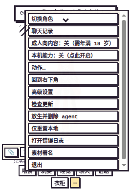

随后发一句话，再打开聊天记录：只有这一段（时间、角色、2 条、首句摘要），主动搭话和初次见面问候都不在：

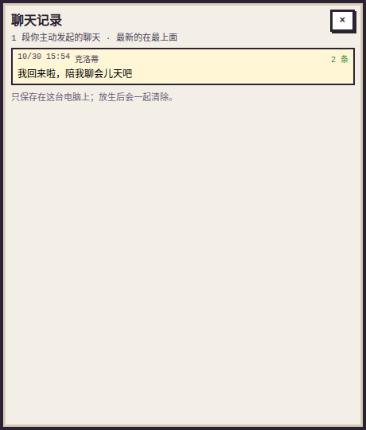

点开后的详情：

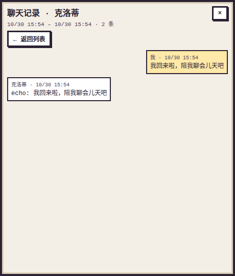

没有主动发起过聊天时的空状态（e2e `history` H1，此时已有一条“初次见面”问候）：


## 七、端到端验收（从干净 clone 开始，T-1232）

下面的步骤在一台没有显示器的 Linux（Ubuntu，Node 24.21.0，npm 11.19.0）上实际跑过，截图都来自这次运行。用的是测试用的假 `lh`（`test/fixtures/fake-lh.js`，离线，不需要登录、不花 token），它把收到的内容原样回显成 `echo: …`，所以系统台词在气泡里是 `echo: [事件] …`。

### 1. 安装与启动

```bash
git clone https://github.com/rdmclin2/lobehub-pixel-pet-affection.git
cd lobehub-pixel-pet-affection
npm install                 # Node 20+；npm 11 会提示 electron-winstaller 的 install script 未放行，可忽略（只在打 Windows 包时用）
npm run demo -- --fresh     # 离线演示：假 lh，直接是一只已唤醒的克洛蒂；Linux 无显示器时前面加 xvfb-run -a
npm start                   # 正式运行：需要 npm install -g @lobehub/cli 并登录
```

第一次启动时 Electron 才下载自己的二进制（终端里打印 `Downloading Electron binary...`），之后不再下载。

一键复现下面全部场景（截图、录屏、运行日志）：

```bash
xvfb-run -a node .agents/acceptance/scripts/chat-history-acceptance.js "$PWD" /tmp/chat-history-acceptance
```

脚本从首次启动开始（选角色 → 唤醒），用 `PIXELPET_TEST=1` 打开测试钩子（窗口不透明，`window.pet.debugSet` / `debugHeartbeat` 可用），输出 `*.png`、`e2e-run.webm`、`run-log.txt`（每一步的气泡文字和 `chat-log.json` 内容）和 `chat-log.json`。

### 2. 复现步骤与结果

| 场景 | 怎么操作 | 看到什么 | 截图 |
| --- | --- | --- | --- |
| 1 启动 | 首次启动 → 选克洛蒂 → 唤醒 | 角色选择页；唤醒后桌宠窗口出现，头顶是“初次见面”问候（`greeting`） | 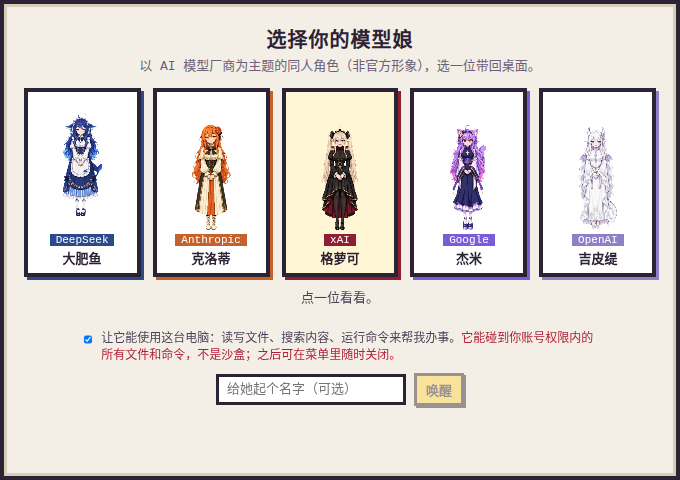 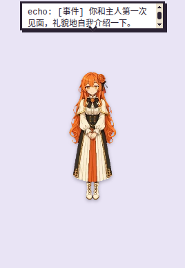 |
| 5 空状态 | 唤醒后立刻 悬停 → **⋯** → **聊天记录** | “还没有你主动发起的聊天”，0 条；此时记录里已有 1 条问候（`historyList()` 返回 `hidden: { greeting: 1 }`） | 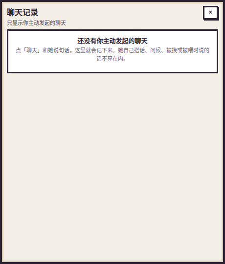 |
| 2 系统主动消息 | 点她的身体（触摸）；再把饥饿调到 90 并跑一次心跳：`window.pet.debugSet({ hunger: 90, lastSpokeAt: 0 })`、`window.pet.debugHeartbeat()`。不用测试钩子时，等 30 秒一次的心跳（她饿了 / 无聊时会主动说话） | 触摸台词气泡（`touch`），然后“你肚子很饿了”主动搭话气泡（`proactive`） | 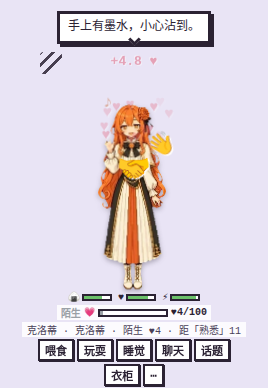 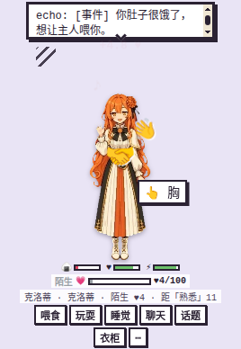 |
| 3 用户发消息 | 悬停 → **聊天**，发“你好呀克洛蒂，今天过得怎么样？”，再发“晚上一起看电影吧，你想看什么？” | 两次都有回复气泡 |  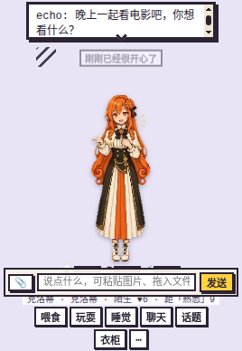 |
| 4 聊天记录 | 悬停 → **⋯** → **聊天记录**，点开那一段 | 列表只有 1 段：克洛蒂 · 4 条 · “你好呀克洛蒂，今天过得怎么样？”。问候、触摸、主动搭话都不在。详情依次是你的两句话和她的两句回复，← 返回列表 | 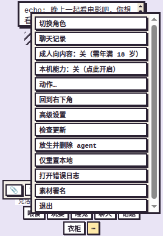 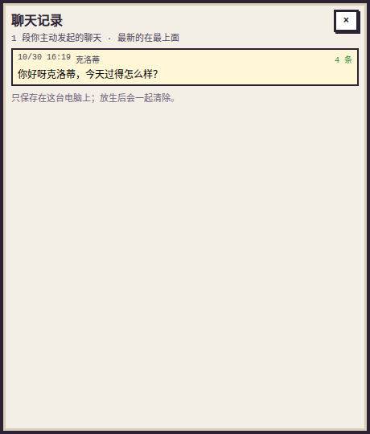 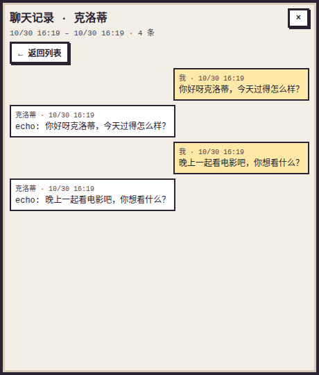 |

这次运行结束时 `chat-log.json` 有 7 条：`greeting` 1、`touch` 1、`proactive` 1、`user` 4（两轮，每轮你一句、她一句）。界面拿到的数据：

```json
{"sessions":[{"id":"m4","speciesId":"claude","preview":"你好呀克洛蒂，今天过得怎么样？","count":4,"userCount":2,"name":"克洛蒂"}],"hidden":{"greeting":1,"touch":1,"proactive":1},"total":7}
```

过滤规则见第二、三节：只显示 `origin: 'user'` 的轮次，过滤在主进程 `userSessions()`（`src/core/chat-log.js:78`）里完成，渲染进程（`src/renderer/history.js`）只拿到过滤后的会话。验收报告链接在 PR 描述里。

## 八、重新开始话题

⋯ 菜单 →「重新开始话题」：当前角色以后的对话进入 LobeHub 里一个**新的 topic**，不再带着之前的上下文。

- **不删除任何东西**：旧 topic 仍留在 LobeHub（可在网页里查看），它的 id 记在存档 `pastTopicIds`（最多 50 个）。agent、好感度、需求值和本地聊天记录都不变。
- **怎么开新 topic**：把当前角色的 `topicId` 清空。下一次 `lh agent run` 不带 `-t`，LobeHub 自己新建 topic，返回的 id 存回存档，之后一直复用。下一句如果是图片，先用 `lh topic create` 建好。
- **只影响当前角色**：其他角色各有自己的 topic，不受影响。
- **聊天记录**：每条记录带上 `topicEpoch`（这个角色重新开始过几次），新话题的第一轮总是开一段新会话。
- 宠物正在说话时会拒绝（`busy`），等她说完再试。

| 部分 | 位置 |
| --- | --- |
| 菜单项 | `src/renderer/index.html` `data-menu="new-topic"`；确认与提示 `src/renderer/app.js` `m === 'new-topic'` |
| IPC / preload | `ipcMain.handle('new-topic')`（`src/main/main.js`）；`window.pet.newTopic()`（`src/main/preload.js`） |
| 数据层 | `PetService.newTopic()` 与 `_epoch()`（`src/main/pet-service.js`）；会话切分 `epochOf()`（`src/core/chat-log.js`） |
| 测试 | `test/pet-service.test.js`「重新开始话题」两条；`test/chat-log.test.js` topicEpoch 切分；e2e `node e2e/run.js history` H7 |

验证：`npm test`；`xvfb-run -a node e2e/run.js history`，H7 截图在 `out/e2e/history/h7-*.png`（菜单项、确认后的气泡、两段会话的聊天记录）。
