# 她的房间（engine `room@1`）· 实现说明

商店第二款小游戏。和「像素小院」一样在独立的游戏窗口里用 PixiJS 8 渲染，游戏包只有图片和 JSON。技术方案见 T-10799 的 `docs/her-room-design.md`（单独的文档 PR），本文说明这一版实现了什么、怎么试玩、怎么测试。

> 本 PR 只做应用里的引擎。正式的大肥鱼房间美术、游戏仓库里的 `games/her-room/` 和上架由后续任务完成。现在的截图用的是 `test/fixtures/games/her-room/` 的最小包：像素图由 `scripts/build-room-fixture.js` 逐像素绘制。

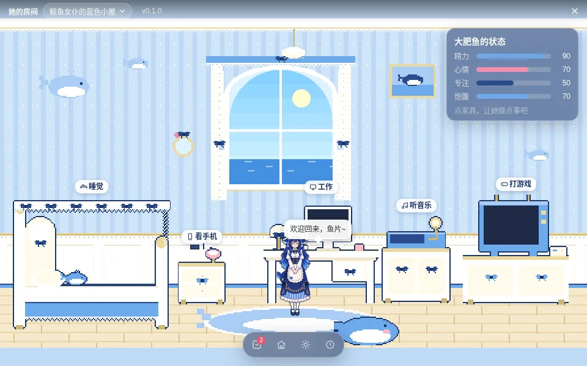

## 玩法

- **入口**：商店 → 小游戏 → 她的房间 → 下载 → 开始玩。托盘「小游戏」、面板 ⌂ 和快捷键打开「上次玩的游戏」，逻辑不变（`settings.scene.game`）。
- **五类活动**：点家具，她先走过去（地上插一个蝴蝶结标记），到了以后才开始这一轮。
  | 活动 | 家具 | 她的动作 | 道具 |
  | --- | --- | --- | --- |
  | 睡觉 | 床 | `sleep`，躺进被子里（旋转 −90°，被子和床尾板盖在她上面） | 房间压暗、冒 Z |
  | 工作 | 书桌和电脑 | `think` | 显示器一行行打字（行数就是进度）、台灯亮、灯光 |
  | 看手机 | 床头柜上的手机 | `look` | 床头柜上的手机消失、出现在她手里、冒爱心 |
  | 听音乐 | 唱片机 | `happy`，轻轻晃 | 唱片转、飘音符 |
  | 打游戏 | 电视和游戏机 | `play` | 电视播 4 帧小游戏、手柄在她手里、冒星星 |
- **反馈**：左下角活动条（图标、正在睡觉、`00:12 / 00:30`、进度条、结束按钮）；家具上沿的标签变成「睡觉中」并带细进度条；台词气泡开始时一句、每 6 秒换一句、做完一句；右上角「大肥鱼的状态」四条横条，进行中末端有斜纹预览这一轮的变化，结算时飘出 ±数字，顶部提示写「睡觉完成：精力 +35，…」。
- **结束方式**：到点自动结算；点「结束」、再点一次同一件家具、点地板、拎起她都算提前结束（按做了多久算，最少 25%）；点另一件家具先结算前一件；切换房间、关窗口、退出应用按做了多久算；进程被杀或崩溃时，下次打开游戏结算——已过一整轮就按完成算，否则按最后一次保存（页面每 5 秒报一次）时的进度。
- **精力不够**（工作、打游戏要精力 ≥ 15）：描边变灰、指针变成禁止，提示「太累了（精力 10，要 15）· 先让她睡一觉」，点了不会开始。
- **换房间**：标题栏「鲸鱼女仆的蓝色小屋 ▾」、工具栏 ⌂ 按钮或 R 键。卡片横排五个条目（头像、房间名、四色色块、可以玩 / 即将开放）。即将开放的四个打开预览卡（房间名、简介、元素标签、头像、即将开放、回到按钮），房间画面不变、不报错。
- **天色**：和像素小院共用 `settings.scene`，☀ 打开同一张天色卡片。房间里按一半强度调色，窗外是全强度天色、太阳 / 月亮、云、雨、雪；夜里灯亮。
- 房间主人在自己的房间里穿 `theme.outfit`（大肥鱼的 `daily`，招牌女仆装），由 main 通过 `PetService.roomLooks` 解析；去别人的房间做客时外观不换。她的动作缺的走 `core/fx.js` 的回落链。

| | |
| --- | --- |
| 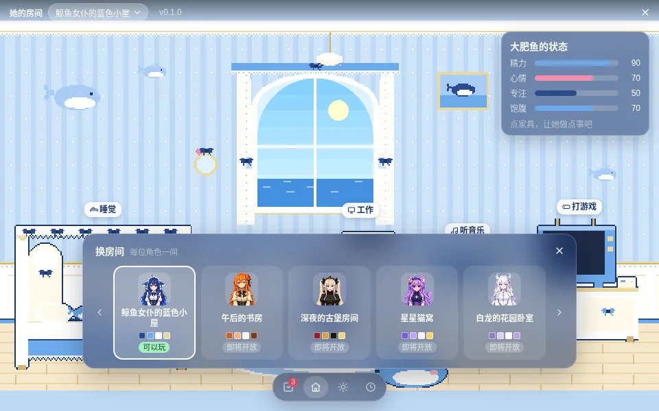 | 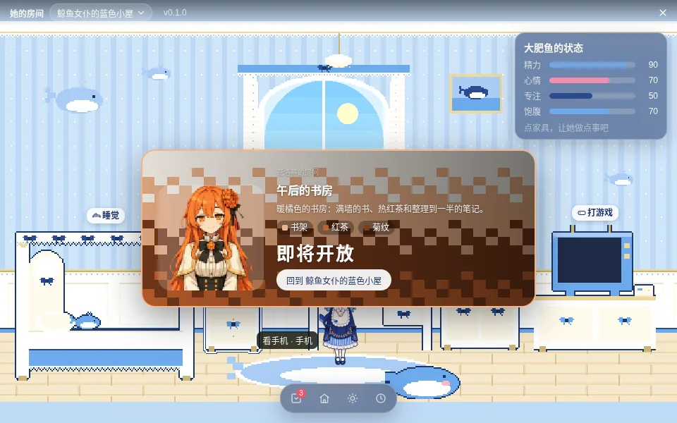 |
| 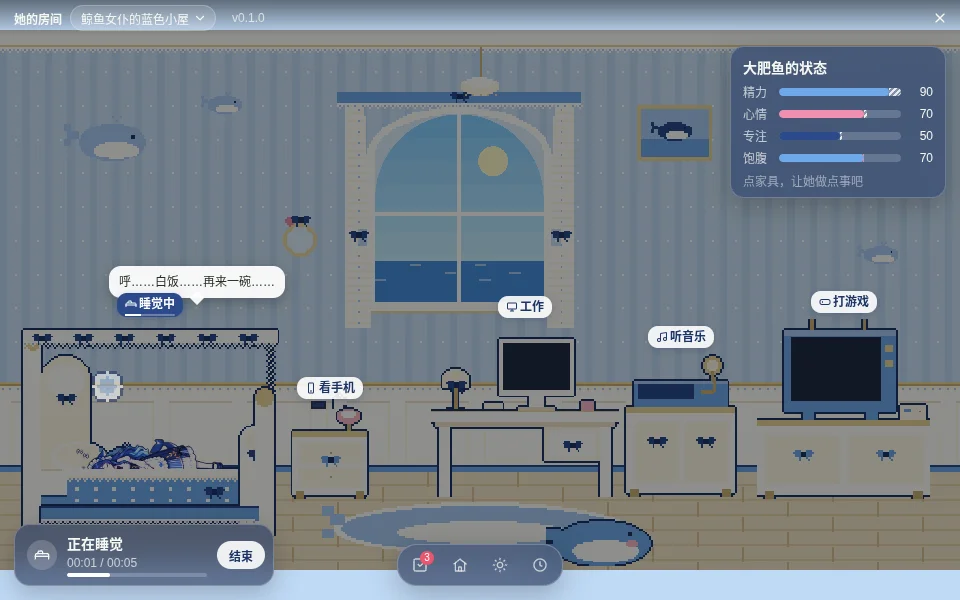 | 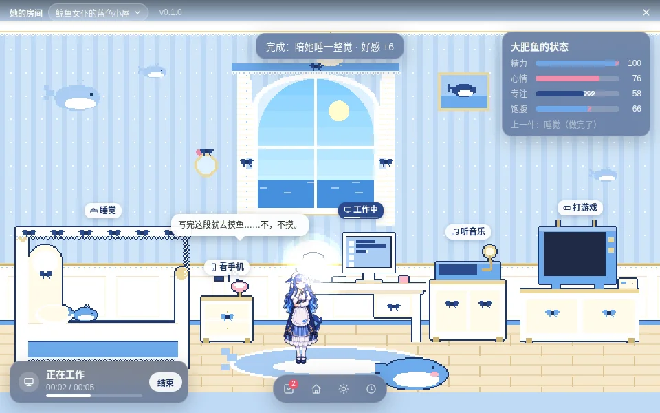 |
| 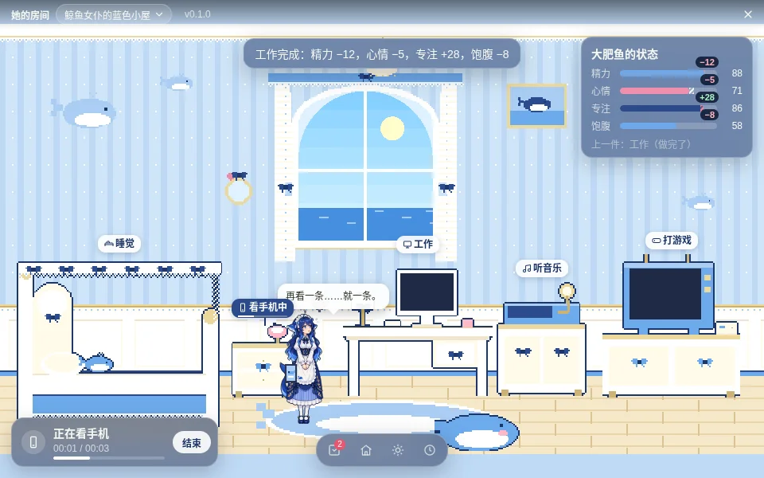 | 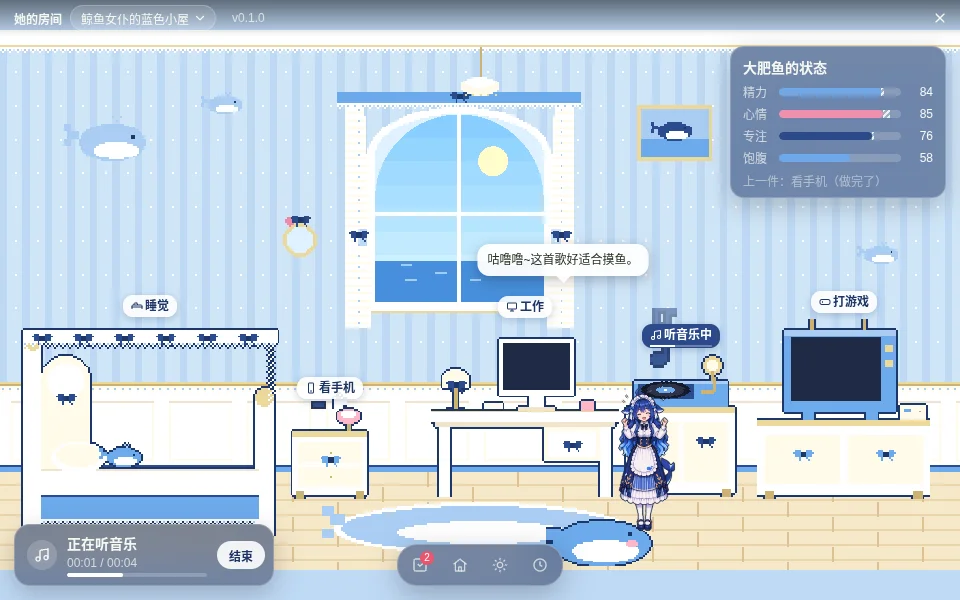 |
| 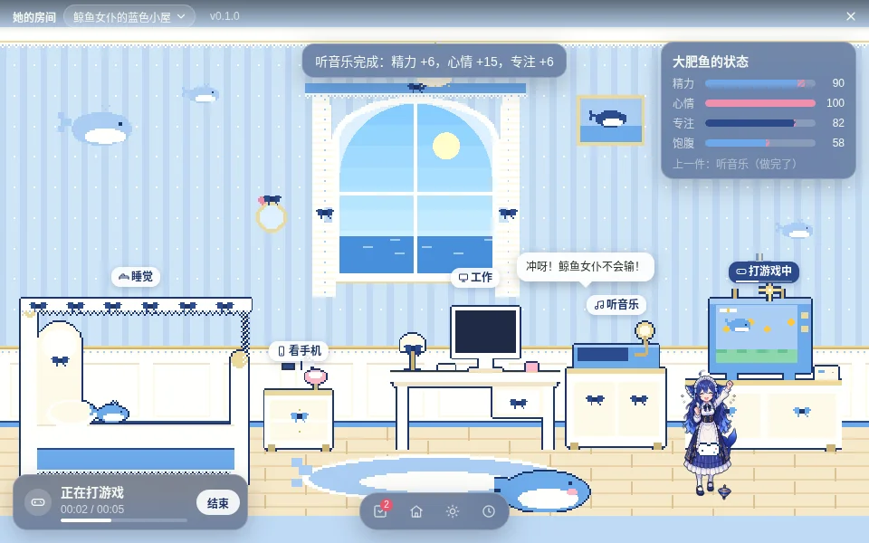 | 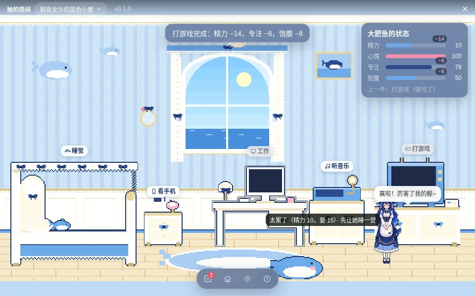 |
| 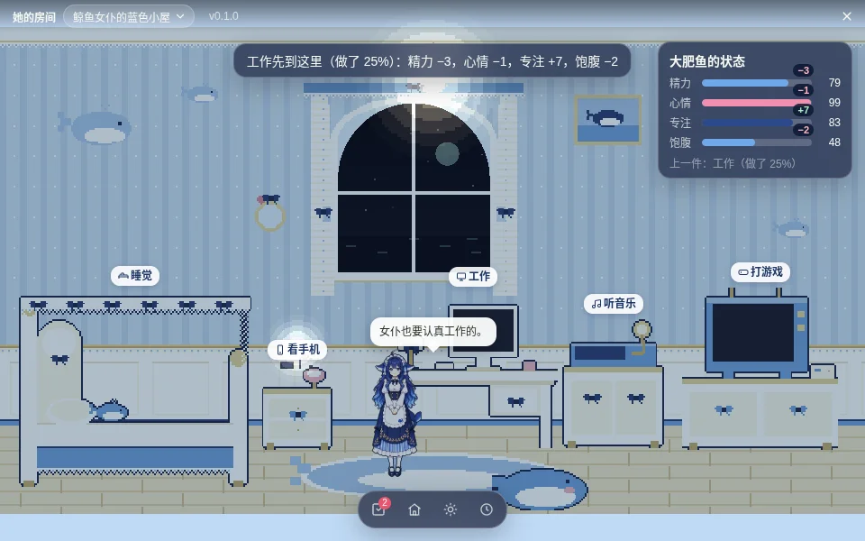 | 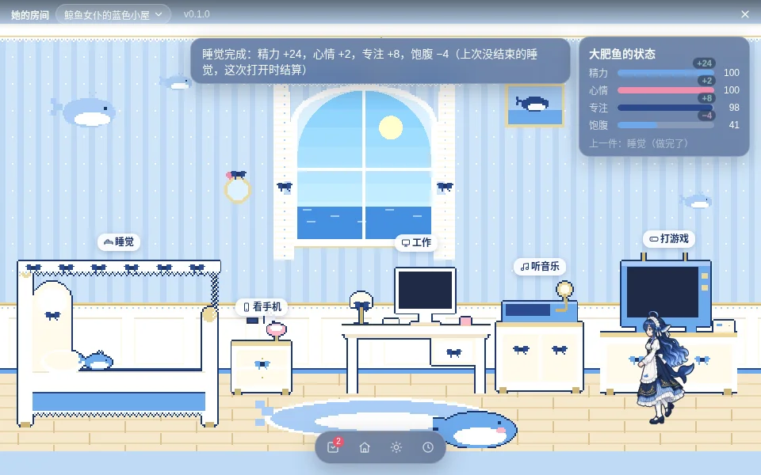 |

录屏：[her-room-demo.mp4](img/her-room/her-room-demo.mp4)（44 秒，章节在 `her-room-demo.chapters.json`）。

## 代码

| 文件 | 作用 |
| --- | --- |
| `src/core/room-pack.js` | `validateRoom`：活动默认值（时长 5–600 s，增减 ±40，只能是四个数值）、主题（五个默认角色、色板、open / soon）、open 主题的世界、地板、家具、五类活动（`at` / `spot` / 道具词表和参数）、文件名前缀、256 KB 和 12 个主题的上限 |
| `src/core/game-pack.js` | `ENGINES = ['yard@1', 'room@1']`，公共字段之后按引擎分派；`namedFiles` / `spriteFiles` 给 `game-store.js` 和 `game://` 协议用；文件名仍然只允许 `.webp / .png / .json` |
| `src/core/room-play.js` | 纯函数状态机（UMD）：`start / settle / tick / recover / apply / view / preview / summary / lines` |
| `src/core/game-quests.js` | `on.kind / on.theme / on.complete`，`distinct: "kind"` |
| `src/main/games.js` | `GameLibrary.activity / roomBoot / roomClose`：用 main 自己的时钟和已安装 manifest 的数值结算，写进度文件，记小事；`saveState` 对房间只接受 `theme` |
| `src/main/pet-service.js` | `roomStats / roomSettle`（只改精力、心情、饥饿，不让桌宠睡着，存盘并推 `update`）、`roomLooks` |
| `src/main/main.js`、`game-preload.js` | IPC `game:activity`；`game:boot` 多给 `room`；关窗口和退出时结算；`PIXELPET_DEV_GAMES=1` 也读 `test/fixtures/games/` |
| `src/renderer/game/engines/room.js`、`room.css` | room@1 引擎：场景树、她的精灵、家具热点和描边、道具效果词表、活动条、标签、气泡、数值卡、换房间和预览卡、窗外天色、`__game()` / `__gameTest` |
| `src/renderer/game/game-boot.js`、`game.html`、`game.js` | 只问一次 `boot()`，按 engine 由 `game.js`（小院，行为不变）或 `engines/room.js` 接手 |
| `scripts/build-room-fixture.js` | 生成最小 room 包（`--check` 检查是否过期） |

和方案的差异：方案建议先把 `game.js` 拆成外壳 + 引擎。这一版没有拆：小院的代码一行没动，只在开头按 engine 让路；天色卡和今日小事卡由房间引擎自己接线（DOM 共用）。拆分留到之后单独的 PR，那时用 e2e `game` 做回归。

## 试玩与测试

```bash
node scripts/build-room-fixture.js                 # 重新生成最小包（改了脚本之后）
PIXELPET_DEV_GAMES=1 npm start                      # 开发：直接读 test/fixtures/games/her-room，不经过商店
npm test                                            # room-pack / room-play / pet-service-room 等单测
xvfb-run -a node e2e/run.js room                    # 商店下载 → 五类活动 → 换房间 → 结算（真实鼠标点画布）
PIXELPET_ROOM_VIDEO=/tmp/her-room.mp4 xvfb-run -a -s "-screen 0 1280x800x24" node e2e/run.js room   # 同上并录屏
xvfb-run -a node e2e/run.js game                    # 像素小院回归（先 node scripts/fetch-game-packs.js）
```
