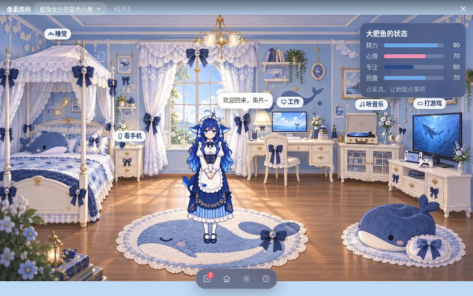
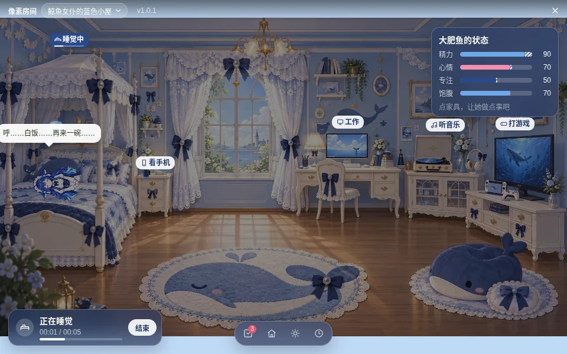
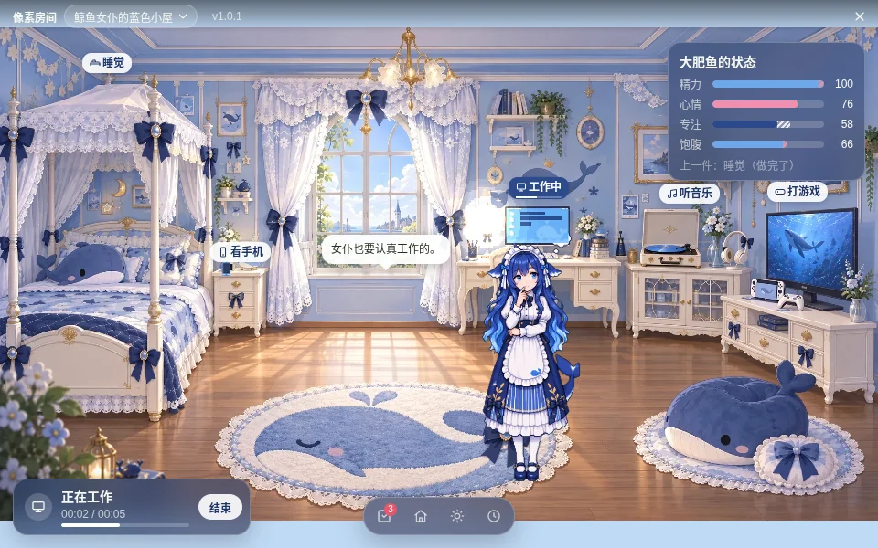
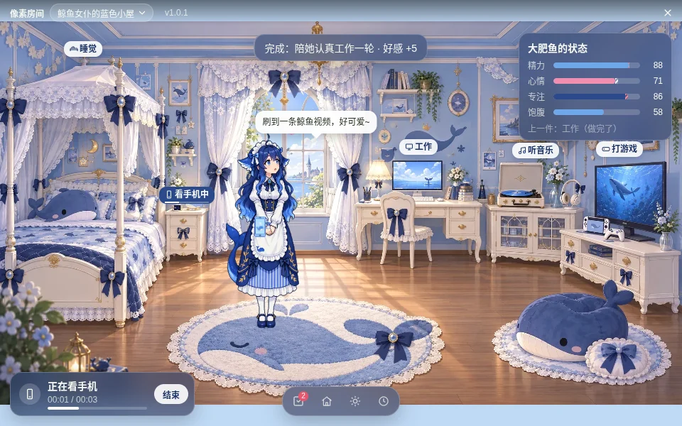
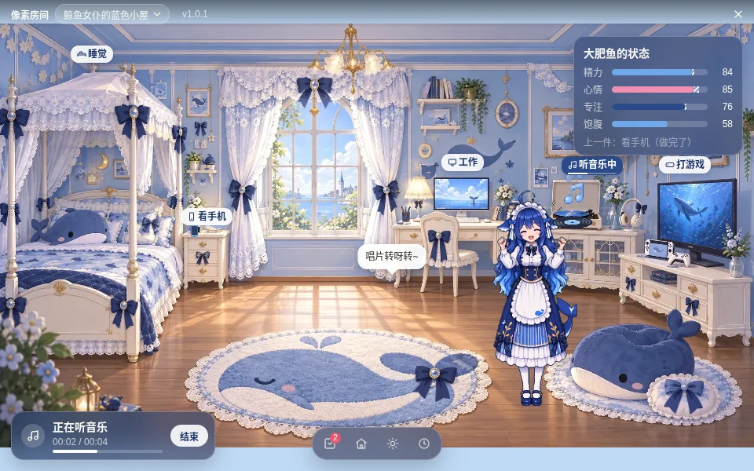
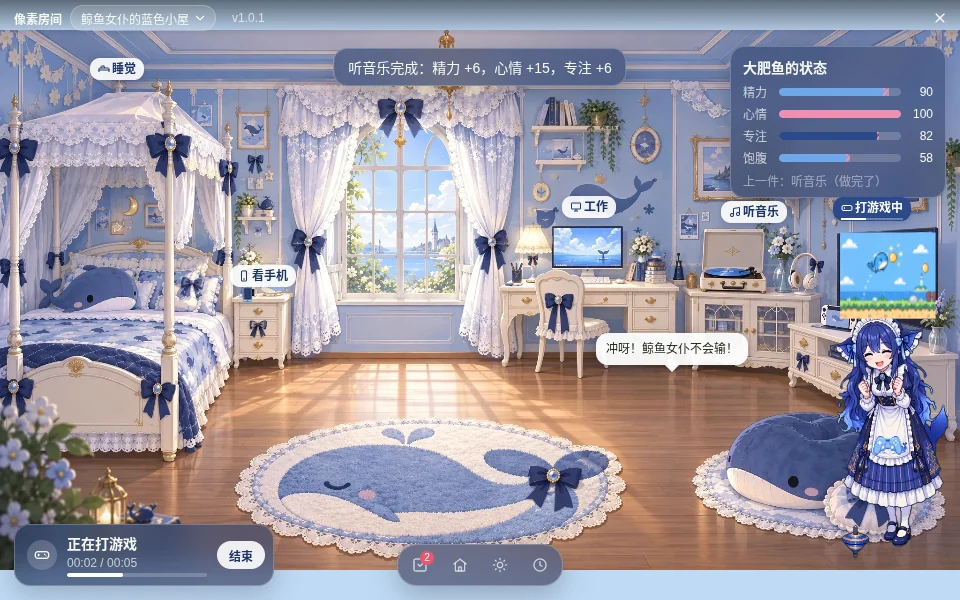
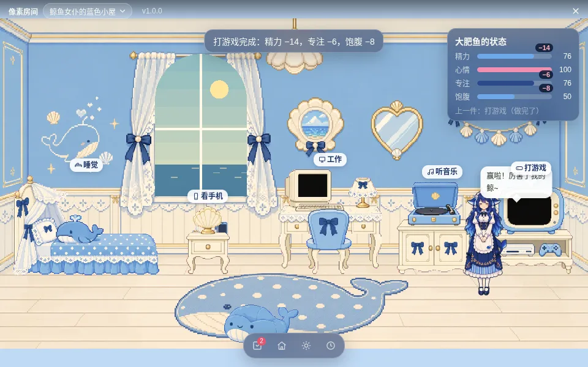
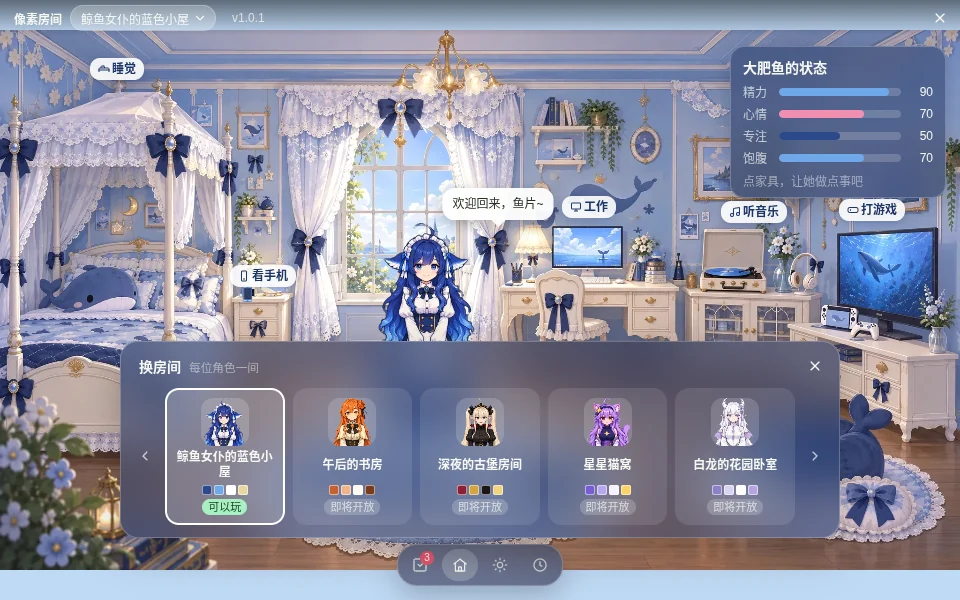
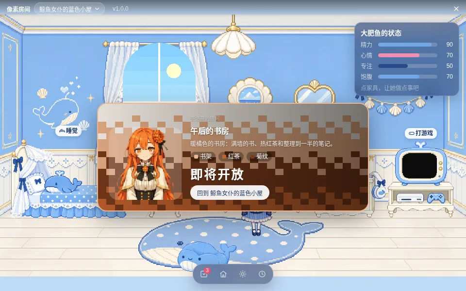
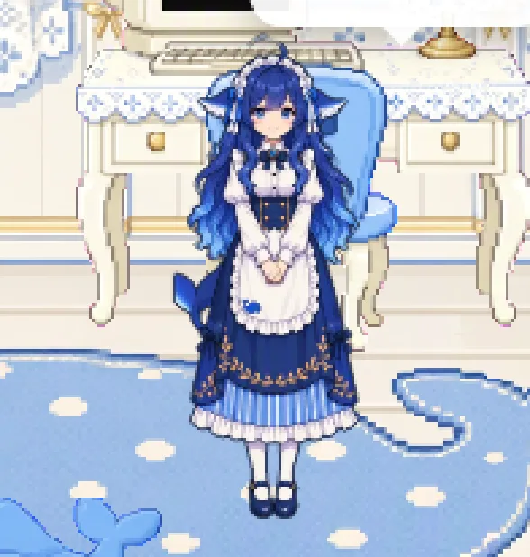

# 像素房间（engine `room@1`）

> 商店第二款小游戏。每位角色有一间自己风格的房间，你陪她睡觉、工作、看手机、听音乐、打游戏：她走过去做事，家具和道具跟着变，做完改变她的精力、心情、专注和饱腹。本版开放大肥鱼的「鲸鱼女仆的蓝色小屋」，另外四间可以预览，即将开放。
> 和「像素小院」一样在独立的游戏窗口里用 PixiJS 8 渲染，游戏包只有图片和 JSON；美术和游戏包在开源仓库 **<https://github.com/rdmclin2/pixel-pet-mini-games>** 的 `games/pixel-room/`。技术方案见 `docs/her-room-design.md`（T-10799，方案阶段的旧名）。
>
> **名字**：这款游戏开发时叫「她的房间」，上架前改名为「像素房间」（game id `pixel-room`），「她的房间」留给之后的插画风新游戏。id 一起改掉是因为旧 id 从没上过 CDN、也没进过任何发布的目录，没有用户装过 `her-room`；应用按引擎 `room@1` 玩，不认具体 id，所以改 id 不用改代码。以后的插画风游戏可以直接用 `her-room` 这个 id。



图和数值都来自真实应用里的验收（`node e2e/run.js roomaccept`，见本文最后一节）：商店下载的正式包、全新存档、真实鼠标、每一轮用真实时长。

## 1. 打开与关闭

| 入口 | 操作 |
| --- | --- |
| 商店 | ⚙ 设置 → 商店 → **小游戏** → 像素房间 → 下载 → **开始玩** |
| 托盘 / 面板 / 快捷键 | 托盘「小游戏」、右键她 → 底栏 ⌂、桌宠窗口里 `Ctrl/⌘ + Shift + H`：打开上次玩的游戏（`settings.scene.game`） |

打开时桌面上的她隐藏、进到房间里；关掉（右上角 ✕、`Ctrl/⌘ + W`、托盘再点一次）后她回到桌面原来的位置。

| 商店：未下载 | 已下载 | 详情页 |
| --- | --- | --- |
|  |  |  |

## 2. 怎么玩

**五件事**。点家具，她先走过去（地上插一个蝴蝶结标记），到了才开始这一轮：

| 活动 | 家具（热点） | 一轮 | 她的动作 | 道具 | 数值（每整轮） |
| --- | --- | --- | --- | --- | --- |
| 睡觉 | 床 | 30 秒 | `sleep`，躺进被子里 | 房间压暗、冒 Z | 精力 +35，心情 +6，专注 +8，饱腹 −4 |
| 工作 | 书桌和电脑 | 30 秒 | `think` | 显示器一行行打字、台灯亮 | 专注 +28，精力 −12，心情 −5，饱腹 −8；要精力 ≥ 15 |
| 看手机 | 床头柜上的手机 | 20 秒 | `look` | 桌上的手机拿到她手里、冒爱心 | 心情 +14，专注 −10，精力 −4 |
| 听音乐 | 唱片机 | 25 秒 | `happy`，轻轻晃 | 唱片转、飘音符 | 心情 +16，精力 +6，专注 +6 |
| 打游戏 | 电视和游戏机 | 30 秒 | `play` | 电视播鲸鱼跳金币、手柄在她手里、冒星星 | 心情 +22，精力 −14，饱腹 −8，专注 −6；要精力 ≥ 15 |

数值到 0 / 100 就停（例如精力已经 90 时睡一整觉只 +10）。

| 睡觉 | 工作 | 看手机 |
| --- | --- | --- |
|  |  |  |
| **听音乐** | **打游戏** | **结束：数值卡飘字** |
|  |  |  |

**反馈**：
- 悬停家具：描白边，指针旁写「睡觉 · 床」；精力不够时描边变灰、提示「太累了（精力 10，要 15）· 先让她睡一觉」，点了不会开始。
- 进行中：左下角活动条（图标、「正在睡觉」、`00:14 / 00:30`、进度条、「结束」）；家具标签变成「睡觉中」带细进度条；她头上的台词气泡开始时一句、每 6 秒换一句；右上角「大肥鱼的状态」四条横条，末端的斜纹是这一轮做完会到哪里。
- 结束：到点自动结算，顶部提示「睡觉完成：精力 +10，心情 +6，专注 +8，饱腹 −4」，数值卡飘出 ±数字，下面一行「上一件：睡觉（做完了）」。

**结束和切换**：
- 点「结束」、再点一次同一件家具、点地板、拎起她：按做了多久算（最少 25%），提示「听音乐先到这里（做了 42%）：精力 +3，专注 +3」。
- 做到一半点另一件家具：先结算前一件，再走过去做新的一件。
- 关窗口、退出应用、换房间：按做了多久算。进程被杀或崩溃时，下次打开游戏结算：已过一整轮就按完成算，否则按最后一次保存（每 5 秒）时的进度。

**换房间**：标题栏「鲸鱼女仆的蓝色小屋 ▾」、工具栏 ⌂ 或 `R` 键。卡片横排五个房间（头像、房间名、四色色块、「可以玩 / 即将开放」）。即将开放的打开预览卡（房间名、简介、元素、即将开放、「回到 鲸鱼女仆的蓝色小屋」），房间画面不变。

| 换房间 | 即将开放：午后的书房（克洛蒂） |
| --- | --- |
|  |  |

| 房间 | 角色 | 状态 |
| --- | --- | --- |
| 鲸鱼女仆的蓝色小屋 | 大肥鱼（DeepSeek） | 可以玩 |
| 午后的书房 | 克洛蒂（Claude） | 即将开放 |
| 深夜的古堡房间 | 格萝可（Grok） | 即将开放 |
| 星星猫窝 | 杰米（Gemini） | 即将开放 |
| 白龙的花园卧室 | 吉皮缇（OpenAI） | 即将开放 |

**她的样子**：房间主人在自己的房间里穿主题的 `outfit`（大肥鱼是像素包 `dafeiyu-pixel` 的 `daily`，招牌女仆装）；去别人的房间做客时外观不换。缺的动作走 `core/fx.js` 的回落链。



**天色**：和像素小院共用 `settings.scene`（时段、天气、随时间流动），☀ 打开同一张天色卡片。房间里按一半强度调色，窗外是全强度的天色、太阳 / 月亮、云、雨、雪；夜里灯亮。

**今日小事**：每天从 9 件里挑 3 件（陪她睡一整觉、陪她认真工作一轮、让她刷会儿手机、陪她听完一张唱片、陪她打完一局游戏、夜里哄她睡觉、下雨天一起听歌、五件事各做一次、摸摸她），完成一件好感 +2，每天最多 3 次（`core/affection.js` 的 `game` 来源）。好感只来自小事，做事本身不加好感。

**保存什么**：精力、心情、饱腹是她自己的数值，写回 `pet.json`（桌面上也一样，应用关着时照常随时间变化）；专注、正在做的事、上一件、累计、房间选择、小事进度存在 `userData/games/.progress/pixel-room.json`。更新或删除游戏包都不影响进度。

## 3. 游戏包格式（engine `room@1`）

包是一个平铺的文件夹，只允许 `.webp` / `.png` / `.json`：

```
manifest.json               五件事的默认数值、主题列表、今日小事、台词
dafeiyu-room.webp           大肥鱼房间的背景（1024×576，不画家具）
dafeiyu-atlas.webp          家具、道具、粒子的图集
dafeiyu-sprites.json        图集索引 { 名字: { x, y, w, h } }
<theme>-preview.webp        （可选）即将开放的房间的预览图
```

每个主题的文件都以主题 id 开头，每个主题最多 4 个文件，最多 12 个主题，manifest 不超过 256 KB。

```jsonc
{
  "schema": 1, "kind": "game", "engine": "room@1",
  "id": "pixel-room", "name": "像素房间", "version": "1.0.1", "description": "…", "credit": "…",
  "defaultTheme": "dafeiyu",
  // 五件事的数值：所有房间共用，主题不能改
  "activities": {
    "sleep": { "label": "睡觉", "verb": "睡一觉", "anim": "sleep", "seconds": 30,
               "deltas": { "energy": 35, "mood": 6, "focus": 8, "fullness": -4 },
               "lines": { "doing": ["呼……"], "done": ["睡饱了。"] } },
    "work":  { "label": "工作", "anim": "think", "seconds": 30, "deltas": { … }, "needs": { "energy": 15 } },
    "phone": { … }, "music": { … }, "game": { … }
  },
  "themes": [
    { "id": "dafeiyu", "character": "dafeiyu", "status": "open", "name": "鲸鱼女仆的蓝色小屋",
      "blurb": "…", "motifs": ["蕾丝", "蝴蝶结", "鲸鱼"],
      "palette": { "primary": "#2C4A8A", "accent": "#6FA8E8", "base": "#FFFFFF", "trim": "#E8D6A0" },
      "outfit": "daily",                                   // 房间主人穿哪件（她的角色包里的 outfit id）
      "world": { "width": 1024, "height": 576, "background": "#BFD9F5" },
      "images": { "room": "dafeiyu-room.webp", "atlas": "dafeiyu-atlas.webp" }, "sprites": "dafeiyu-sprites.json",
      "petHeight": 190, "spawn": [560, 512], "door": [985, 520],
      "walk": { "cell": 8, "area": [[40, 456], [985, 456], [1015, 568], [10, 568]], "blocked": [{ "cx": 455, "cy": 552, "rx": 62, "ry": 13 }] },
      "furniture": [
        { "id": "bed", "sprite": "bed", "x": 150, "y": 448, "label": "床", "front": "bed-front" },   // (x, y) = 精灵底边中点
        { "id": "beanbag", "sprite": "whale-beanbag", "x": 455, "y": 566, "use": { "at": [455, 520], "anim": "sit", "seconds": [8, 16], "label": "坐一会儿" } },
        …
      ],
      "activities": {                                       // 五件事在这个房间里怎么演：在哪、站哪、道具
        "sleep": { "at": "bed", "spot": [215, 478], "face": "right", "pose": "tucked", "lie": [232, 392],
                   "props": [{ "fx": "dim", "to": 0.55 }, { "fx": "layer", "sprite": "quilt", "x": 186, "y": 441, "under": "front" },
                             { "fx": "emit", "sprites": ["z1", "z2"], "from": [250, 370], "every": 1.4, "rise": 60 }] },
        "work":  { "at": "desk", "spot": [468, 488], "bubble": [430, 262], "props": [{ "fx": "screen-type", "rect": [519, 271, 53, 48], "rows": 5, "color": "primary" }, …] },
        …
      },
      "lights": [{ "x": 631, "y": 300, "r": 50, "on": "work" }, …],   // 夜里亮的灯；on: 只在做这件事时亮
      "window": { "rect": [270, 62, 160, 248], "arch": true },          // 窗外画天色的区域
      "lines": { "enter": ["…"], "touch": ["…"] } },
    { "id": "claude", "character": "claude", "status": "soon", "name": "午后的书房", "blurb": "…", "motifs": […], "palette": { … } },
    …
  ],
  "quests": [{ "id": "sleep-full", "title": "陪她睡一整觉", "on": { "type": "activity-end", "kind": "sleep", "complete": true } }, …]
}
```

- **活动**（`activities.<kind>`）：`seconds` 5–600；`deltas` 只能是 `energy / mood / focus / fullness`，每项 ±40 以内；`needs` 只能是 `energy`；`anim` 是她会的动作（`idle sit play pat look happy eat sleep think lookAround`）。
- **手绘房间**：家具直接画在底图里的主题写 `smooth: true`（底图和图集平滑缩放，不走像素的 nearest），家具用透明占位精灵加 `hit` 多边形（点击范围，也是悬停描边）；`lieScale` 0.3–1 是她躺下时的大小（床在房间靠里的地方，要小一点）；`window.painted: true` 表示窗外的风景也画好了，晴天白天不盖天色，其余时候才画。大肥鱼这间由 `games/pixel-room/art/build_painted.py` 从手绘底图生成（不再走 `layout.json` 的切图）。
- **主题里的活动**：`at` 是一件家具，`spot`（她站的位置）要在地板上（`walk.area` 内、不在 `blocked` 里）；`face` left / right；`pose: "tucked"` 是躺进被子，**必须给 `lie`**（她的脚在床上的位置；没有它她会躺在床边的地板上）；`bubble` 是台词气泡的位置（挡住显示器、电视时挪开）；`props` 最多 8 个。
- **道具效果词表**（`props[].fx`，参数都有范围检查）：

  | fx | 作用 | 参数 |
  | --- | --- | --- |
  | `dim` | 房间压暗 | `to` 0.3–1 |
  | `layer` | 加一层精灵（被子、亮着的台灯） | `sprite`、`x`、`y`，`under: "front"` 画在床尾板下面 |
  | `swap` | 换掉一件家具的图 | `sprite`、`to` |
  | `hide` | 藏起一个装饰 | `sprite` |
  | `hold` | 拿在她手里 | `sprite`、`hand` [u, v]（0–1，她身上的相对位置） |
  | `spin` | 旋转（唱片） | `sprite`、`x`、`y`、`squash` 0.1–1、`rpm` 1–120 |
  | `frames` | 播帧动画（电视） | `sprites`（1–8）、`rect`、`fps` 0.5–30 |
  | `screen-type` | 屏幕上逐行打字，行数就是进度 | `rect`、`rows` 1–24、`color`、`sprite` |
  | `emit` | 冒粒子（Z、音符、爱心、星星） | `sprites`、`from`（[x, y] 或 `"head"`）、`every` 0.2–30、`rise` |
  | `bob` | 她轻轻晃 | `target: "pet"`、`period`、`amp` |
  | `glow` | 一圈光 | `x`、`y`、`r` 4–400 |

- **主题**：`character` 是五个默认角色之一；`status` open / soon；`palette` 四个 `#RRGGBB`；至少一个 open，`defaultTheme` 要是 open 的。soon 的主题只要基本字段（换房间卡片和预览卡用）。
- **小事**：`on.type` `activity-end` / `touch` / …，可加 `kind`、`theme`、`complete`、`phase`、`weather`；`distinct: "kind"` 表示「五件事各做一次」这种按种类计数。
- 校验：应用 `src/core/room-pack.js`（`validateRoom`，由 `game-pack.js` 按 engine 分派）和游戏仓库 `tools/game-pack.js` 是同一套规则；文件夹里有 manifest 没列出的文件就拒绝安装。数值只在主进程结算（`core/room-play.js`、`src/main/games.js`），页面传来的数字不算数。

## 4. 加一个新房间

以克洛蒂的「午后的书房」（`claude`，现在是 soon）为例，在游戏仓库里：

1. **美术**：在 `games/pixel-room/art/prompts.json` 加 `claude-room`（背景，不画家具）、`claude-furniture`、`claude-props`、`claude-screens` 的提示词，`scripts/generate.sh games/pixel-room` 生成原图到 `art/raw/`（一次一张、每张之间停 20 秒）。
2. **切图**：`art/layout.json` 的 `sets` 加一套 `claude`（文件名前缀），给每个精灵命名、定框和缩放；`python3 scripts/game_sprites.py build games/pixel-room/art/layout.json games/pixel-room/art/raw games/pixel-room/pack` 输出 `claude-room.webp`、`claude-atlas.webp`、`claude-sprites.json`（图集里不能留品红像素）。
3. **manifest**：把 `claude` 主题的 `status` 改成 `open`，补上 `outfit`、`world`、`images`、`sprites`、`petHeight`、`spawn`、`door`、`walk`、`furniture`、五件事的 `activities`（`at`、`spot`、`props`，躺下的给 `lie`）、`lights`、`window`、`lines`。数值不用写：五件事在所有房间里一样。
4. **校验与预览**：`node tools/game-pack.js games/pixel-room`、`node --test tools/`；`python3 scripts/room_preview.py` 出静态合成图；再把 `pack/` 复制到应用仓库的 `catalog/games/pixel-room/`，`PIXELPET_DEV_GAMES=1 npm start` 在真实引擎里看（见下一节）。
5. **发版**：升 `pack/manifest.json` 的 `version`（例如 1.1.0），`CHANGELOG.md` 顶部加「## 1.1.0 · 日期」，按 [mini-games.md §9](mini-games.md#9-上架版本与升级) `node scripts/build.js && node scripts/publish.js`，推上 main。已安装的应用会提示「有更新」，进度保留。

只换房间、不加新玩法时不用动应用。需要新的道具效果或新的活动种类时，要先在应用里加（`room-pack.js` 的 `FX` / `KINDS` 和 `engines/room.js`），应用发版后再发用到它的包，并在 `store.json` 写 `minAppVersion`。

## 5. 试玩、上架与验证

```bash
# 游戏仓库（rdmclin2/pixel-pet-mini-games）
node tools/game-pack.js games/pixel-room && node --test tools/
node scripts/build.js pixel-room            # out/pixel-room-1.0.0.zip + catalog.json 条目（大小、sha256、更新说明）

# 应用仓库
cp ../pixel-pet-mini-games/games/pixel-room/pack/* catalog/games/pixel-room/   # 不经过商店，直接试玩
PIXELPET_DEV_GAMES=1 npm start
node scripts/sync-game-catalog.js --repo ../pixel-pet-mini-games --all     # 用本地仓库生成商店目录和封面（--all 含未发布的条目，只用来试，不提交）
unset ELECTRON_RUN_AS_NODE
xvfb-run -a -s "-screen 0 1600x1000x24" node e2e/run.js roomaccept       # 上架验收（下面）
xvfb-run -a node e2e/run.js room                                           # 引擎回归（最小包 test/fixtures/games/pixel-room，轮次缩短）
```

**上架**（游戏仓库）：`node scripts/publish.js pixel-room` 把包传到 CDN（需要 `dc` 登录，或 `DC_CLI=<develop-center>/packages/cli/dist/index.js` 加环境变量 `DC_TOKEN`、`DC_BASE_URL`）、下载回来比对、标记 `published`，推上 main；应用里跑 `node scripts/sync-game-catalog.js`（游戏仓库的 PR 还没合并时加 `--repo <游戏仓库>`）更新随应用发布的目录和封面。1.0.0 已于 2026-11-05 上传：<https://chat-cloud.lobeobjects.space/dc/ops-assets/archives/pixel-pet/games-v1/pixel-room-1.0.0.zip>（551302 字节，sha256 `1e112e9c…`）。包写了 `minAppVersion: "0.27.0"`：之前的应用在商店里显示「需要更新应用」。

**上架验收**（`e2e/pixel-room-accept.js`，`roomaccept`）：包从真实 CDN 下载（不设 `PIXELPET_CATALOG_URL`，下载地址和用户的一样）；开跑前先从 CDN 取回包，核对和 `src/core/game-catalog.json`、游戏仓库 `build.js` 打出的包 sha256 一致，下载后核对装好的文件和 CDN 上的包逐字节相同。游戏仓库的 `catalog.json` 由本地 http 服务提供（它的 main 分支要等 PR 合并后才有这一项）；升级用的 1.0.1 是 CDN 上的 `pixel-room-1.0.1-acceptance.zip`（内容和 1.0.0 相同，只升版本号，单独取名，不占以后正式 1.0.1 的文件名）。全新存档、不设 `PIXELPET_CATALOG_PREINSTALLED`，每次点击和悬停都是 Xvfb 上的真实鼠标（xdotool），整屏录像带章节，每一步的数值写进 `out/e2e/pixel-room-accept/obs/*.json`：

- A1 全新存档，她在桌面上。
- A2 商店：未下载（封面）→ 下载 → 已下载 · 开始玩；详情页。
- A3 开始玩：游戏窗口里是她，桌面上的她消失；✕ 关闭后回到桌面。
- A4 房间全景和角色特写。
- A5 换房间：五个主题，一个可以玩、四个即将开放。
- A6 五件事各做一整轮（真实时长）：悬停热点、点击、她走过去、进行中、结算、数值和 `pet.json` 一致；A6b 提前结束、中途切换。
- A7 退出再启动：已下载、上次玩的游戏、房间、数值、上一件、今日小事都在。
- A8 升级：目录改成 1.0.1（CDN 上的验收包）→ 游戏里「有新版本」、商店「有更新」→ 更新 → v1.0.1，进度还在。

## 6. 代码

| 文件 | 作用 |
| --- | --- |
| `src/core/room-pack.js` | `validateRoom`：活动默认值、主题、open 主题的世界 / 地板 / 家具 / 五件事 / 道具词表和参数、文件名前缀、大小上限 |
| `src/core/game-pack.js` | `ENGINES = ['yard@1', 'room@1']`，公共字段之后按引擎分派；`namedFiles` / `spriteFiles` 给 `game-store.js` 和 `game://` 用 |
| `src/core/room-play.js` | 纯函数状态机：开始、进行中、整轮结算、提前结束、切换、精力不够、关窗口 / 退出 / 被杀后的结算 |
| `src/core/game-quests.js` | `on.kind / on.theme / on.complete`、`distinct: "kind"` |
| `src/main/games.js` | `GameLibrary.activity / roomBoot / roomClose`：只信 main 的时钟和已安装 manifest 的数值 |
| `src/main/pet-service.js` | `roomStats / roomSettle`（只改精力、心情、饱腹，存盘并推 `update`）、`roomLooks` |
| `src/renderer/game/engines/room.js`、`room.css` | 引擎：场景、她的精灵、家具热点和描边、道具效果、活动条、标签、气泡、数值卡、换房间和预览卡、窗外天色 |
| `scripts/sync-game-catalog.js` | 游戏仓库的目录和封面 → `src/core/game-catalog.json`、`src/renderer/catalog/games/`；`--repo` 读本地仓库，`--all` 含未发布条目 |
| `e2e/pixel-room-accept.js` | 上架验收（`roomaccept`）；`e2e/mini-room.js` 是用最小包的引擎回归（`room`） |

## 7. 已知限制

- 只开放了大肥鱼的房间；另外四间只有换房间卡片和预览卡。
- 房间里没有声音。
- 天色「随时间流动」默认开着（一天 24 分钟），所以玩几分钟窗外就会从白天变到黄昏、夜里，房间也跟着变暗；想一直是白天，在天色卡片里关掉「随时间流动」或打开「对齐本机时间」。
- 在 Xvfb 软件渲染（SwiftShader）下约 40–60 fps。
