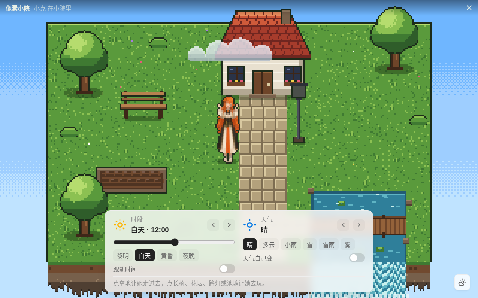
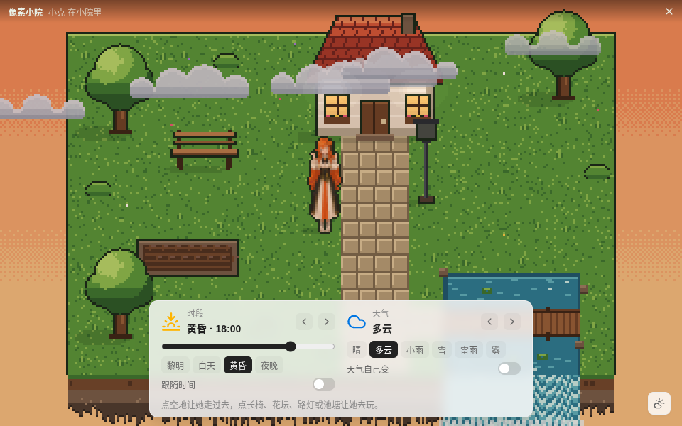
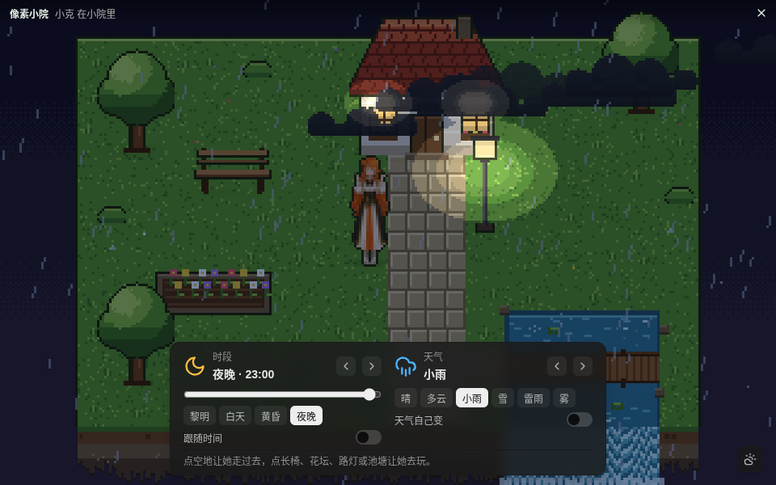
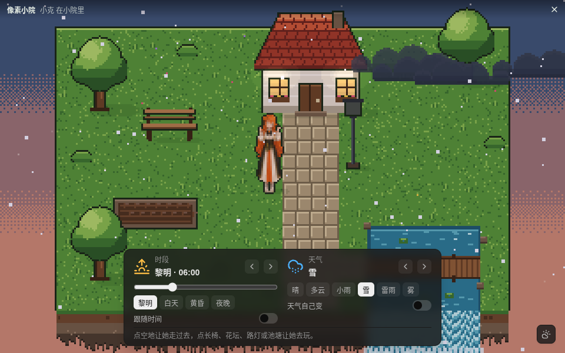

# 像素小院 · 验收报告（T-6157）

> 分支 `feat/pixel-scene`（PR：https://github.com/rdmclin2/lobehub-pixel-pet-affection/pull/145 ，`feat/pixel-scene` → `canary`，PR 描述内嵌下文全部截图和录屏 GIF）
> 日期 2026-11-05 · 环境 Ubuntu（Linux 6.8）、Xvfb 1280×800、Electron（Playwright `_electron` 驱动）、fake `lh`（不花 token）
> 按 [`.agents/acceptance/PROJECT.md`](../.agents/acceptance/PROJECT.md)：桌面应用用 `xvfb-run -a node e2e/run.js <scenario>` 驱动真实应用，每步结果写 `out/e2e/results.json`。

## 1. 逐条对照 Goal

| # | Goal 要求 | 结论 | 证据 |
| --- | --- | --- | --- |
| 1 | 像素风小游戏场景（参考帖子风格） | 达成 | 俯视像素庭院：小屋、大树、池塘瀑布、石板路、木桥、长椅、花坛、路灯；320×200 逻辑像素整数 3 倍放大、不平滑（e2e S2：`scale=3 canvas=960×600 smoothing=false uniformBlocks=1334/1334`）。参考分析见 [`pixel-scene-design.md`](pixel-scene-design.md)；截图见 §2 |
| 2 | 桌宠在场景里自由移动 / 交互 | 达成 | e2e S6 自主游走、S7 点空地走到该格、S8 长椅 / 花坛 / 路灯 / 池塘四种互动、S9 拖拽（§3 原始输出）；截图 `pos-left` `pos-right` `pos-front`、`act-touch` `act-bench` `act-water` `act-lamp`；录屏 0.8 s–26 s |
| 3 | 用户能调节时间（昼夜 / 时段） | 达成 | e2e S3：黎明 6.03h 亮度 106.5 / 白天 143.6 / 黄昏 130.3 / 夜晚 61.0（夜里路灯亮），滑块 18:30 → 「黄昏 · 18:30」；S4 跟随本机时间；录屏 26.2 s 起拖动滑块 06:00 → 21:00 |
| 4 | 用户能调节天气 | 达成 | e2e S5：晴 0 粒子 / 多云 6 朵云 / 小雨 156 雨线 / 雪 120 雪花 / 雷雨 / 雾，色调与亮度随之变化；S10 设置窗口改天气同步；S12 重启后保留；录屏 43.2 s 起 多云 → 小雨 → 雪 |
| 5 | 交付可运行的项目代码 | 达成 | `npm run start:no-sandbox` 在 xvfb 下启动，35 秒后仍在运行、SIGINT 退出 0；`npm test` 1026 项 0 失败；`npm run e2e -- scene` 13/13；`npm run e2e -- scenedocs` 4/4（§3） |
| 6 | 说明实现与运行方式的文档 | 达成 | [`pixel-scene.md`](pixel-scene.md)：§0 功能说明、§1 入口、§2 玩法、§3 时段与天气、§4 实现与文件说明、§5 运行与验证（`npm start` / e2e 命令）、§6 已知限制；README「像素小院」小节与 [`usage.md`](usage.md)「像素小院（她的家）」都链接到它 |
| 7 | 截图或录屏证明效果 | 达成 | `docs/img/pixel-scene/` 下 11 张截图 + `pixel-scene-demo.mp4`（H.264 960×600 20 fps 58.85 s）+ `.gif` + `.chapters.json`，均在 `pixel-scene.md` 引用 |

## 2. 截图与录屏

四种组合（她都站在画面中间的空地上）：

| 白天 · 晴 12:00 | 黄昏 · 多云 18:00 | 夜晚 · 小雨 23:00 | 雪天（黎明 06:00） |
| --- | --- | --- | --- |
|  |  |  |  |
| 天空蔚蓝、投影清晰、1 朵云 | 天空橙红、6 朵云两层、偏暗 | 深蓝夜空、155 根雨线、路灯和窗户暖光圈 | 120 片雪花、晨光偏粉冷 |

位置与互动：`pos-left.png`（左侧 (56,92)）、`pos-right.png`（右侧 (264,92)）、`pos-front.png`（路灯旁 (200,124)）；`act-touch.png`（点她，气泡「嗯？……头发里夹了书签吗？」）、`act-bench.png`（坐长椅）、`act-water.png`（浇花 `play`）、`act-lamp.png`（夜里拍路灯，灯 true → false）。

录屏 [`pixel-scene-demo.mp4`](img/pixel-scene/pixel-scene-demo.mp4)（生成方式：`e2e/pixel-scene-docs.js` 用 Playwright 在真实应用里点画布与「天色」卡片，同时 `ffmpeg -f x11grab -draw_mouse 1` 录 Xvfb 上小院窗口区域，含鼠标指针；GIF 由 ffmpeg palettegen/paletteuse 转出）。章节：

| 时间 | 画面 |
| --- | --- |
| 0.8 s | 白天 · 晴：不操作，她自己在小院里走动 |
| 9.8 s | 点空地：插一面小旗，她沿路走过去（手形指针可见） |
| 19.1 s | 点她：开心一下，头上出气泡 |
| 22.2 s | 点长椅：走过去坐下 |
| 26.2 s | 拖动时间滑块 06:00 → 21:00，天色由亮转暗，路灯与窗户亮起 |
| 43.2 s / 47.4 s / 51.6 s | 天气 多云 / 小雨 / 雪 |
| 55.8 s | 时段按钮「白天」：雪中的白天 |

```text
$ ffprobe -v error -show_entries format=duration,size,format_name:stream=codec_name,width,height,r_frame_rate,nb_frames -of default=nw=1 docs/img/pixel-scene/pixel-scene-demo.mp4
codec_name=h264
width=960
height=600
r_frame_rate=20/1
nb_frames=1177
format_name=mov,mp4,m4a,3gp,3g2,mj2
duration=58.850000
size=1461393
```

## 3. 按文档复现命令的原始输出

`npm start`（第一次，按文档 §5 第一条）——这台 Linux 的 `chrome-sandbox` 没有 setuid，Electron 按设计拒绝启动，正是文档写明要改用 `start:no-sandbox` 的情况：

```text
> pixel-pet-affection@0.24.0 prestart
> npm run build:admin
> pixel-pet-affection@0.24.0 build:admin
> vite build --config admin/vite.config.mjs
> pixel-pet-affection@0.24.0 start
> electron .
[1356666:1105/073836.987203:FATAL:sandbox/linux/suid/client/setuid_sandbox_host.cc:172] The SUID sandbox helper binary was found, but is not configured correctly. Rather than run without sandboxing I'm aborting now. You need to make sure that /home/ubuntu/develop/rdmclin2/lobehub-pixel-pet-affection-worktrees/t5081-motion-lib/node_modules/electron/dist/chrome-sandbox is owned by root and has mode 4755.
/home/ubuntu/develop/rdmclin2/lobehub-pixel-pet-affection-worktrees/t5081-motion-lib/node_modules/electron/dist/electron exited with signal SIGTRAP
EXIT=1
```

`npm run start:no-sandbox`（文档 §5 第二条；在 `xvfb-run -a -s "-screen 0 1280x800x24"` 里，带 fake `lh`：`LH_BIN=$PWD/test/fixtures/fake-lh.js FAKE_LH_DIR=… PIXELPET_DATA_DIR=…`；35 秒后截屏、检查进程，再对 electron 主进程发 SIGINT 结束——脚本里的 `pkill` 模式没匹配上，SIGINT 是随后手动 `kill -INT <pid>` 发出的）：

```text
- Adjust chunk size limit for this warning via build.chunkSizeWarningLimit.
✓ built in 1.46s
> pixel-pet-affection@0.24.0 start:no-sandbox
> electron . --no-sandbox
[vrm] motion library: dev /home/ubuntu/vrm-assets/baked-v2 — 294 clips (female 98, neutral 98, male 98), baked 2026-11-05T05:21:47.733Z
(electron) 'safeStorage.isEncryptionAvailable' is deprecated and will be removed. Please use 'safeStorage.isAsyncEncryptionAvailable' instead.
alive_after_35s=yes
npm_exit_after_SIGINT=0
```

35 秒时的屏幕：首启「开始之前」18+ 确认页（新数据目录的第一步），应用正常运行。

`npm test`：

```text
ℹ tests 1026
ℹ suites 0
ℹ pass 1023
ℹ fail 0
ℹ cancelled 0
ℹ skipped 3
ℹ todo 0
ℹ duration_ms 64643.756977
EXIT=0
```

`env -u ELECTRON_RUN_AS_NODE xvfb-run -a npm run e2e -- scene`：

```text
PASS  [scene] S1 入口：她的面板 ⌂ 打开像素小院，桌面上的她隐藏；托盘有「像素小院」 — tray=打开设置…/显示桌宠/像素小院/重置姿势/检查更新/退出 · scene visible=true · pet visible=false · source=panel
PASS  [scene] S2 像素渲染：整数缩放、不平滑、多图层；claude-pixel 精灵已加载 — scale=3 canvas=960×600 smoothing=false uniformBlocks=1334/1334 layers=sky>ground>waterfall>shadows>props+pet>clouds>particles>light>fireflies pet=sprites 43×53px
PASS  [scene] S3 时间调节：黎明 / 白天 / 黄昏 / 夜晚 时段按钮与连续滑块，天空、光照遮罩、灯光随之变化 — dawn: 6.03h K=0.375 sky=#435b7d lights=0.50 lamp=false bright=106.5 card=dark | day: 11.97h K=0 sky=#6fb6ff lights=0.00 lamp=false bright=143.5 card=light | dusk: 17.98h K=0.25 sky=#ef905c lights=0.30 lamp=false bright=130.1 card=light | night: 22.97h K=0.625 sky
PASS  [scene] S4 跟随系统时间：打开后小院时刻 = 本机时间；关掉后回到固定时刻 — follow on: hour=7.750 clock=7.722 （卡片「白天 · 07:43」） · chip 白天 → follow off, hour=11.97
PASS  [scene] S5 天气调节：晴 / 多云 / 小雨 / 雪（另有雷雨 / 雾），粒子与色调立即变化 — clear: rain=0 snow=0 clouds=1 tintK=0.00 bright=143.6 | cloudy: rain=0 snow=0 clouds=6 tintK=0.10 bright=136.5 | rain: rain=156 snow=0 clouds=8 tintK=0.18 bright=129.4 | snow: rain=0 snow=120 clouds=5 tintK=0.06 bright=146.3 | storm: rain=231 snow=6 clouds=10 tintK=0.28
PASS  [scene] S6 自主游走：没人点她，过一会儿她自己走到别处 — from (136,108) → (133,100) mode=wander state=walk walked=195
PASS  [scene] S7 点击目标点：点空地，她走过去（小旗），到达该格 — click (264,88) → mode goto/walk facing left → arrived tile 16,5 at (264,92)
PASS  [scene] S8 与物件互动：长椅坐下、花坛浇花、路灯开关、池塘看鱼 — 长椅: act=sit sitting=true state=idle at (96,76) | 花坛: watered before=false state=play → watered=true | 路灯: true → false (manual=false) | 池塘: act=look state=look | main 记录的互动：sit、sit、sit、water、lamp、look
PASS  [scene] S9 拖拽：按住她拖动 → 拎起，松手落在可走格 — lifted at (100,156) → dropped (100,156) tile 6,9
PASS  [scene] S10 切换宠物包：设置窗口换成 gemini-pixel，小院里的她同步；设置窗口改天气，小院跟着变 — pet url → gemini-pixel/sheets/daily.webp (43×53) · settings window scene.weather=snow → yard snow · back to claude-pixel
PASS  [scene] S11 Ctrl+Shift+H 关闭小院：桌面上的她回到原位 — scene visible=false pet visible=true bounds same=true closes=key
PASS  [scene] S12 持久化：小院时刻 23:00、雪 → 重启后保留；Ctrl+Shift+H 在桌宠窗口打开小院 — settings.json scene={"followClock":false,"hour":23,"weather":"snow","autoWeather":false} · after restart (Ctrl+Shift+H): hour=23 phase=night weather=snow snow=120 card=「夜晚 · 23:00」「雪」
PASS  [scene] S13 录屏：黎明 → 白天 → 黄昏 → 夜晚开灯 → 下雨 → 下雪 → 她坐到长椅上 — /home/ubuntu/develop/rdmclin2/lobehub-pixel-pet-affection-scene/out/e2e/pixel-scene/scene.webm (8302 KB) chapters=1.1s 黎明 / 3.8s 白天 / 6.8s 黄昏 / 9.8s 夜晚（路灯、窗户亮起，萤火虫） / 12.7s 小雨 / 17.5s 雪 / 22.2s 白天 · 晴，点长椅：她走过去坐下 / 29.9s 点空地：她走过去
13/13 passed
EXIT=0
```

`env -u ELECTRON_RUN_AS_NODE xvfb-run -a -s "-screen 0 1280x800x24" npm run e2e -- scenedocs`：

```text
PASS  [scenedocs] D1 四种时段 × 天气：白天晴 / 黄昏多云 / 夜晚小雨 / 雪天，她站在中间空地 — day-clear: 12.00h phase=day weather=clear rain=0 snow=0 clouds=1 bright=144.0 lamp=false pet=(152,108) happy | dusk-cloudy: 18.00h phase=dusk weather=cloudy rain=0 snow=0 clouds=6 bright=123.4 lamp=false pet=(152,108) happy | night-rain: 23.00h phase=night weather=rain rain=157 snow=0 clouds=8 bright=53.6 lamp=true pet=(152,108) happy | snow: 6.00h phase=dawn weather=snow rain=0 snow=120 clouds=5 bright=104.3 lamp=false pet=(152,108) happy
PASS  [scenedocs] D2 她在小院的不同位置：左侧、右侧、前景石板路旁（白天晴） — pos-left: (56,92) tile 3,5 | pos-right: (264,92) tile 16,5 | pos-front: (200,124) tile 12,7
PASS  [scenedocs] D3 她正在互动：点她出气泡、坐长椅、浇花、夜里拍路灯 — 点她: bubble「嗯？……头发里夹了书签吗？」 state=happy | 长椅: sitting | 花坛: water/play | 路灯: true → false
PASS  [scenedocs] D4 录屏（≥10 s，含鼠标指针）：自己走 → 点地走过去 → 点她 → 长椅 → 拖时间滑块 → 换天气 — mp4 58.850000s crop={"x":160,"y":100,"w":960,"h":600} chapters=0.8s 白天 · 晴：不操作，她自己在小院里走动 / 9.8s 点空地：插一面小旗，她沿路走过去 / 19.1s 点她：她开心一下，头上出气泡 / 22.2s 点长椅：她走过去坐下 / 26.2s 拖动时间滑块：06:00 → 21:00，天色由亮转暗，路灯与窗户亮起 / 43.2s 天气切换：多云 / 47.4s 天气切换：小雨 / 51.6s 天气切换：雪 / 55.8s 时段按钮「白天」：雪中的白天
4/4 passed
EXIT=0
```

## 4. 本轮改动与发现

- 第一次跑 `scene` 时 S8 / S9 随机失败：她「自己走动」时有 30% 会去用物件（自己浇了花、自己坐上长椅），而测试先断言「花还没浇」、并且只等 20 秒让她站起来；池塘「看」在互动结束（3 秒）后才记录到 main，测试读得太早。已改测试（`e2e/pixel-scene.js`），不改产品行为；改后 13/13。
- 新增 `e2e/pixel-scene-docs.js`（`npm run e2e -- scenedocs`）：可重复生成本文全部截图和录屏。
- Xvfb 下窗口不透明、没有窗口管理器边框，截图看不到真实桌面上的置顶 / 透明效果（PROJECT.md §6）。
