# 像素小院（像素风小游戏场景）· 使用与实现

> T-5550 · 分支 `feat/pixel-scene` · 方案见 [`pixel-scene-design.md`](pixel-scene-design.md)（T-5549）。
> 本文说明怎么打开、怎么玩、怎么调时段和天气、怎么实现、怎么运行和验证，以及已知限制。

## 0. 功能说明

像素小院是桌宠的「家」：一块 320×200 逻辑像素、整数倍放大的俯视像素庭院（小屋、大树、池塘与瀑布、石板路、木桥、长椅、花坛、路灯），画风参考像素风小游戏场景（参考分析见 [`pixel-scene-design.md`](pixel-scene-design.md)；所有像素由代码生成，不使用参考视频的素材）。

- **自由活动**：她在小院里自己游走；点空地她沿寻路走过去；点长椅、花坛、路灯、池塘她走过去互动；点她会开心并冒出台词气泡；按住可以拎起她放到别处。
- **时间调节**：「天色」卡片的滑块连续调 0:00–23:45，或一键切换 黎明 / 白天 / 黄昏 / 夜晚，也可以跟随本机时间；天空、光照、投影、路灯和窗户灯光随时段变化。
- **天气调节**：晴 / 多云 / 小雨 / 雪 / 雷雨 / 雾，切换时 3 秒淡入淡出，可以开「天气自己变」。
- 时段与天气保存在 `settings.json`，重启后保留；设置窗口里有同一组设置。

### 截图

四种时段 × 天气组合（同一位置的她，画面由 `node e2e/run.js scenedocs` 在真实应用里截取，窗口 960×600，3 倍放大）：

| 白天 · 晴（12:00） | 黄昏 · 多云（18:00） |
| --- | --- |
| 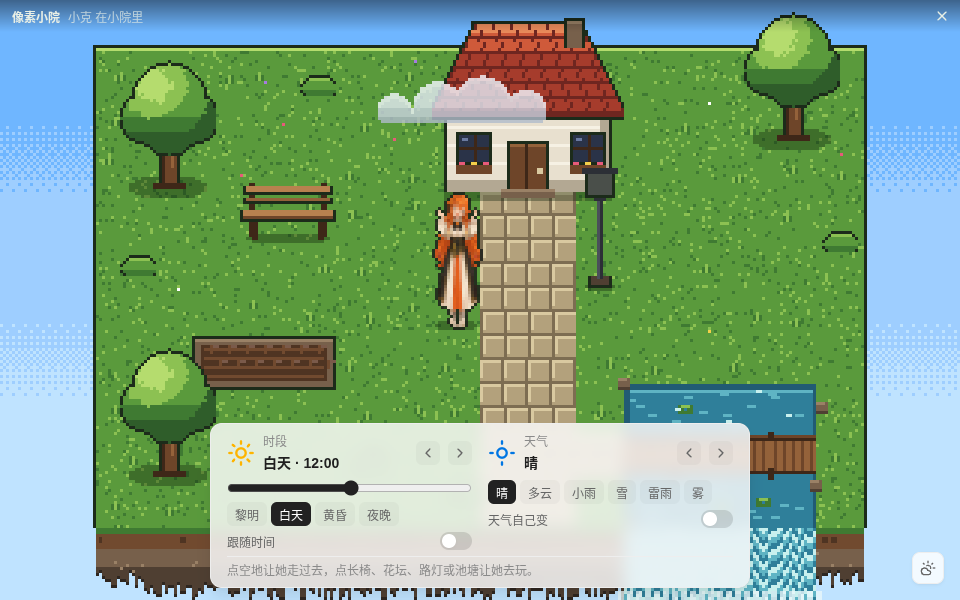 | 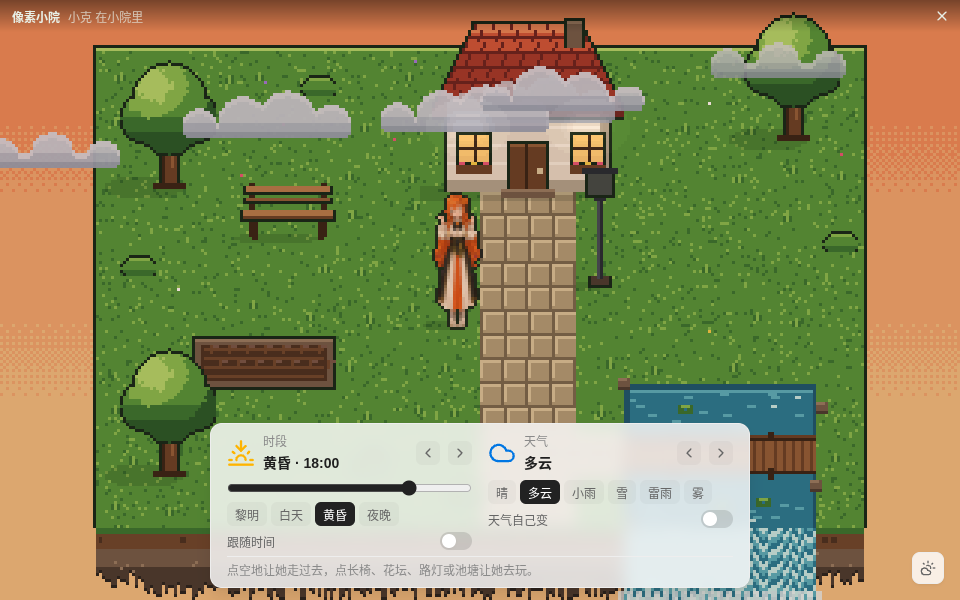 |
| **夜晚 · 小雨（23:00）** | **雪天（黎明 06:00 · 雪）** |
| 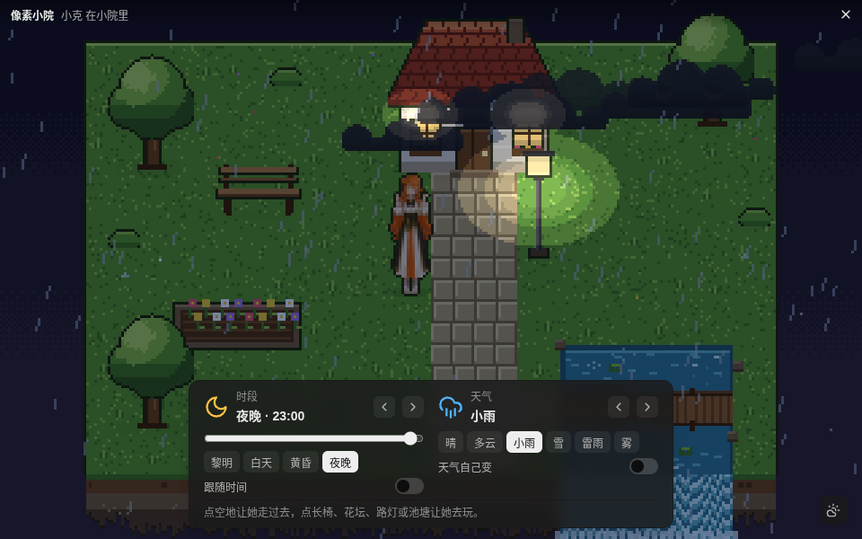 | 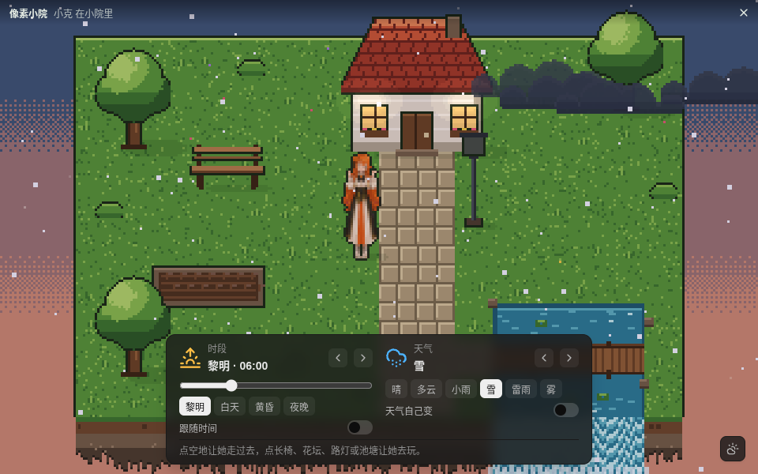 |

她在小院的不同位置（点空地后走到的地方）：

| 左侧长椅旁 | 右侧草地 | 石板路旁的路灯下 |
| --- | --- | --- |
| 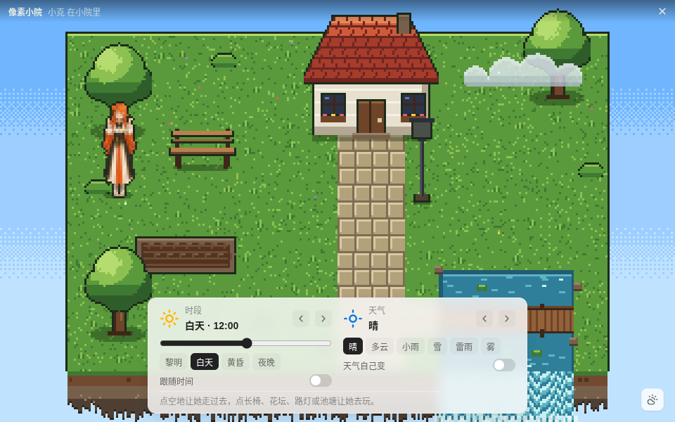 | 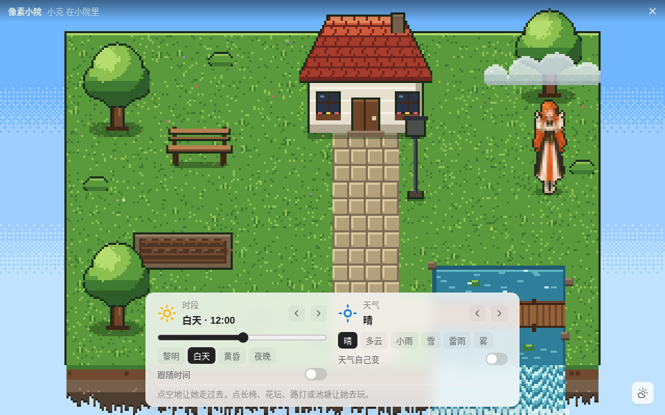 | 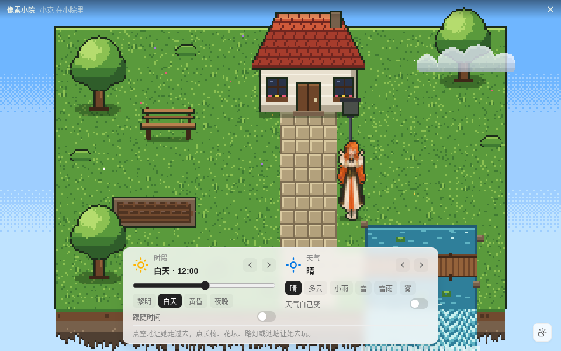 |

她正在互动：

| 点她：开心 + 台词气泡 | 点长椅：坐下 | 点花坛：浇花 | 夜里点路灯：拍一下开关灯 |
| --- | --- | --- | --- |
| 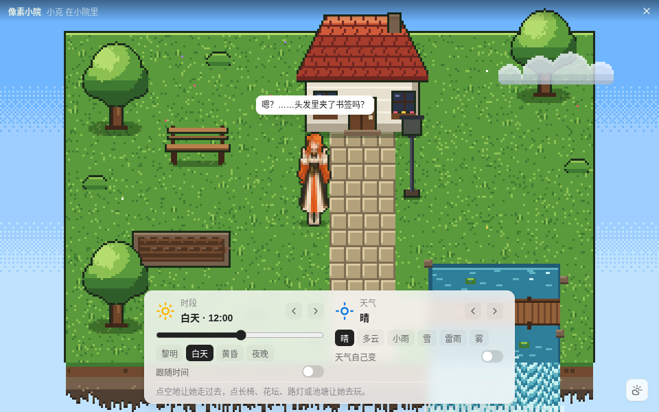 | 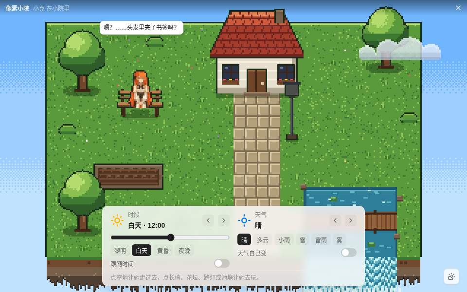 | 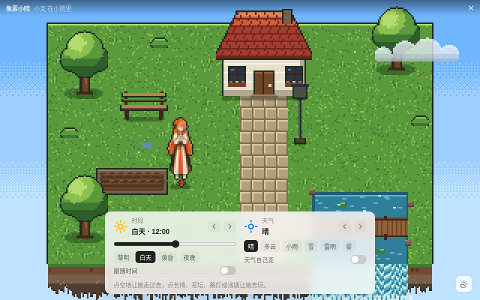 | 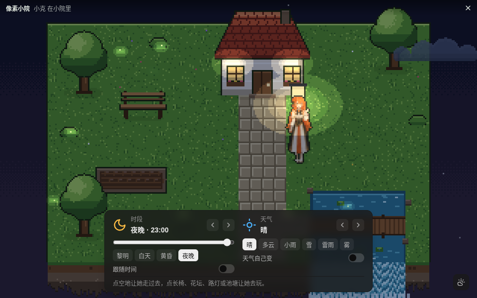 |

### 录屏

[`img/pixel-scene/pixel-scene-demo.mp4`](img/pixel-scene/pixel-scene-demo.mp4)（H.264，960×600，20 fps，约 59 秒，带鼠标指针；章节时间点见 [`pixel-scene-demo.chapters.json`](img/pixel-scene/pixel-scene-demo.chapters.json)）：她自己走动 → 点空地（小旗）她走过去 → 点她出气泡 → 点长椅坐下 → 拖动时间滑块 06:00 → 21:00 → 天气 多云 → 小雨 → 雪 → 切回白天。下面是同一段的 GIF（480 px 宽、10 fps）：

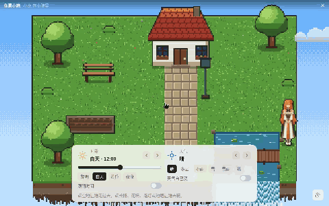

录屏的生成方式：`e2e/pixel-scene-docs.js` 用 Playwright 驱动真实应用（真实鼠标点击画布和「天色」卡片），同时用 `ffmpeg -f x11grab` 录下 Xvfb 屏幕上小院窗口所在的区域（含鼠标指针），再用 ffmpeg 转出 GIF。

## 1. 打开与关闭

小院是一个独立窗口（960×600，可调大小）。打开时桌面上的她「回家」：她的桌宠窗口隐藏，出现在小院里；关闭小院后她回到桌面原来的位置。

| 入口 | 操作 |
| --- | --- |
| 她的面板 | 右键她 → 面板底栏的 ⌂（像素小院） |
| 快捷键 | 桌宠窗口有焦点时按 `Ctrl/⌘ + Shift + H`；小院里再按一次（或 `Ctrl/⌘ + W`、右上角 ✕）关闭 |
| 托盘 | 托盘菜单「像素小院」（再点一次关闭） |

小院开着时，任何需要桌面上的她的入口（托盘「显示桌宠」、语音快捷键等，都经过 `showPet()`）会先关小院。

## 2. 怎么玩

- **她自己逛**：设置里「自己走动」（`prefs.roam`）开着时，她每隔 4–9 秒挑一处 3–6 格外的空地走过去，或者（30%）去用一个物件。
- **点空地**：插一面小旗，她沿 A* 寻出的路走过去（绕开小屋、大树、池水，走石板路和木桥），到了小旗消失。
- **点物件**（悬停时描白边、指针变手形）：
  | 物件 | 她做什么 | 画面反馈 |
  | --- | --- | --- |
  | 长椅 | 走过去坐下（只露腰以上，坐 20–40 秒；夜里坐久了会打盹 `sleep`） | — |
  | 花坛 | 浇花 2.5 秒（`play` 动作 + 洒水壶） | 花从蔫（褐色）变成开花（彩色、两帧摇摆），持续 10 分钟；下雨也算浇过 |
  | 路灯 | 走到灯下拍一下（`pat`） | 路灯开 / 关（闪两下）；手动开关保持到下一次天黑 / 天亮 |
  | 池塘 | 站在岸边看（`look`） | 水面泛起涟漪 |
- **点她**：原地开心一下（`happy` / `pat`），同时走一次桌宠的「摸摸」（`touch`），有台词时头上出气泡。
- **按住她拖动**：拎起（`lifted`），松手落到最近的可走格。

她的所有画面都是现有角色包里的动作（`walk` `idle` `play` `pat` `look` `lifted` `sleep` `happy`），缺的动作按 `core/fx.js` 的回落链降级，所以 5 个内置像素包都能进小院。换角色 / 换装（设置窗口 → 角色）后小院里的她立即重画。图片 / Live2D / VRM 外观在小院里是她的立绘「纸片人」，走路时一跳一跳。

## 3. 时段与天气（「天色」卡片）

卡片在画面下方中央，`Esc` 或右下角按钮收起 / 展开。卡片随时段变色：白天浅色、夜晚深色。

- **时段**：滑块 0–23:45 连续调节（15 分钟一档）；`黎明 06:00 / 白天 12:00 / 黄昏 18:00 / 夜晚 23:00` 四个按钮和 `‹ ›` 跳时段。时段切换约 1 秒平滑过渡，拖滑块时跟手。
  - 天空色带、整体光照（乘色遮罩，8 档量化）、投影浓淡和方向、窗户灯光、路灯、星星、萤火虫都随时段变化；路灯和窗户在夜里把周围「挖亮」成一圈一圈的暖光。
  - **跟随时间**：打开后小院时刻 = 这台电脑的时间；拖滑块或点时段按钮会自动关掉它。
- **天气**：晴 / 多云 / 小雨 / 雪 / 雷雨 / 雾，点了立即切换，旧天气 3 秒淡出、新天气 3 秒淡入：
  | 天气 | 画面 |
  | --- | --- |
  | 晴 | 一朵白云，夜里萤火虫 |
  | 多云 | 6 朵云两层视差，色调偏灰，投影变淡 |
  | 小雨 | 160 根斜雨线 + 落地溅点，池面涟漪，画面压暗偏蓝，花坛算浇过 |
  | 雪 | 120 片雪花正弦飘落，偏冷 |
  | 雷雨 | 260 根雨线，偶尔闪电白闪（系统「减少动态效果」时不闪） |
  | 雾 | 三条抖动边的雾带缓慢平移 |
  - **天气自己变**：每 8–20 分钟按马尔可夫表换一次（雪只在 11–2 月）；手动选天气会关掉它。

时段和天气存进 `settings.json` 的 `scene` 分组（`followClock` `hour` `weather` `autoWeather`），重启后保留。设置窗口 → 玩法 → 桌宠行为 → 「像素小院」卡片里是同一组设置，两边改动互相同步。

## 4. 实现

| 文件 | 作用 |
| --- | --- |
| `src/core/scene-time.js` | 时段表、6 个关键帧、`lightAt(t)`（smoothstep + 线性 RGB 插值 + 8 档量化）、`phaseOf` `clockHour` `formatHour` `stepPhase` `approachHour` |
| `src/core/scene-weather.js` | 6 种天气参数、`mixWeather`（淡入淡出混合）、马尔可夫 `nextWeather`、粒子步进 `stepParticles` |
| `src/core/scene-map.js` | 20×12 格地图、物件与阻挡、A* `findPath`、`smoothPath`、`nearestWalkable`、`propAt` |
| `src/core/scene-pet.js` | 她的状态机（idle / wander / goto / interact / lifted），时间与随机数由调用方注入 |
| `src/main/scene-window.js` | `SceneWindow`：建一次、之后显示 / 隐藏，打开时隐藏桌宠窗口、关闭时还原 |
| `src/main/scene-preload.js` | 小院页面的桥：`boot` `set` `touch` `act` `close`，`onSettings` `onView` |
| `src/renderer/scene/scene.html` `scene.css` | 页面与「天色」卡片（`--lobe-*` 令牌） |
| `src/renderer/scene/scene-art.js` | 调色板 + 代码生成全部 tile 和物件（不用图片文件，不含参考视频的任何像素） |
| `src/renderer/scene/scene.js` | 渲染循环（固定步长 1/30 s）、图层合成、整数缩放、输入换算、精灵预缩放、`window.__scene()` 调试读数 |

- **渲染**：Canvas 2D，逻辑分辨率 320×200，图层从下到上：天空色带（Bayer 抖动）→ 地面 + 瀑布 + 池面闪光 → 投影 → 物件和她（按脚点 y 排序，她能走到树后面）→ 云 → 雨 / 雪 → 光照遮罩（`multiply`，光源 `destination-out` 三圈挖亮，再 `lighter` 叠暖光）→ 萤火虫 / 雾 / 闪电。最后整数倍（`floor(min(W/320, H/200))`）放大到屏幕 canvas，`imageSmoothingEnabled = false`，四周留黑边。
- **她的精灵**：通过 `pack:` 协议取当前外观的精灵图，按待机帧的不透明区域把她缩到 44 逻辑像素高（先 4× 平滑缩放再到 1×，alpha 50% 阈值去毛边，加 1 px 深色描边）。朝左时镜像。
- **设置**：`src/core/settings.js` `SCENE` / `normalizeScene`，`settings-schema.js` 四个字段（页面 `behavior`，卡片「像素小院」），小院窗口改动走 `scene:set` → schema `validate` → `PetService.setSection('scene')` → 广播。
- **入口接线**：`src/main/main.js`（托盘项、`Ctrl/⌘+Shift+H`、`showPet()` 先关小院、IPC `scene-open` / `scene:*` / `debug-scene*`）、`src/renderer/panel/panel.html`（⌂ 按钮）、`src/renderer/app.js`（合成按键的回落）。

## 5. 运行与验证

前置：Node.js 20+、npm；Linux 无显示器时需要 `xvfb`（`sudo apt-get install -y xvfb`），重新生成录屏还需要 `ffmpeg`。

```bash
npm install                     # 首次；postinstall 会确认 Electron 二进制
npm start                       # 启动桌宠（prestart 先构建设置窗口）；右键她 → ⌂ 打开小院
npm run start:no-sandbox        # Linux 从源码运行、chrome-sandbox 没有 setuid 时
xvfb-run -a npm run start:no-sandbox   # 没有显示器的 Linux
```

不想登录 LobeHub 也能试：用测试里的假 `lh`（不联网、不花 token）：

```bash
LH_BIN="$PWD/test/fixtures/fake-lh.js" FAKE_LH_DIR=/tmp/fake-lh PIXELPET_DATA_DIR=/tmp/pp-demo npm start
```

测试与 e2e（`npm run e2e` 即 `node e2e/run.js`，后面跟场景名；不要跑 `all`，它包含花 token 的 `live`）：

```bash
npm test                                                                  # 单测，含 test/scene-*.test.js 与 settings 新用例
env -u ELECTRON_RUN_AS_NODE xvfb-run -a npm run e2e -- scene              # 小院 e2e 13 步（fake lh，不花 token）
env -u ELECTRON_RUN_AS_NODE xvfb-run -a -s "-screen 0 1280x800x24" npm run e2e -- scenedocs   # 重新生成本文的截图与录屏（docs/img/pixel-scene/，需要 ffmpeg）
env -u ELECTRON_RUN_AS_NODE xvfb-run -a -s "-screen 0 1280x800x24" npm run e2e -- scenerec    # 整屏录屏：桌面上的她 → 面板 ⌂ → 小院 → 关闭（out/e2e/pixel-scene-rec/）
```

`env -u ELECTRON_RUN_AS_NODE` 只在从 Electron 宿主（如某些编辑器终端）里运行时需要；普通终端里可以省略。每一步的结果写进 `out/e2e/results.json`。

`e2e/pixel-scene.js` 的 13 步：入口与桌宠隐藏、整数缩放（逐块同色检查）、四个时段与滑块（亮度 白天 > 黎明 / 黄昏 > 夜晚，夜里路灯亮）、跟随时间、六种天气（粒子数、云数、色调）、自主游走、点地走过去、四个物件互动、拖拽、换角色同步与设置窗口改天气同步、`Ctrl+Shift+H` 关闭并回到原位、重启后保留、一段录屏。截图与录屏在 `out/e2e/pixel-scene/`（`scene.webm` + `scene.chapters.json`）。

`e2e/pixel-scene-docs.js`（场景 `scenedocs`）产出本文的图：`day-clear` `dusk-cloudy` `night-rain` `snow`（四种组合）、`pos-left` `pos-right` `pos-front`（不同位置）、`act-touch` `act-bench` `act-water` `act-lamp`（互动）和 `pixel-scene-demo.mp4` / `.gif` / `.chapters.json`。

## 6. 已知限制

- **只有一张地图**：20×12 格的固定庭院，没有多场景、镜头移动或地图编辑；寻路按格走（A*），不会跳跃或游泳。
- **没有音效**：小院里没有环境音（雨声、虫鸣），雷雨只有闪电白闪；系统开了「减少动态效果」时雨雪粒子减半、不闪电。
- **雪只在冬天自己出现**：「天气自己变」只在 11–2 月切到雪；手动选雪不受月份限制。
- **非像素外观是纸片人**：图片 / Live2D / VRM 外观在小院里显示为她的立绘缩小版，走路时一跳一跳，没有逐帧走路动画。
- **小院互动不加好感**：互动只在 main 里记录（`debug-scene` 可读），点她走的是现有「摸摸」，好感规则不变。
- **窗口状态不落盘**：「天色」卡片收起与否、小院窗口的位置和大小只在本次运行内记住。
- **没有对外接口**：方案里标为可选的 `POST /pixel-pet/scene` 没有做。
- **Xvfb 下的画面**：无头 Linux 下（e2e、截图）窗口不透明、没有窗口管理器边框；截图里看不到真实桌面上的置顶 / 透明效果。

## 7. 和方案的差异


- 设置窗口没有单独的「像素小院」页：四个设置放在 玩法 → 桌宠行为 的「像素小院」卡片里（通用表单渲染，不改设置窗口代码）；`scene.panelOpen` / `scene.bounds` 没有落盘（卡片收起和窗口位置只在本次运行内记住）。
- 对外接口 `POST /pixel-pet/scene`（方案里标为可选）没有做。
- 小院里的互动只记录在 main（`debug-scene` 可读），不额外加好感；点她走的是现有 `touch`，好感规则不变。
