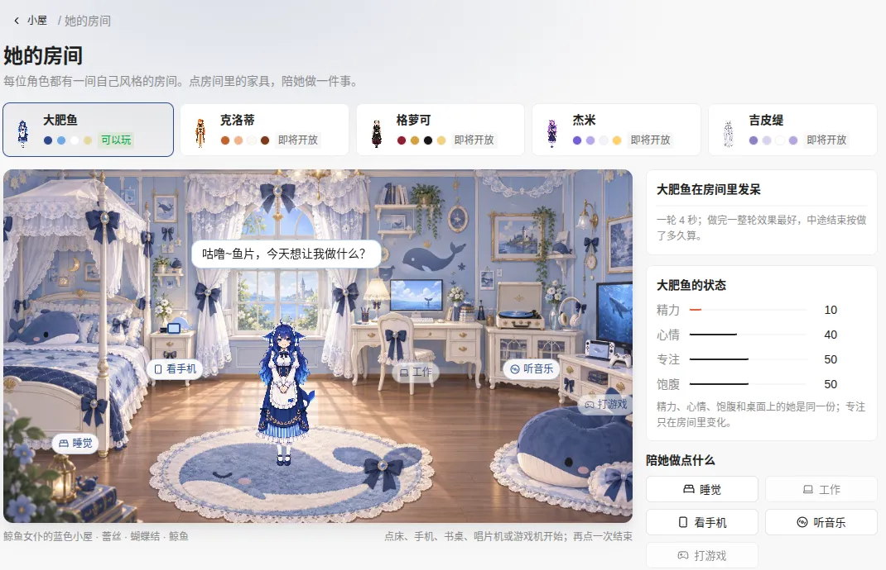
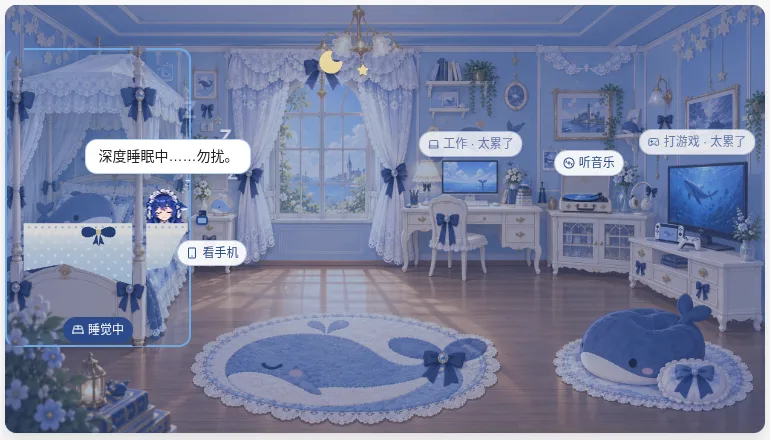
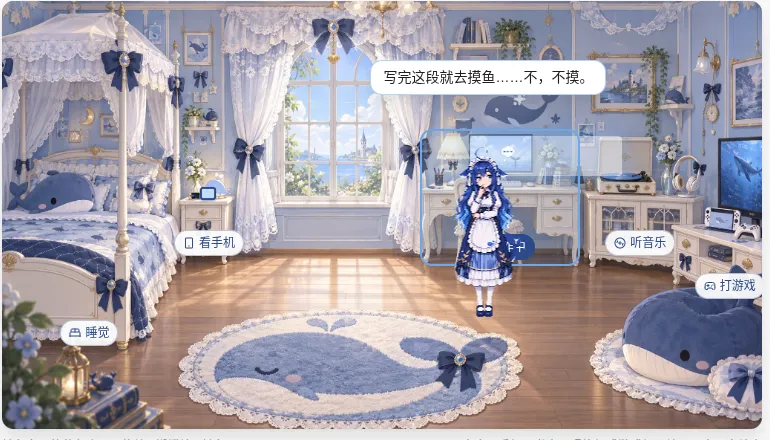
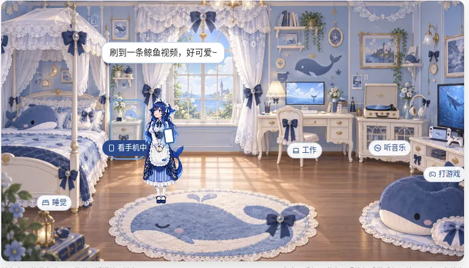
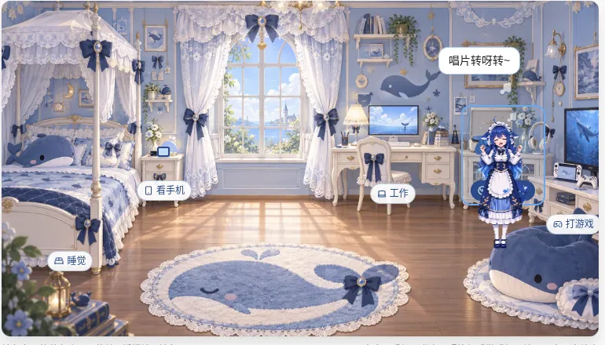
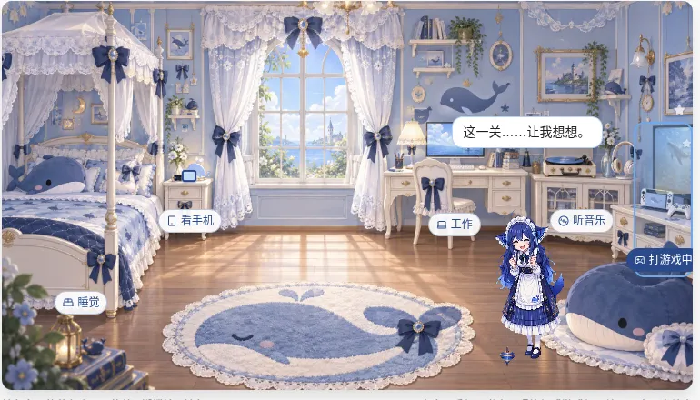
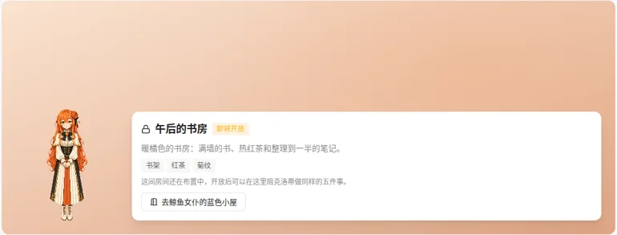

# 房间小游戏（她的房间）

> 设置窗口 → **小屋 → 她的房间**（`#/room`）。每位默认角色有一间自己风格的房间，你可以在房间里陪她做五件事：**睡觉、工作、看手机、听音乐、打游戏**。每件事都有可点的家具、进行中的画面和计时，结束后改变她的精力、心情、专注和饱腹。这些数值会保存下来，重启后还在。
> 本轮开放的是 **大肥鱼的「鲸鱼女仆的蓝色小屋」**：浅蓝和奶白配色，有蕾丝床幔、蝴蝶结和鲸鱼抱枕，大肥鱼穿着招牌女仆装。另外四位角色的房间可以切换过去预览，状态是「即将开放」。（T-6174）



| 睡觉（床） | 工作（书桌和电脑） | 看手机（手机） |
| --- | --- | --- |
|  |  |  |
| **听音乐（唱片机）** | **打游戏（游戏机）** | **切换房间类型：即将开放** |
|  |  |  |

## 1. 怎么玩

1. 进入：设置窗口 → 小屋。英雄区的 **去她的房间**，或下面的「她的房间」卡片（卡片上有房间缩略图；她正在做事时显示「正在睡觉」等）。
2. **切换房间类型**：页面顶部是房间选择器，每位角色一张卡片（她的小立绘、房间配色、「可以玩」或「即将开放」）。点一张卡片就切换，你的选择会保存；第一次打开时显示当前陪你的角色的房间。即将开放的房间显示一张预览卡：房间名、简介、元素标签、她的立绘（和选择器卡片上同一套像素形象，没遇见过她也显示立绘，不是剪影），以及「去鲸鱼女仆的蓝色小屋」按钮。预览不会是空白，也不会报错。
3. **开始一件事**：点房间里的家具（床、床头柜上的手机、书桌和电脑、唱片机、游戏机），或者点右侧「陪她做点什么」里的按钮。每个家具上有一个标签，例如「睡觉」，进行中会变成「睡觉中」。标签画在她上面一层，她走到哪里都挡不住标签；书桌、唱片机和游戏机的标签在家具上沿，床和手机的在下沿。
4. **进行中能看到的变化**：
   - 她走到对应的位置，播放对应的动作（复用像素包里的动作帧，见 §3）。
   - 房间里的道具会变：
     - 睡觉：房间变暗、月亮和星星出来；她躺进床里，盖上一床贴着床面的浅蓝被子（奶白蕾丝翻边、海军蓝蝴蝶结，只盖在床垫上，不超出床），被子上只露出她的头、鲸鱼鳍耳和女仆头饰，床尾板和床柱画在被子前面；飘出 Z。
     - 工作：显示器屏幕上是一页文档，一行一行打出来（一轮写 5 行，正在写的那行有光标，写到第几行就是这一轮的进度）；右侧计时下面也写着「显示器上写好了 2 / 5 行，第 3 行正在打字」。
     - 看手机：手机从床头柜到了她手里，屏幕亮着。
     - 听音乐：唱片转起来、飘出音符。
     - 打游戏：电视完整在画面里，屏幕上是一个小横版游戏（鲸鱼跳过金币，地面在滚动，顶上的进度条就是这一轮的进度）；她站在电视柜前，冒星星。
   - 她头上有台词气泡，每 5 秒换一句。
   - 右侧「正在睡觉 00:12 / 00:20」计时和进度条。
5. **结束**：一轮（默认 20 秒）做完会自动结算，并提示「睡觉完成：精力 +35，心情 +6，专注 +8，饱腹 -4」；也可以点「结束睡觉」、再点一次同一个家具提前结束；或者直接点另一个家具，前一件事会先结算再开始新的。提前结束按做了多久算，最少算四分之一轮。
6. **太累了**：精力低于 15 时，工作和打游戏的按钮和家具都是灰的。原因直接写在页面上：右侧「陪她做点什么」下面是「大肥鱼太累了（精力 10，要 15 才行）：工作和打游戏先不能做。点床让她睡一觉就好。」，房间里这两个家具的标签变成「工作 · 太累了」「打游戏 · 太累了」（悬停提示也还在）。睡一觉就能做了。

## 2. 数值与对应关系

右侧「大肥鱼的状态」显示四个数值（0–100），每个数值右边是上一件事带来的变化：

| 房间里的名字 | 存在哪 | 和已有数据的关系 |
| --- | --- | --- |
| 精力 | `pet.characters[base].energy` | 就是桌宠原有的精力（她的面板、玩法页的「精力」，`pet-state.js` 里随时间下降、睡着时恢复） |
| 心情 | `pet.characters[base].mood` | 就是桌宠原有的心情（影响好感加成、`currentStatus` 的开心 / 委屈） |
| 饱腹 | `100 - pet.characters[base].hunger` | 桌宠原有的饥饿值反过来显示（玩法页的「饱腹」也是这样显示） |
| 专注 | `pet.characters[base].room.focus` | 房间新增的数值，只有房间里的活动会改变它，初始 50 |

一轮做完的效果（`src/core/room.js` `ACTIVITIES`；提前结束按比例算）：

| 活动 | 家具 | 她的动作 | 精力 | 心情 | 专注 | 饱腹 | 开始条件 |
| --- | --- | --- | --- | --- | --- | --- | --- |
| 睡觉 | 床 | `sleep` | +35 | +6 | +8 | −4 | — |
| 工作 | 书桌和电脑 | `think` | −12 | −5 | +28 | −8 | 精力 ≥ 15 |
| 看手机 | 手机 | `look` | −4 | +14 | −10 | — | — |
| 听音乐 | 唱片机 | `happy` | +6 | +16 | +6 | — | — |
| 打游戏 | 游戏机 | `play` | −14 | +22 | −6 | −8 | 精力 ≥ 15 |

- 打游戏做完一整轮，按桌面上的「玩耍」算一次好感（同样有冷却和每日上限，见 `affection.js` 的 `play`）。
- 在房间里活动不会让桌面上的她进入「睡着」状态（不影响点她、吵醒扣好感）；只有房间里自己的数值在变化。当前陪你的就是这间房间的主人时，开始一件事也会让桌面上的她做同样的动作。
- 数值和房间记录跟桌宠存档放在同一个 `pet.json` 里。正在进行的活动也会保存：关掉窗口或应用再打开，计时接着走；关得比一轮还久的，下次启动应用时直接按一整轮结算（主进程启动时就结算，`RoomService.settleDue`，不用先打开房间页；打游戏也照常计好感），打开房间会看到「上一件：睡觉（完成）」。

## 3. 美术

- **房间背景**：`src/renderer/rooms/dafeiyu/room.webp`（2048 × 1152）。2026-11-05 用 LobeHub 的 `gpt-image-2.5-sunburst` 生成（`lh generate image -m gpt-image-2.5-sunburst -p lobehub --param size=2048x1152 --param quality=high`），提示词在同目录的 `prompt.txt`：浅蓝墙面（#6FA8E8）、奶白家具（#FFFFFF）、深蓝点缀（#2C4A8A）、浅金描边（#E8D6A0），蕾丝床幔和窗帘、海军蓝蝴蝶结、鲸鱼抱枕、鲸鱼墙贴、鲸鱼地毯和鲸鱼懒人沙发。画面里没有人物、没有文字。第一张图右边的电视被画面边缘裁掉一半，所以又用同一个模型以第一张图为唯一参考图编辑了一次（`--param imageUrls=[<第一张图>]`，第二段提示词也在 `prompt.txt`）：镜头稍微拉远，电视、电视柜和游戏机完整入画，懒人沙发挪到电视柜左前方。用 ffmpeg 转成 WebP。许可见 [NOTICE.md](../NOTICE.md)。
- **角色**：大肥鱼的像素包 `dafeiyu-pixel` 的招牌女仆装 `sheets/daily.webp`，用 `SpriteStage` 播放（和小屋、角色图鉴同一套代码）。五件事复用已有动作帧：睡觉 `sleep`（闭眼；躺进床里时只画出她的头和肩，下面由被子盖住），工作 `think`，看手机 `look`，听音乐 `happy`，打游戏 `play`。本轮没有新生成动作帧。
- **睡觉的被子**：一个 SVG 图层，坐标用画面像素（主题的 `bed`）：`blanket` 是盖在床垫上的被子（浅蓝渐变 + 奶白波点，上沿是奶白蕾丝翻边和一个海军蓝蝴蝶结，在她肩膀处微微隆起）；`front` 是床尾板和两根床柱，从背景图里按多边形裁出来，重新画在她和被子上面（同样压上夜色），所以她是「躺在床里」，不是贴在床上。她本人用 `tucked` 位置：下巴对齐被子上沿，只露出头、鲸鱼鳍耳和女仆头饰。
- **其他道具变化**：显示器（屏幕上逐行打字的文档）、唱片（平放的唱片按透视压扁后旋转）、电视（屏幕上的小游戏）、手机、夜色、音符、星星和 Z 是叠在背景上的图层（`admin/src/console/stage/RoomScene.tsx`），颜色来自主题色板（CSS 变量 `--room-primary / --room-accent / --room-base / --room-trim`），不是界面令牌。它们属于角色美术，和舞台一样放在 `stage/` 下，按 `product.md` 放行动效时长检查。

## 4. 数据模型

| 位置 | 内容 |
| --- | --- |
| `src/core/room.js` | 纯函数：`ACTIVITIES`（五件事：标签、家具、动作、每轮效果、开始条件）、`THEMES`（每位默认角色一个主题）、`start / settle / view / catalog`。每个函数都显式传入 `now`，方便测试 |
| `src/main/room-service.js` | `RoomService`，挂在 `PetService` 上：选中的房间、房间主人（主题对应的角色，遇见过才能玩）、开始和结束、打游戏计好感，保存后推送给设置窗口 |
| `src/main/main.js` | IPC：`room-state`、`room-theme`、`room-start`、`room-stop`（只接受设置窗口）；`adminState().room`。e2e 用 `PIXELPET_ROOM_ROUND_MS` 缩短一轮（只在测试模式生效） |
| `src/main/admin-preload.js` | `petAdmin.room.{state, setTheme, start, stop}` |
| `admin/src/console/pages/Room.tsx` | 页面：房间选择器、房间、正在做的事、状态、活动按钮、预览卡 |
| `admin/src/console/stage/RoomScene.tsx` | 房间画面：背景、家具热点、她的位置与动作、道具图层、台词气泡 |

存档（`pet.json`）：

```jsonc
{
  "roomTheme": "dafeiyu",            // 最后选的房间类型（存档级）
  "characters": {
    "dafeiyu": {
      "energy": 45, "mood": 46, "hunger": 54,   // 原有数值，房间直接改它们
      "room": {
        "focus": 58,                            // 专注
        "activity": { "kind": "work", "startedAt": 1762345678901 },  // 正在做的事，没有时为 null
        "last": { "kind": "sleep", "complete": true, "fraction": 1, "deltas": { "energy": 35, "mood": 6, "focus": 8, "fullness": -4 }, "line": "咕噜~睡饱了，精神满满！", "at": 1762345670000 },
        "totals": { "sleep": { "count": 1, "completed": 1, "ms": 20000 } }   // 每件事做过几次、完成几次、累计时长
      }
    }
  }
}
```

主题条目（`THEMES` 里的一项）：

```js
{
  id: 'dafeiyu', character: 'dafeiyu',          // 房间 id 与房间主人（src/characters/<id>.json）
  name: '鲸鱼女仆的蓝色小屋', status: 'open',     // open = 可以玩；soon = 即将开放（只显示预览卡）
  blurb: '…', motifs: ['蕾丝', '蝴蝶结', '鲸鱼'],
  palette: { primary: '#2C4A8A', accent: '#6FA8E8', base: '#FFFFFF', trim: '#E8D6A0' },
  outfit: 'daily',                               // 她在房间里穿哪套（像素包 outfits 的 id）
  art: { background: 'rooms/dafeiyu/room.webp', width: 2048, height: 1152 },  // 相对 src/renderer/
  hotspots: { bed: { label: '床', x, y, w, h }, phone, desk: { …, chip: 'top' }, music, game },  // 家具热点，占画面的 %；chip: 'top' = 标签在家具上沿（她站的地方挡不到）
  spots: { idle: { x, y, h }, sleep: { x, y, h, tucked: true }, work: { x, y, h, bubble: { x, y } }, phone, music, game },  // 她的位置（脚下）与身高 %；tucked = 盖在被子里（y 是被子上沿 = 她的下巴）；bubble = 台词气泡的位置（不在头顶时）
  props: { monitor, record, tv, phone },         // 会变化的道具框（%）：显示器屏幕、唱片、电视屏幕、床头柜上的手机
  bed: { blanket: [[x, y], …], front: [[[x, y], …], …], bow: [x, y] },  // 画面像素：被子多边形（前两个点是蕾丝上沿）、画在她前面的床尾和床柱、蝴蝶结位置
  lines: { idle: [...], sleep: { doing: [...], done: '…' }, … },  // 她的台词；缺的用 room.js 的 LINES
}
```

## 5. 给其余四位角色做房间

克洛蒂（午后的书房）、格萝可（深夜的古堡房间）、杰米（星星猫窝）、吉皮缇（白龙的花园卧室）已经有主题条目：名字、简介、元素和色板，状态是 `soon`。开放其中一间：

1. **画背景**：照 `src/renderer/rooms/dafeiyu/prompt.txt` 的格式写她的提示词（正面视角，家具贴着后墙排在一条地平线上：床 + 床头柜上的手机、书桌和电脑、放唱片机的矮柜、电视和游戏机，中间留出空地，没有人物和文字），用 `lh generate image -m gpt-image-2.5-sunburst -p lobehub --param size=2048x1152 --param quality=high "<提示词>"` 生成，转成 WebP 放到 `src/renderer/rooms/<id>/room.webp`，提示词存为同目录的 `prompt.txt`。
2. **量坐标**：把图缩到 1024 宽看，按画面百分比填 `hotspots`（五个家具）、`spots`（她站在哪、多高；床上是 `tucked: true`，y 填被子上沿）和 `props`（显示器屏幕、唱片、电视屏幕、手机的框，只框屏幕本身）；再按原图像素填 `bed`（床垫上被子的多边形、床尾板和床柱的多边形）。用 `ffmpeg -i room.webp -vf drawgrid=w=50:h=50 grid.png` 画网格量最方便。她站的位置不要挡住显示器、唱片、电视和家具标签（e2e 会检查标签不在她身上）。
3. **补条目**：在 `THEMES` 里给她加 `art`、`outfit`（她像素包里的服饰 id）、`hotspots`、`spots`、`props`、`lines`，把 `status` 改成 `'open'`。
4. **验证**：`npm test`（`test/room.test.js` 会检查每个 open 主题的图存在、每件事都有家具和位置、热点不超出画面、动作在她的像素包里）；再按 §6 跑 e2e 截图看位置。
5. **许可**：在 [NOTICE.md](../NOTICE.md) 和 [characters.md](characters.md) 她的小节里写上房间图的来源。

不需要改页面代码：选择器、预览卡和房间画面都由主题数据生成。

## 6. 验证

```bash
npm test                                  # 含 test/room.test.js：主题、五件事、结算、存档、重启后读回
npm run typecheck:admin && npm run lint:design
xvfb-run -a node e2e/run.js room          # 真实 Electron：截图在 out/e2e/room/，录屏在 out/e2e/room/video/
npm run demo -- --character dafeiyu       # 离线 demo：右键她 → ⚙ 设置 → 小屋 → 去她的房间
```

e2e `room` 场景（`e2e/room.js`，一轮缩短到 4 秒）：R1 小屋里的入口 → R2 房间画面（背景加载、女仆装 sheet 已画出、5 个热点、5 种房间）→ R3 依次切换五种房间类型（四个即将开放的都显示预览和她的立绘、不是剪影、没有报错、选择保存进 `pet.json`）→ R4 精力 10 时工作 / 打游戏不可点，原因写在页面上（面板里的提示和「太累了」标签）→ R5 五件事各做一整轮（她的动作、道具、计时、台词、进度；每件事都检查家具标签不在她身上、画在她上面且在画面内；睡觉的被子在床的范围内、她的头露在被子上面；工作的显示器上写好的行数在增加；打游戏的电视完整在画面内、屏幕上有游戏、她在电视前面；数值按上表的方向变化，屏幕显示和 `pet.json` 一致）→ R10 中途切换和提前结束按比例结算 → R11 重启后房间、数值和统计都还在 → R12 睡觉时关掉应用超过一整轮再打开：还没打开房间页，`pet.json` 里就已经按一整轮结算（精力 +35、心情 +6、专注 +8、饱腹 −4，允许关机那几秒的自然衰减 ±1），打开房间显示「睡觉（完成）」。
