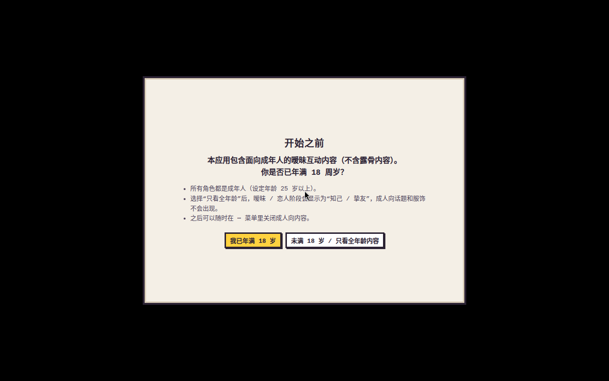

# T-1229 未完成功能盘点、可运行性修复与消息数据流

分支：`feat/t-1229-complete-runnable`（基于 `master` `b65b519`）。本文回答四件事：仓库里还有哪些没做完、哪些挡住了运行、怎么从干净 clone 装好并启动、现有测试和冒烟的真实结果，以及聊天消息现在怎么流动、存在哪里（给下一步“聊天记录”功能用）。

结论先说：`master` 的功能本身是完整的，代码里没有 TODO / FIXME，也没有未合并的功能分支。挡住“干净 clone 直接跑起来、测试全过”的有两处，本分支都修了：

1. **e2e `roster` 场景在 master 上 15 / 206 步失败**：`96d7ccc`（互动语音）新增了两个设置开关，roster 的期望列表没跟着改。已修，206 / 206 通过。
2. **Linux 从源码 `npm start` 直接崩溃**（Chromium SUID 沙盒），而且没有不登录 LobeHub 就能直接看到桌宠的命令。新增 `npm run start:no-sandbox` 和 `npm run demo`。

## 一、未完成功能清单及处理结果

盘点来源：`README.md`、`AGENTS.md`、`docs/`（`affection-design.md`、`dsh-pet-gap.md`、`usage.md`、`characters.md`、`tts-voice-research.md`、`compliance-review.md`）、`e2e/acceptance-proposal.md`；`grep -rn "TODO\|FIXME\|XXX\|HACK\|未实现\|待实现"` 覆盖 `src e2e test scripts docs README.md`（**0 处**）；`git branch -r --no-merged origin/master`（只有 3 个 `evidence/*` 截图分支，没有功能分支）；以及实际安装、启动、跑全部测试。

“运行必需”指不处理就装不上、起不来，或者现有测试 / 冒烟不过。

| # | 项目 | 来源 | 运行必需？ | 处理结果 |
| --- | --- | --- | --- | --- |
| 1 | `e2e/run.js roster` 的 N8 仍断言旧的 7 个“桌宠行为”开关；`96d7ccc` 加了 `voiceInteractions`（默认开）和 `voiceMurmurs`（默认关）。N8 先断言失败，就没去打开“点击音效 / 朗读回复”，所以 N9（点击音效）、N11（朗读）跟着失败。5 个角色 × 3 = 15 步失败 | 实跑 `xvfb-run -a node e2e/run.js roster` | 是（现有冒烟不过） | **已修复**（`668b0df`）：期望列表补上两个开关。修复前 191/206，修复后 206/206（见第三节） |
| 2 | Linux 从源码 `npm start` 直接退出：`chrome-sandbox is owned by root and has mode 4755`，`SIGTRAP`。`node_modules` 里的沙盒助手不可能是 setuid root | 实跑 `npm start`（输出见第二节） | 是（Linux 起不来） | **已修复**（`e43d8ea`）：新增 `npm run start:no-sandbox`；`docs/usage.md`“二、运行”写明 `xvfb-run -a npm run start:no-sandbox`。`npm start` 不变，保留 macOS / Windows 和已设好权限的 Linux 的沙盒 |
| 3 | 没有“一条命令直接看到桌宠”的方式：文档里的假 `lh` 试玩还要手动过 18+ 确认、选角、唤醒，在无显示器机器上没法点 | `docs/usage.md` 原“不连 LobeHub 试玩” | 是（无显示器环境验证启动） | **已补齐**（`e43d8ea`）：`scripts/demo.js` + `npm run demo`。用测试的假 `lh` 在 `<tmp>/pixel-pet-demo` 准备好存档（18+ 按“只看全年龄”回答，用应用自己的 `PetService.hatch` 唤醒克洛蒂），然后启动 Electron；支持 `--character`、`--name`、`--fresh`、`--data`。单测 `test/demo.test.js` |
| 4 | Windows 安装包只检查了构建产物，没在真机运行 | `e2e/acceptance-proposal.md` | 否 | **暂缓**：本机是 Linux，没有 Windows 真机；CI（`.github/workflows/release.yml`）照常构建 |
| 5 | `e2e/update-smoke.js` 在 Linux 上什么也不检查 | 源码：只处理 `darwin`、`win32` | 否 | **暂缓**：它校验 macOS zip 替换和 Windows `latest.yml`，按设计在 release CI 的对应平台跑。Linux 改为验证 `npm run dist:linux` 能打包（第三节） |
| 6 | e2e `live`、`e2e/stage-reply-live.js`、`e2e/adversarial-live.js` | `AGENTS.md`、`docs/usage.md` | 否 | **未运行，原因明确**：会用真实 `lh` 登录创建并删除真实 agent，消耗 token（`AGENTS.md`：避免 `all`，因为它包含 `live`）。其余 17 个离线场景全部跑过 |
| 7 | D32 聊天窗口（完整历史） | `docs/dsh-pet-gap.md` D32 | 否 | **暂缓，交给下一任务**：本任务不做聊天记录；现有数据流见第四节 |
| 8 | D9 其余约 80 段大肥鱼专属视频、D20 每只独立 agent 的完整多开、D21 弹簧跟手、D22 物理参数设置页、D23 跨屏飞行、D29 截屏、D33 快捷键 / 斜杠命令、D34 模型分别设置、D36 工具级工作状态、D37 系统通知、D38 余额档位、D40–D44 | `docs/dsh-pet-gap.md` | 否 | **暂缓，沿用原文档的理由**：都是 dsh-pet 对照里明确“不移植 / 不适用”的设计决定（缺素材、缺数据源如 `lh` 没有额度接口、平台限制、隐私等），不是半成品 |
| 9 | `npm install` 提示 `electron-winstaller` 的 install script 没在 allowScripts 里 | npm 11 安装输出 | 否 | **不处理**：只在打 Windows 包时用；Linux 安装、启动、`dist:linux` 都不受影响 |
| 10 | 第一次启动 Electron 时下载二进制（`Downloading Electron binary...`） | 安装 / 启动输出 | 否 | **不处理**：electron 45 的正常行为，需要能联网；文档已写明 |

## 二、安装与启动

需要 Node.js 20+（本次用 v24.21.0 / npm 11.19.0）。Linux 无显示器时用 `xvfb-run`。

```bash
git clone -b feat/t-1229-complete-runnable https://github.com/rdmclin2/lobehub-pixel-pet-affection.git
cd lobehub-pixel-pet-affection
npm install

# 不登录 LobeHub，直接启动到一只已唤醒的桌宠（假 lh，离线）
npm run demo                     # 有桌面
xvfb-run -a npm run demo         # Linux 无显示器

# 正常启动（真实 lh；首次启动走 18+ 确认 → 选角 → 唤醒）
npm start                        # macOS / Windows / 已设好沙盒权限的 Linux
npm run start:no-sandbox         # Linux 从源码
xvfb-run -a npm run start:no-sandbox
```

### 干净 clone 的原始输出

以下来自一个全新目录：`/tmp/t1229/clean`，clone 的是已推送的分支。

```text
$ git clone -b feat/t-1229-complete-runnable https://github.com/rdmclin2/lobehub-pixel-pet-affection.git
exit=0
$ git log --oneline -3
e43d8ea ✨ feat(dev): npm run demo starts straight on a hatched pet; npm run start:no-sandbox
668b0df ✅ test(e2e): roster N8 expects the 互动语音 / 朗读碎碎念 switches added in 96d7ccc
b65b519 Merge pull request #46 from rdmclin2/feat/walk-cycle
$ node -v && npm -v
v24.21.0
11.19.0
$ npm install
npm warn deprecated inflight@1.0.6: ...
npm warn deprecated rimraf@2.6.3: Rimraf versions prior to v4 are no longer supported
npm warn deprecated lodash.isequal@4.5.0: ...
npm warn deprecated glob@7.2.3: Glob versions prior to v9 are no longer supported
npm warn deprecated boolean@3.2.0: ...

added 290 packages, and audited 291 packages in 3s

47 packages are looking for funding
  run `npm fund` for details

found 0 vulnerabilities
npm warn install-scripts 1 package has install scripts not yet covered by allowScripts:
npm warn install-scripts   electron-winstaller@5.4.0 (install: node ./script/select-7z-arch.js)
exit=0
```

`xvfb-run -a -s "-screen 0 1280x800x24"` 内启动，45 秒后用 `ffmpeg -f x11grab` 截整个 X 屏幕，然后按 PID 结束应用：

```text
$ DISPLAY=:108 npm run demo

> pixel-pet-affection@0.9.0 demo
> node scripts/demo.js

[demo] data: /tmp/pixel-pet-demo (hatched claude); lh: fake (offline)
Downloading Electron binary...
(electron) 'safeStorage.isEncryptionAvailable' is deprecated and will be removed. Please use 'safeStorage.isAsyncEncryptionAvailable' instead.
--- screen grabbed after 45s; app still running: yes
[61635:...:ERROR:ui/gfx/x/connection.cc:64] X connection error received.     ← 截图后 xvfb 关闭时的正常输出
```


放大右下角（透明窗口，xvfb 没有合成器，所以背景是黑色）：


```text
$ DISPLAY=:108 npm run start:no-sandbox

> pixel-pet-affection@0.9.0 start:no-sandbox
> electron . --no-sandbox

(electron) 'safeStorage.isEncryptionAvailable' is deprecated and will be removed. Please use 'safeStorage.isAsyncEncryptionAvailable' instead.
--- screen grabbed after 12s; app still running: yes
```



e2e `fresh` 在同一个干净 clone 上唤醒后，悬停显示的控制条（喂食 / 玩耍 / 睡觉 / 聊天 / 话题 / 衣柜 / ⋯）：


修复前，Linux 上 `npm start`（不带 `--no-sandbox`）的输出：

```text
$ xvfb-run -a npm start

> pixel-pet-affection@0.9.0 start
> electron .

[59462:1030/151439.012622:FATAL:sandbox/linux/suid/client/setuid_sandbox_host.cc:172] The SUID sandbox helper binary was found, but is not configured correctly. Rather than run without sandboxing I'm aborting now. You need to make sure that <repo>/node_modules/electron/dist/chrome-sandbox is owned by root and has mode 4755.
<repo>/node_modules/electron/dist/electron exited with signal SIGTRAP
exit=1
```

## 三、测试与冒烟

| 命令 | 结果 | 说明 |
| --- | --- | --- |
| `npm test` | **321 / 321 通过**（26 个测试文件；master 上 320，加上新增的 `test/demo.test.js`） | 干净 clone 上同样 321 / 321 |
| `xvfb-run -a node e2e/run.js <场景>`，17 个离线场景逐个跑 | **修复后全部通过**；roster 修复前 191 / 206 | 见下表 |
| `xvfb-run -a node e2e/run.js live` | 未运行 | 真实 LobeHub agent，消耗 token（第一节 #6） |
| `node e2e/update-smoke.js dist` | 输出 `[update-smoke] nothing to check on linux` | 按设计只在 macOS / Windows 上检查（第一节 #5） |
| `npm run dist:linux` | exit 0，用时 3 分 35 秒，生成 `dist/PixelPetAffection-0.9.0-linux-x64.tar.gz`（135 MB） | 验证 Linux 打包 |

`npm test` 原始输出（尾部）：

```text
✔ on quit the swap happens without reopening; a failed swap keeps the old app (18.266412ms)
✔ a test feed replaces GitHub for both the update files and the latest-release lookup (0.277842ms)
ℹ tests 321
ℹ suites 0
ℹ pass 321
ℹ fail 0
ℹ cancelled 0
ℹ skipped 0
ℹ todo 0
ℹ duration_ms 61226.196109
exit=0
```

e2e 场景逐个运行（`for s in …; do timeout 1500 xvfb-run -a node e2e/run.js $s; done`），每行取自该场景日志的最后一行：

```text
fresh      exit=0   13s  14/14 passed
wardrobe   exit=0   15s  13/13 passed
migrate    exit=0    4s  2/2 passed
characters exit=0    5s  7/7 passed
dafeiyu    exit=0    6s  6/6 passed
busy       exit=0   49s  15/15 passed     (busy + longreply + daemon + oldlh)
space      exit=0    9s  3/3 passed
advanced   exit=0    9s  6/6 passed
packs      exit=0   26s  6/6 passed
models     exit=0    6s  5/5 passed
update     exit=0    6s  2/2 passed
art        exit=0    9s  2/2 passed
roster     exit=1  584s  191/206 passed   ← master，修复前
touch      exit=0  240s  27/27 passed
voice      exit=0   18s  14/14 passed
ivoice     exit=0   93s  15/15 passed
chatvoice  exit=0   38s  5/5 passed
roster     exit=0  576s  206/206 passed   ← 本分支，修复后
```

roster 修复前的全部失败（`master` `b65b519`，每行截到 200 字符）：

```text
FAIL  [roster-dafeiyu] N8 settings: 桌宠行为 switches (roam on, sound / voice off, memes and collisions on by default) — Expected values to be strictly deep-equal: + actual - expected   [     'r
FAIL  [roster-dafeiyu] N9 click sound when she is clicked (setting on) — page.waitForFunction: Timeout 3000ms exceeded.
FAIL  [roster-dafeiyu] N11 voice: her reply is read aloud with her own pitch and pace — an utterance was queued
FAIL  [roster-claude] N8 settings: ...（同上）
FAIL  [roster-claude] N9 click sound when she is clicked (setting on) — page.waitForFunction: Timeout 3000ms exceeded.
FAIL  [roster-claude] N11 voice: her reply is read aloud with her own pitch and pace — an utterance was queued
FAIL  [roster-grok]   N8 / N9 / N11（同上）
FAIL  [roster-gemini] N8 / N9 / N11（同上）
FAIL  [roster-gpt]    N8 / N9 / N11（同上）
```

修复后同样三步（节选两个角色，其余三个相同）：

```text
PASS  [roster-dafeiyu] N8 settings: 桌宠行为 switches (roam on, sound / voice off, 互动语音 on, 朗读碎碎念 off, memes and collisions on by default) — roam=on, clickSound=off, voice=off, voiceInteractions=on, voiceMurmurs=off, memes=on, collide=o…
PASS  [roster-dafeiyu] N9 click sound when she is clicked (setting on) — pop played (0 → 1)
PASS  [roster-dafeiyu] N11 voice: her reply is read aloud with her own pitch and pace — speechSynthesis.speak("echo: 看这个") lang zh-CN, pitch 1.35, rate 1; system voices here: 0 (none — this Linux box has no speech engine), status done
PASS  [roster-gpt] N8 settings: … voiceInteractions=on, voiceMurmurs=off, memes=on, collide=on, t…
PASS  [roster-gpt] N9 click sound when she is clicked (setting on) — pop played (0 → 1)
PASS  [roster-gpt] N11 voice: … speechSynthesis.speak("echo: 看这个") lang zh-CN, pitch 1.1, rate 1; …, status done
206/206 passed
```

干净 clone 上的 `fresh` 冒烟：

```text
$ xvfb-run -a node e2e/run.js fresh
PASS  [fresh] first launch shows the five model-chan
PASS  [fresh] choosing a character enables waking her and shows who she is
PASS  [fresh] hatching invokes lh login and shows the device code
PASS  [fresh] after login the agent is created and the pet appears — greeting: echo: [事件] 你和主人第一次见面，礼貌地自我介绍一下。
PASS  [fresh] CLI call order was whoami -> login -> workspaces -> agent create -> connect device -> bind -> models -> set model -> agent run
PASS  [fresh] restart goes straight to the pet (state persisted, no onboarding)
PASS  [fresh] at rest only the pet is shown, with no buttons, bars or text box — window 268x388
PASS  [fresh] hovering the pet reveals the controls and moving away hides them again
PASS  [fresh] feeding lowers hunger and shows food — hunger 80 -> 45
PASS  [fresh] affection crossing 15 by a pat moves the stage from 陌生 to 熟悉 and unlocks topics — …
PASS  [fresh] topics: a locked topic returns its unlock condition, an unlocked one is sent to the agent with [话题] — …
PASS  [fresh] restart keeps affection, stage and unlocked topics — after restart: 小蓝 · 格萝可 · 熟悉 ♥17 · 距「亲近」18
PASS  [fresh] without an 18+ answer the adult switch is off and only reopens the same 18+ confirmation
PASS  [fresh] release deletes the agent through lh and returns to character selection

14/14 passed
exit=0
```

## 四、现有聊天 / 对话数据流

行号以本分支为准（`src/` 本分支没有改动，与 `master` `b65b519` 相同）。

### 4.1 用户主动输入：renderer → main → LLM

| 步骤 | 位置 |
| --- | --- |
| 聊天框回车触发 `send` | `src/renderer/app.js:1533`（`keydown` Enter）→ `send()` `src/renderer/app.js:1508` |
| 调 preload 暴露的 `window.pet.chat(text, imgs, files)` | `src/renderer/app.js:1524` |
| preload：`ipcRenderer.invoke('chat', { text, images, files })` | `src/main/preload.js:35` |
| main：`ipcMain.handle('chat', …)`，图片写到临时文件，拖入的文件只传路径 | `src/main/main.js:251`，调 `service.chat(...)` 在 `:256` |
| `PetService.chat()`：busy 检查、`state.touch`、`_ensureReady` | `src/main/pet-service.js:561` |
| 有图片时先 `lh file upload`，再在话题里建一条用户消息并挂图 | `src/main/pet-service.js:579-585`；`src/core/lh-client.js:268`（`createTopic`）、`:275`（`createUserMessage`） |
| 拼 prompt：状态块 + 可选本机提示 + **用户原文（没有标记）** | `src/core/persona.js:149-151`（`buildChatPrompt`），调用在 `src/main/pet-service.js:590` |
| 调 LLM：`lh agent run -a <agentId> -p <prompt> --json [-t <topicId>]` | `src/main/pet-service.js:591` → `src/core/lh-client.js:362-363`（`run`），子进程 `spawn` 在 `src/core/lh-client.js:46` |
| 回复：记下 `topicId`、加好感、内容守卫、`_say(text, 'llm', 'chat')` | `src/main/pet-service.js:592-595` |
| `_say` 发 `say` 事件并保存 | `src/main/pet-service.js:159-167` |
| main 把 `say` 转给窗口 | `src/main/main.js:413` |
| renderer 显示气泡（只写 DOM `textContent`）并朗读 | `src/renderer/app.js:2059` → `say()` `src/renderer/app.js:1131` |

另外两条也会走 `service.chat()`，`_say` 时同样是 `kind: 'chat'`：

- 本机 HTTP 接口 `POST /pixel-pet/chat`：`src/core/api.js:72-75` → `src/main/main.js:445`（`chat: (text) => service.chat(text, [], [])`）。它是外部脚本发起的，不是用户在聊天框里打的字，但现在和聊天框**没有字段区分**。
- 用户点话题面板里的一个话题：`src/renderer/app.js:1126` → `src/main/preload.js:19` → `src/main/main.js:214` → `PetService.talkTopic()` `src/main/pet-service.js:631`。prompt 是 `[话题] <标题>：<话题 prompt>`（`src/core/persona.js:129-131`），回复 `_say(text, 'llm', 'topic:<id>')`（`src/main/pet-service.js:650`）。由用户点选发起，但正文是预设的话题 prompt。

### 4.2 系统发起的消息

| 触发 | 产生位置 | 调 LLM？ | `say` 的 `source` / `kind` |
| --- | --- | --- | --- |
| 心跳定时器（30 秒；测试模式不启动） | `src/main/main.js:22`（`HEARTBEAT_MS`）、`:452`（`setInterval`）→ `PetService.heartbeat()` `src/main/pet-service.js:894` | — | — |
| 主动搭话：饿了 / 无聊 / 早晨问候 / 晚上问候 | 决策 `src/core/proactive.js:22-39`（`nextEvent`：12 分钟冷却，`hunger ≥ 75` → `hungry`，闲置 45 分钟 50% → `bored`，6–11 点 `greet_morning`，20–23 点 `greet_evening`，每天一次）；调用 `src/main/pet-service.js:905-906` | 是，`_speak(kind)` `src/main/pet-service.js:519`；prompt `[事件] …`（`src/core/persona.js:123-126`，调用在 `pet-service.js:537`）。每小时最多 6 次（`proactive.js:42-54` `LlmBudget`），超出或忙时用离线台词 | `llm` 或 `fallback` / `hungry`、`bored`、`greet_morning`、`greet_evening` |
| 离开一段时间回来（好感衰减） | `src/main/pet-service.js:905`（`lost > 0 ? 'missed'`） | 是（同上） | `missed` |
| 睡醒 | `src/main/pet-service.js:903` | 否 | `fallback` / `woke`（直接 `emit`，不经 `_say`） |
| 初次见面 / 切换到新角色 | `src/main/pet-service.js:231`（`hatch`）、`:493`（`switchCharacter`） | 是 | `met` |
| 关系升级 | `src/main/pet-service.js:626`（`_onStageUp`） | 是 | `stage_up` |
| 角色下线提示 | `src/main/pet-service.js:437-442` | 否 | `fallback` / `retired` |
| 喂食 / 摸摸 / 玩耍 / 哄睡（按钮） | `src/renderer/app.js:1415` → `src/main/main.js:212` → `PetService.act()` `src/main/pet-service.js:816`，台词 `:835` | 否（离线台词，`proactive.js:58-75` `fallbackLine` / `fallbackPool`） | `fallback` / `feed`、`pat`、`play`、`sleep` |
| 部位触摸（情绪反应） | `src/renderer/app.js:1773` → `src/main/main.js:213` → `PetService.touch()` `src/main/pet-service.js:846`，台词 `:863` | 否 | `fallback` / `touch:<部位>` |
| 本机 HTTP 接口 `POST /pixel-pet/say` | `src/core/api.js:56-57` → `src/main/main.js:442` → `sayExternal` `src/main/pet-service.js:757-760` | 否 | `api` / `api` |
| renderer 自己的提示语（出错、忙、取消、本机能力等） | 例如 `src/renderer/app.js:1525-1530` 直接调本地 `say()` | 否 | 不经过 main |

### 4.3 是否持久化、存在哪里

- **本地不保存任何消息正文。** `src/core/store.js:7-25` 的 `Store` 只把整个存档原子写到 `<userData>/pet.json`（`src/main/main.js:425`；`userData` 可用 `PIXELPET_DATA_DIR` 改，`src/main/main.js:25`）。存档里每个角色只有 `agentId`、`topicId`、状态数值和 `lastSpokeAt` 等时间戳（`src/core/pet-state.js:25-46` `createPet`），没有消息数组。`_save()`（`src/main/pet-service.js:141-143`）每次 `_say` 后都会调用，但只更新这些字段。
- **renderer 也不保存**：气泡只写 DOM（`src/renderer/app.js:1131-1137`），`src/renderer/*.js` 里没有 `localStorage` / `sessionStorage` / `indexedDB`。
- **`pixel-pet.log`**（`src/main/main.js:72-80`）只记错误，不记消息。
- **唯一的消息记录在 LobeHub 服务端**：每次 `lh agent run` 都带同一个角色的 `-t <topicId>`（`src/core/lh-client.js:362-364`），所以这个话题里**混着**三类轮次：用户聊天（状态块 + 原文）、`[话题] …`、系统事件 `[事件] …`（主动搭话、问候、`missed`、`met`、`stage_up`）。e2e 的假 `lh` 会回显 prompt，可以直接看到标记，例如 `echo: [事件] 你和主人第一次见面，礼貌地自我介绍一下。`（第三节 `fresh` 输出）。不调 LLM 的离线台词（触摸、喂食、睡醒、`api say`、预算用完时的 fallback）不进 LobeHub，也不在本地，**现在不在任何地方留存**。

给下一任务（只看用户主动发起的聊天记录）的提示：现成的区分点是 `PetService._say` 的 `source` / `kind`（`chat`、`topic:*`、各事件 kind），以及发往 LobeHub 的 prompt 前缀（用户聊天没有 `[事件]` / `[话题]` 标记）。但 `api /chat` 和聊天框都是 `kind: 'chat'`，如果要排除外部接口，需要先在 `chat()` 里加来源字段。

## 五、本分支改动

| 提交 | 文件 | 内容 |
| --- | --- | --- |
| `668b0df` | `e2e/run.js` | roster N8 期望列表补上 `voiceInteractions=on`、`voiceMurmurs=off`（第一节 #1） |
| `e43d8ea` | `scripts/demo.js`、`test/demo.test.js`、`package.json`、`docs/usage.md`、`README.md` | `npm run demo`、`npm run start:no-sandbox` 和对应文档、单测（第一节 #2、#3） |
| 本文所在提交 | `docs/t-1229-runnable-audit.md`、`docs/img/t-1229/*.png` | 本文与截图 |
