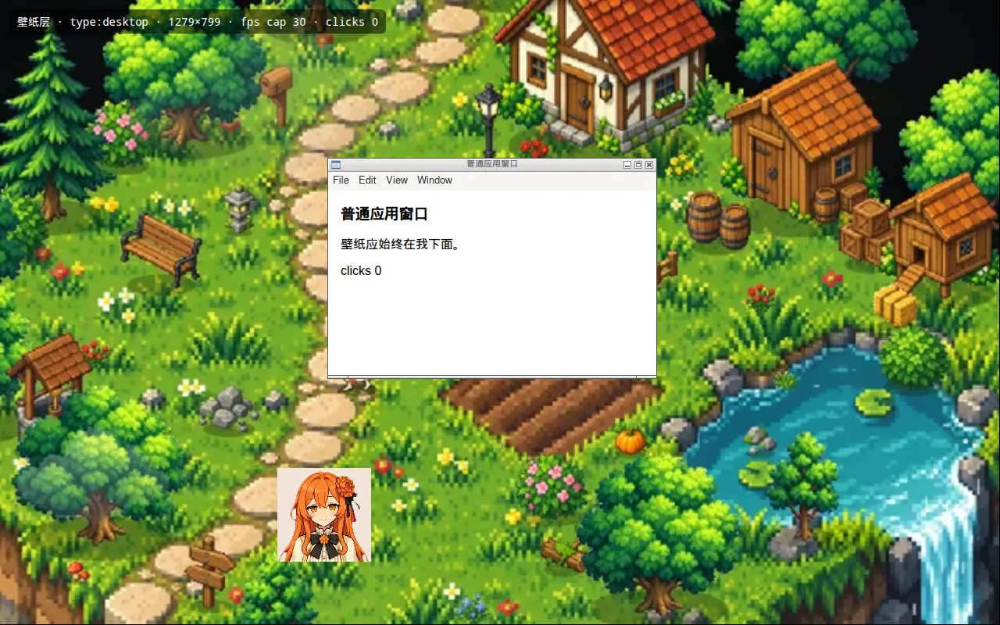
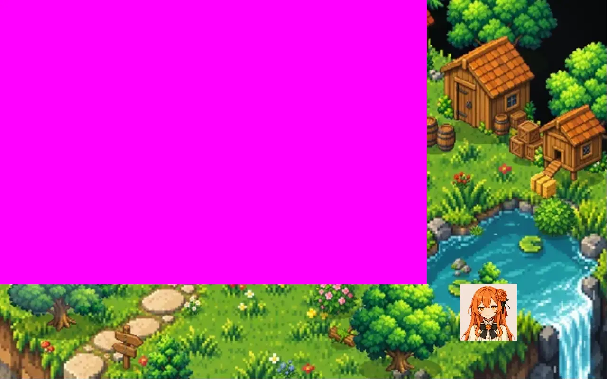
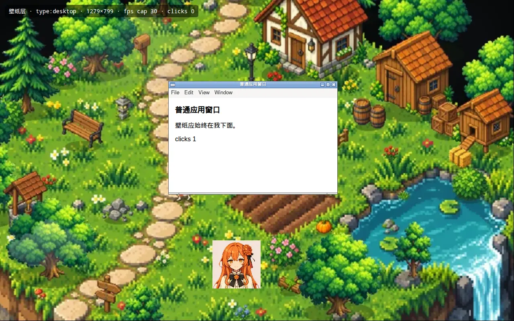
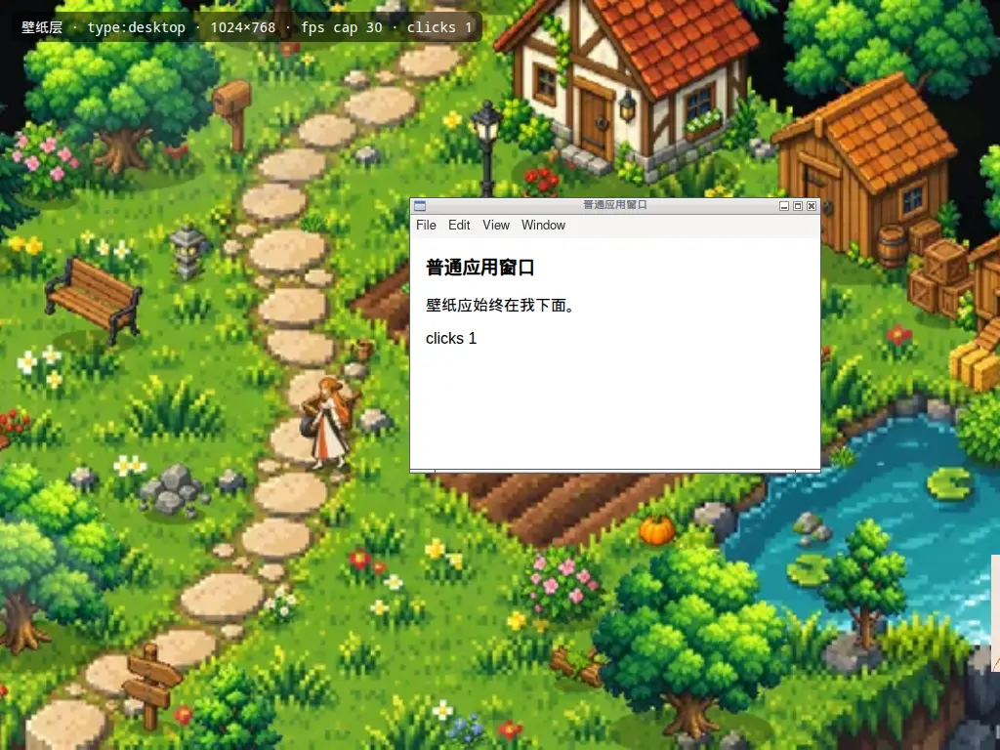

# 桌面壁纸模式（设计）：平台挂载方案与「壁纸包」格式

> 目标：让她「住」在桌面背景里，像 Wallpaper Engine（<https://www.wallpaperengine.io/>）那样做成一张会动的壁纸。桌面图标和所有窗口都在她上面，日常操作不受影响。壁纸和小游戏一样，在 商店 里下载、安装、更新。
> 本文是设计，不含产品代码。Linux 的选型已用探针在本机 X11 上验证（[§6.1](#61-本机已跑的探针linux-x11)，`scripts/wallpaper-probe/`）。Windows 和 macOS 的选型都写定了，需要在真机上验证的项目、判据和证据形式列在 [§6.2](#62-真机矩阵windows--macos--linux-桌面环境)。
> 相关：[mini-games.md](mini-games.md)（游戏包、商店、下载器）、[pixel-room.md](pixel-room.md)、[illustrated-room.md](illustrated-room.md)。任务描述里的 `docs/room.md` 在 canary 上不存在，房间类游戏的文档就是这两份。

## 0. 结论一览

| 平台 | 选型（核心路径） | 降级 | 交互 |
| --- | --- | --- | --- |
| Windows 10 / 11 | 随应用发布一个小的 **Win32 helper exe**（C，不是 Node 原生模块，在 CI 里编译、签名）。helper 给 Progman 发 `0x052C` 生成 WorkerW，再把壁纸窗口 `SetParent` 进图标层后面那个 WorkerW。24H2 的新窗口结构单独处理（§1.1）。 | helper 启动失败、被拦或找不到 WorkerW：不进壁纸模式，她留在桌面，弹窗写明原因。不用 PowerShell 兜底（§1.1.3）。 | 壁纸收不到鼠标，图标照常可点；用热键或托盘叫她出来 |
| macOS 12+ | `BrowserWindow({ type: 'desktop' })`，窗口层级为 `kCGDesktopWindowLevel - 1`，在 Finder 桌面图标下面。再调 `setVisibleOnAllWorkspaces(true)` 让它出现在每个 Space，并设 `focusable: false`。 | `type: 'desktop'` 不生效时（自检不过）改用**静态壁纸**：用 NSWorkspace 把她此刻的画面设成桌面图片（§1.2）。 | 同上（desktop 级窗口本来就收不到焦点、键盘和鼠标） |
| Linux X11 | `BrowserWindow({ type: 'desktop' })` 会给窗口设 `_NET_WM_WINDOW_TYPE_DESKTOP`，由窗口管理器把它放在最底层。**不能**设 `focusable: false`，否则窗口变成 override-redirect、盖住一切（探针 P8）。再加 `setIgnoreMouseEvents(true)` 和 `showInactive()`。 | 没有 EWMH 窗口管理器时不可用（探针 P0）。桌面环境自带的图标窗口也是 DESKTOP 类型，两者先后不确定，所以首次进入时提示一次、给出退出方法（§1.3）。 | 同上（点穿，探针 P3/P4） |
| Linux Wayland | 客户端在协议上没法把自己放到壁纸层：GNOME/Mutter 没有 layer-shell，Electron 也不提供它，所以**动态壁纸不可行**（§1.4 证据）。 | GNOME 用 `gsettings`、KDE 用 `plasma-apply-wallpaperimage` 设**静态壁纸**（她此刻的画面，每小时按时段换一张），桌宠窗口照常在桌面上。其他合成器：壁纸模式不可用。 | 她一直是桌面上的普通桌宠窗口 |

各平台统一的原则：

1. **壁纸只看不点**。壁纸层不接收任何输入，图标、右键菜单、框选都是系统的。我们不装全局鼠标钩子（`WH_MOUSE_LL`），也不申请辅助功能权限，杀软和隐私上都更干净。想和她互动，就把她**叫出来**（§2.3）。
2. 壁纸里的她由壁纸引擎自己画（复用小游戏的 Pixi 渲染和 `game-pet`），不把现有的桌宠窗口挪进壁纸层（§2.1）。
3. 壁纸包和小游戏包一样**只有数据**：`.webp` / `.png` / `.json`，没有 entry、脚本和 HTML（§3）。
4. 平台不支持时如实告知，并给出静态壁纸这条退路，不把半成品当作「成功」。

---

## 1. 三平台把窗口放到桌面层

层级关系（从上到下）：

```
普通应用窗口 / 她的桌宠窗口（叫出来时，alwaysOnTop）/ 同屏伙伴
─────────────────────────────
桌面图标层   Windows: SHELLDLL_DefView（列表控件）  macOS: Finder 桌面图标窗口  Linux: DE 的桌面窗口（如有）
─────────────────────────────
壁纸层（本模式的窗口）  Windows: WorkerW 的子窗口  macOS: kCGDesktopWindowLevel - 1  Linux X11: DESKTOP 类型窗口
─────────────────────────────
系统壁纸（被我们盖住，退出时恢复显示）
```

### 1.1 Windows：WorkerW + helper exe

#### 1.1.1 机制

Explorer 的桌面由 `Progman` 窗口和其中的 `SHELLDLL_DefView`（图标列表）组成。给 `Progman` 发一条未公开但被 Wallpaper Engine、Lively 等广泛使用的消息 `0x052C`，Explorer 会生成一个 `WorkerW` 窗口，位置在图标层后面、系统壁纸前面，专门用来画动态壁纸（Windows 自己切换幻灯片壁纸时也用它）。把我们的窗口 `SetParent` 进这个 WorkerW，窗口就会在图标下面、所有应用窗口下面。

**attach 算法**（helper 的 `attach` 命令）：

1. `progman = FindWindowW(L"Progman", NULL)`。
2. `SendMessageTimeoutW(progman, 0x052C, 0xD, 0x1, SMTO_NORMAL, 1000, &r)`，再补发一次 `(0, 0)`，兼容老版本。
3. **旧结构**（Win10 1809–22H2、Win11 21H2–23H2）：用 `EnumWindows` 枚举顶层窗口，找到含有 `SHELLDLL_DefView` 子窗口的那个窗口 `w`，然后 `workerw = FindWindowExW(NULL, w, L"WorkerW", NULL)`，即排在 `w` 后面的那个兄弟 WorkerW。
4. **24H2 结构**（build ≥ 26100）：Explorer 在 24H2 改了桌面窗口树，WorkerW 变成 `Progman` 的子窗口。此时用 `workerw = FindWindowExW(progman, NULL, L"WorkerW", NULL)`，并用 `SetWindowPos(workerw, HWND_BOTTOM, …, SWP_NOMOVE|SWP_NOSIZE|SWP_NOACTIVATE)` 保证它在 DefView 下面。先按 `RtlGetVersion` 的 build 号选 3 或 4，选中的那条找不到时再试另一条。
   证据：Lively 2.2.0.0 的发布说明写着「为适配 Windows 11 24H2 的平台变化完全重写了核心组件」；24H2 发布初期，微软对装了壁纸类应用的电脑设过升级阻止（safeguard hold）。这一步因此列为真机必测（§6.2 W3）。
5. 窗口样式：去掉 `WS_POPUP`、加上 `WS_CHILD`，扩展样式加 `WS_EX_NOACTIVATE`，然后 `SetParent(hwnd, workerw)`，再用 `SetWindowPos(hwnd, NULL, x, y, w, h, SWP_NOACTIVATE|SWP_NOZORDER|SWP_SHOWWINDOW)` 定位。坐标用的是相对 WorkerW 客户区的物理像素，WorkerW 覆盖整个虚拟屏，原点是 `SM_XVIRTUALSCREEN` / `SM_YVIRTUALSCREEN`，可能是负数。
6. 自检：`GetParent(hwnd) == workerw && IsWindowVisible(hwnd)`，返回 `{ ok, layout: 'legacy' | '24h2', workerw }`。

**detach**：`SetParent(hwnd, NULL)`，恢复原样式，然后对 WorkerW 调 `RedrawWindow(…, RDW_INVALIDATE|RDW_ERASE|RDW_ALLCHILDREN)`。最后用 `SystemParametersInfoW(SPI_SETDESKWALLPAPER, 0, <SPI_GETDESKWALLPAPER 取到的当前路径>, SPIF_SENDCHANGE)` 让系统壁纸重画一次，避免 WorkerW 上留着我们最后一帧。

Electron 侧：`win.getNativeWindowHandle()` 拿到 HWND（Buffer，x64 下用 `readBigUInt64LE`），传给 helper。壁纸窗口的创建参数是 `{ show: false, frame: false, skipTaskbar: true, focusable: false, resizable: false, transparent: false, backgroundThrottling: false }`。`backgroundThrottling: false` 的原因：Chromium 的原生遮挡计算只看顶层窗口，被重新挂成子窗口的 HWND 可能被误判为「被遮住」而停掉动画，所以 Windows 上暂停与否由 helper 判断（§2.4），不交给 Chromium。等 `ready-to-show` 之后先 attach，attach 成功了才 `showInactive()`。

#### 1.1.2 为什么是 helper exe（不引入需编译的 Node 原生模块）

| 途径 | 结论 | 理由 |
| --- | --- | --- |
| **随应用发布的 helper exe**（选用） | ✅ 主选型 | 用纯 Win32 C 写，约 100–150 KB，只依赖 user32 / kernel32 / ntdll。在 CI 里编译：`release.yml` 增加一个 `windows-latest` job，用 MSVC `cl /O1 /GS`，**不走 node-gyp**，和 Electron ABI 无关，开发者本机不需要编译。它是独立进程，崩了或卡住（比如 Explorer 不回 `SendMessage`）都拖不死主进程。它自带消息循环，可以收 `TaskbarCreated`、`WM_DISPLAYCHANGE`、前台窗口变化这些事件（§1.5）。 |
| PowerShell + `Add-Type`（P/Invoke） | ❌ 不用（只留一个开发诊断脚本） | ① 企业设备用 AppLocker / WDAC 开了 **Constrained Language Mode** 时，`Add-Type` 直接被禁。② `Add-Type` 运行时调 csc 编译，往 `%TEMP%` 写 DLL，冷启动 1–3 秒，每次都经过 AMSI 扫描。③「隐藏的 powershell.exe 用 P/Invoke 调 user32 的 SetParent / FindWindowEx」是 EDR 常见的告警特征（ATT&CK T1059.001）。④ 监听 Explorer 重启要一直挂着一个 powershell 进程（约 60 MB）。 |
| koffi 等预编译 FFI（N-API） | ❌ 不用 | 虽然不用编译，但原生代码进了主进程：调 user32 卡住时阻塞主线程，崩溃时带走整个应用；多出约 5 MB；杀软看到的特征和 PowerShell 方案一样。 |

**helper 协议**（stdin / stdout 上的 JSON lines；stdin 关闭，即应用退出，helper 先 detach 再退出）：

```jsonc
→ { "id": 1, "cmd": "attach", "hwnd": "0x1A2B3C", "rect": { "x": 0, "y": 0, "w": 2560, "h": 1440 } }   // 物理像素、虚拟屏坐标
← { "id": 1, "ok": true, "layout": "24h2", "workerw": "0x10052" }
→ { "id": 2, "cmd": "place",  "hwnd": "…", "rect": {…} }     // 分辨率 / 显示器变化后重新定位
→ { "id": 3, "cmd": "status", "hwnd": "…" }                  // ← { ok, attached, parentAlive, visible }
→ { "id": 4, "cmd": "detach", "hwnd": "…" }
← { "event": "shell-restarted" }                             // TaskbarCreated：Explorer 重启了
← { "event": "occluded", "monitor": "\\\\.\\DISPLAY1", "on": true, "why": "fullscreen" | "d3d" | "presentation" | "maximized" }
← { "event": "display-changed" }                             // WM_DISPLAYCHANGE / WM_DPICHANGED
← { "event": "session", "locked": true }                     // WTS_SESSION_LOCK / UNLOCK
← { "error": "no-workerw" | "bad-hwnd" | "timeout", "id": 1 }
```

主进程那一端是 `src/main/wallpaper/win-helper.js`：spawn、请求超时 3 秒、helper 崩溃后自动重启一次，再崩就退出壁纸模式。

#### 1.1.3 签名、杀软与完整性

- **现状**：`package.json` 的 `build.win` 没有配置证书，安装包本来就没签名，SmartScreen 会对**下载的安装包**提示。helper 随安装包一起解压，没有 Mark-of-the-Web，所以 SmartScreen 不会再为它单独提示。
- **签名**：应用拿到 Authenticode 证书后，helper 和主程序用同一张证书签（electron-builder `win.signtoolOptions` 加 `signExts: ['.exe']`，`extraResources` 里的 exe 一起签）。在那之前 helper 不签名，每个版本发布前做三件事：
  ① 用 `MpCmdRun.exe -Scan -ScanType 3 -File pixelpet-desktop-helper.exe` 扫一遍，结果存档；
  ② 上传 VirusTotal，记录检出数；
  ③ 如有误报，到 Microsoft WDSI 提交误报申诉。
- **降低误报的做法**：不注入、不装钩子、不联网、不写文件、不需要管理员权限（manifest 写 `asInvoker`），不打包压缩（不用 UPX）；版本资源写清产品名和用途（「Pixel Pet 桌面壁纸助手」），并声明 `PerMonitorV2` DPI 感知。
- **完整性**：构建时把 helper 的 sha256 写进 `src/main/wallpaper/helper.json`。主进程 spawn 前先校验 sha256，被替换了就拒绝启动，原因记为 `helper-tampered`。
- **失败即降级**：helper 起不来（被杀软隔离、`ENOENT`）、attach 返回 `no-workerw`，或 3 次重试都失败：不进壁纸模式，她留在桌面。弹窗原文：「这台电脑上没法把她放进壁纸：壁纸助手没能启动（可能被安全软件拦下了）。她先留在桌面上。」不同原因换后半句，见 §3.6。

#### 1.1.4 Win10 / Win11 差异

| 项 | Win10 1809–22H2 | Win11 21H2–23H2 | Win11 24H2+ |
| --- | --- | --- | --- |
| WorkerW 位置 | 顶层窗口，排在 DefView 所在窗口后面 | 同 Win10 | Progman 的子窗口（§1.1.1 第 4 步） |
| 虚拟桌面 | WorkerW 在各个虚拟桌面共享，壁纸在每个虚拟桌面都可见 | 同左 | 同左 |
| 「显示桌面」Win+D | 壁纸不受影响（它是 WorkerW 的子窗口） | 同左 | 同左 |
| 已知问题 | 系统切换壁纸幻灯片时会重建 WorkerW，按 Explorer 重启处理（§1.5） | 同左 | 窗口树结构不稳定，所以 attach 后每 30 秒自检一次 `status` |

Electron 45 最低支持 Win10，所以 Win7/8 不在范围内。Windows on ARM 上 x64 的应用和 helper 都走仿真，暂不单独出 arm64 包。

### 1.2 macOS：`type: 'desktop'`

```js
new BrowserWindow({ type: 'desktop', ...display.bounds, frame: false, focusable: false, hasShadow: false,
  enableLargerThanScreen: true, show: false, backgroundColor: '#000000' });
win.setVisibleOnAllWorkspaces(true, { visibleOnFullScreen: false });
win.setIgnoreMouseEvents(true);
win.showInactive();
```

- Electron 文档说明 `desktop` 类型把窗口放在 `kCGDesktopWindowLevel - 1` 层级，并且**收不到焦点、键盘和鼠标事件**。这一层在 Finder 桌面图标层（`kCGDesktopIconWindowLevel`）下面，所以图标、点击桌面空白处、框选、Sonoma 起的「点按墙纸显示桌面」都照常是 Finder 的。
- 用 `setVisibleOnAllWorkspaces(true)` 让它出现在每个 Space；`visibleOnFullScreen: false` 让全屏应用的 Space 里没有它，那里本来也看不到桌面。
- 不抢焦点：desktop 级窗口本来就成不了 key/main window，再加上 `focusable: false` 和 `showInactive()`，进入壁纸模式时当前应用也不会失去焦点。
- 覆盖范围是 `display.bounds`（包括菜单栏后面），她走动的区域按 `workArea` 裁剪，不会走进菜单栏和 Dock 后面。
- **降级**：进入后 1 秒做一次自检，用 `osascript -l JavaScript` 调 `CGWindowListCopyWindowInfo` 读本窗口的 `kCGWindowLayer`，读取 layer 不需要录屏权限，判据是 layer 小于 Finder 桌面图标窗口的 layer。自检不过，或者用户在「设置 → 壁纸」里选了「静态壁纸」，就改为静态：先用 `NSWorkspace.desktopImageURLForScreen` 记下原壁纸，再用 `setDesktopImageURL:forScreen:options:error:` 设成她此刻的画面（§2.5），退出时恢复原壁纸。这两个调用都通过 JXA 完成，不需要「自动化」权限。

### 1.3 Linux X11：`_NET_WM_WINDOW_TYPE_DESKTOP`

```js
new BrowserWindow({ type: 'desktop', ...display.bounds, frame: false, skipTaskbar: true, show: false, backgroundColor: '#000000' });
// 不设 focusable:false（见下）
win.setIgnoreMouseEvents(true);
win.showInactive();
win.setBounds(display.bounds);   // 显示后再定一次尺寸：openbox 下初始会少 1 px（探针里是 1279×799）
```

- `type: 'desktop'` 会设上 `_NET_WM_WINDOW_TYPE_DESKTOP`（探针 P1），符合 EWMH 的窗口管理器会把它放在所有普通窗口下面。普通窗口一直在它上面，就算主动对它 `raise` / `activate` 也是这样（P2a/P2b，见截图）。
- **坑：`focusable: false` 在 X11 上会让 Chromium 建一个 override-redirect 窗口**。这样的窗口不归窗口管理器管，DESKTOP 类型被忽略，它在哪里 map 就停在哪层。实测它会盖住普通窗口，屏幕采样从白色变成品红（P8，`p8-focusable-false-covers-normal.png`）。所以 Linux 上保留 focusable，靠 `setIgnoreMouseEvents(true)` 让点击直接落到它下面（P3），点击壁纸位置也不会让它变成活动窗口（P4：`_NET_ACTIVE_WINDOW` 变成 0，也就是桌面）。
- **没有窗口管理器**（`_NET_SUPPORTING_WM_CHECK` 不存在，P0）时没有谁负责把它压在底层，判定不可用，原因记为 `no-wm`。主进程用 `xprop -root _NET_SUPPORTING_WM_CHECK` 判断；系统没有 `xprop` 时视为有窗口管理器，再靠进入后的自检兜底。
- **桌面图标**：GNOME（DING 扩展）、Xfce（xfdesktop）、LXDE（pcmanfm --desktop）、KDE（plasmashell）都会自己画一个桌面窗口，它也可能是 DESKTOP 类型。两个 DESKTOP 窗口的先后由窗口管理器决定，规范没有规定。处理办法：首次在 Linux 上进入时弹一次说明「如果桌面图标被盖住了，从托盘 → 壁纸 → 退出壁纸」；有 `xprop` 时检查 `_NET_CLIENT_LIST` 里有没有别的 DESKTOP 窗口，有就把这条提示改成主动提醒。这些环境放进真机矩阵（§6.2 L1–L3）。

### 1.4 Linux Wayland：动态壁纸不可行，降级为静态壁纸

- **证据**：Wayland 核心协议不让客户端决定自己的层级。能把窗口放到背景层的只有 `wlr-layer-shell` 这一类扩展协议，KDE 和 wlroots 系支持，**GNOME Mutter 不支持**；而且 Electron/Chromium 不提供 layer-shell。Electron 45 在 Wayland 会话里默认走原生 Wayland（ozone `auto`），`type: 'desktop'` 没有效果。强制 `--ozone-platform=x11` 走 XWayland 时，合成器是否把 X11 的 DESKTOP 窗口放在 Wayland 桌面后面，各家实现不同，不能当作核心路径。
- **判定**：`process.env.XDG_SESSION_TYPE === 'wayland'` 或存在 `WAYLAND_DISPLAY` 时，不用动态壁纸，走**静态壁纸**：
  - GNOME：用 `gsettings get org.gnome.desktop.background picture-uri`（以及 `picture-uri-dark`）记下原值，再 `gsettings set …` 设成她的画面；
  - KDE Plasma：`plasma-apply-wallpaperimage <png>`，原壁纸从 `~/.config/plasma-org.kde.plasma.desktop-appletsrc` 里读出来记下；
  - 其他合成器（sway、Hyprland 等）：判定不可用，原因记为 `wayland-unsupported`。
- **影响**：Wayland 上她不会在壁纸里动，壁纸是一张按时段每小时更新一次的静态图（§2.5），她本人照常是桌面上的桌宠窗口。商店卡片照常可以「设为壁纸」，设好后的提示写明是静态的（§3.6）。

### 1.5 交互、显示器变化、休眠唤醒与 Explorer 重启

**交互策略（三平台一致）**

| 方案 | 结论 |
| --- | --- |
| 默认点穿：壁纸不接收输入 | ✅ 采用。Windows 上 DefView 在上面，本来就收走所有输入；macOS 的 desktop 级窗口收不到事件；Linux 用 `setIgnoreMouseEvents(true)` |
| 只有宠物区域可交互 | ❌ 不做。Windows 要装 `WH_MOUSE_LL` 全局钩子把鼠标转发过来（杀软和隐私风险），macOS 要辅助功能权限，Linux 能做但三平台会不一致 |
| 热键召回 | ✅ 采用。全局快捷键默认 `Ctrl+Alt+P`（macOS 为 `⌃⌥P`），可以在设置里改，只在壁纸模式下注册，注册失败时设置页显示「被占用」，和 `voice-hotkey.js` 同样处理。托盘里也有「叫她出来」。任何需要她出现在桌面上的操作（语音快捷键、`showPet()`）也会先把她叫出来 |

**多显示器与分辨率**

- 「设置 → 壁纸 → 显示在」：`主显示器`（默认）或 `所有显示器`。选所有显示器时每块屏各开一个壁纸窗口，用同一个包、各自取景（`fit: cover` 加上 `focus` 焦点）。她只在其中一块屏上，也就是她进入壁纸时所在的那块。
- 监听 `screen` 的 `display-added` / `display-removed` / `display-metrics-changed`，Windows 上还有 helper 的 `display-changed`。事件去抖 500 ms 后执行一次 `reconcile()`：
  - 新增的显示器建窗口；拔掉的显示器关窗口；她所在的屏没了，就把她挪到主屏；
  - 其余窗口 `setBounds(display.bounds)`，Windows 上改为 helper `place`，坐标用 `screen.dipToScreenRect(null, bounds)` 换成物理像素；
  - 按新的 `workArea` 重新算她能走的区域。
- 探针 P6：分辨率从 1280×800 改成 1024×768 后，`display-metrics-changed` 触发，壁纸重新铺满为 1024×768。多显示器在本机模拟不出来（§6.1 P7），列入真机测试。

**休眠唤醒 / 锁屏**

- `powerMonitor` 收到 `suspend` 或 `lock-screen` 时暂停（0 fps，保留最后一帧）。
- 收到 `resume` 或 `unlock-screen` 后依次：
  ① 跑一次 `reconcile()`（显示器顺序可能变了）；
  ② Windows 用 helper `status` 检查 `parentAlive && attached`，不满足就重新 attach；macOS/Linux 检查 `win.isVisible()` 和 bounds；
  ③ 按 §2.4 恢复帧率。
- 看门狗：壁纸模式期间每 30 秒检查一次第 ② 步，检查本身很便宜。

**Explorer 重启 / WorkerW 失效（Windows）**

- helper 用 `RegisterWindowMessage(L"TaskbarCreated")` 收 Explorer 重启通知，发出 `shell-restarted`。
- WorkerW 销毁时，挂在它下面的窗口可能被一起销毁，Electron 收到 `closed`；也可能变成孤儿窗口。两种情况都会处理：
  - 窗口还在：重新 attach；
  - 窗口没了：重新建窗口，`loadFile` 加上次的状态（时刻、天气、她的位置），再 attach。
- 重试间隔 0.5 / 1 / 2 / 4 / 8 秒，总共不超过 30 秒，因为 Explorer 启动需要时间。都失败就退出壁纸模式，她回到桌面，提示原文：「桌面刚刚重启了，她没能回到壁纸里，先回到桌面上了。托盘 → 壁纸 可以再试一次。」
- 壁纸页面崩溃（`render-process-gone`）：10 分钟内最多重载 3 次，超过就同样退出。

---

## 2. 与现有桌宠窗口的关系

### 2.1 她怎么「住」在壁纸里：引擎内渲染

**选型：壁纸引擎自己画她，不把现有桌宠窗口的渲染器搬进壁纸层。**

- 小游戏已经证明这条路可行：`yard@1` 在 Pixi 里用角色包的动作（`walk` / `idle` / `sit` / `sleep` / …）画她，缺的动作按 `core/fx.js` 的回落链降级。图片、Live2D、VRM 外观在游戏里显示成立绘「纸片人」（mini-games.md §3）。壁纸复用这些代码：
  - `core/game-pet.js` 的状态机：自己逛、用物件、睡觉；
  - `core/game-world.js` 的可走区域和寻路；
  - `core/game-sky.js` 的时段和天气。
- 不搬桌宠窗口的理由：
  ① 桌宠窗口是 `main.js:500` `createWindow()` 建的那个透明小窗，VRM 模式下跑的是 three.js，铺满全屏后 GPU 开销是数量级的增长；
  ② 它带聊天气泡、面板、拖拽这些交互，在壁纸里都用不上；
  ③ 一块屏只开一个 WebGL 上下文，暂停和降帧也只管这一处。
- 页面放在 `src/renderer/wallpaper/`（wallpaper.html / wallpaper.js），图片走 `game://<id>/<file>` 协议（`games.js` 现在就只放行 manifest 列出的文件）。preload 是 `wallpaper-preload.js`，只暴露 `boot` / `onPower` / `onPet` / `saveState`。
- 她在壁纸里的动作表从角色包取，规则和小游戏一样。换角色或换装时主进程广播 `wallpaper:look`，壁纸立即重画。

### 2.2 进出壁纸时桌宠窗口的显示 / 隐藏

新加 `src/main/wallpaper/host.js`，里面的 `WallpaperHost` 和 `GameWindow` 一样提供 `onEnter` / `onExit`，由 `main.js` 接上。她的位置有四种：

```
desktop ──设为壁纸──▶ wallpaper ──叫她出来──▶ out ──回到壁纸 / 5 分钟没理她──▶ wallpaper
   ▲                     │  ▲                    │
   └────退出壁纸─────────┘  └──小游戏关闭────── game ◀──打开小游戏──（desktop / wallpaper / out 都可以）
```

| 动作 | 桌宠窗口（`main.js:500`） | 壁纸里的她 | 其他 |
| --- | --- | --- | --- |
| 设为壁纸（desktop → wallpaper） | `win.hide()`，`petPanel.close('hidden')` | 从桌宠窗口所在的屏幕位置对应到可走区域里最近的点，「走进」壁纸 | 同屏伙伴（`main.js:427` 的 visitors）留在桌面，和小游戏的做法一样；系统壁纸被盖住 |
| 叫她出来（wallpaper → out） | 在她壁纸里的位置对应的屏幕点 `show()`、`focus()`，底边贴着 `workArea` | 淡出（壁纸照常动） | 托盘「回到壁纸」可用 |
| 回到壁纸（out → wallpaper） | `hide()` | 在窗口所在位置淡入 | 设置里「自动回到壁纸」默认开，5 分钟没跟她互动就回去 |
| 退出壁纸（任何状态 → desktop） | 按她的位置 `show()` | 壁纸窗口销毁，Windows 上 helper detach | 恢复系统壁纸（静态方案恢复原图） |
| 打开小游戏 | 已经是隐藏的 | 壁纸暂停在 0 fps，她不显示 | `GameWindow.onClosed`（`main.js:1695`）改成：`settings.wallpaper.on` 时回到壁纸，否则回到桌面 |
| 退出应用 | — | `before-quit`（`main.js:1717`）里同步 detach，恢复系统壁纸 | 下次启动时 `settings.wallpaper.on` 还开着，就在桌宠孵化后 3 秒重新进入 |

`showPet()`（`main.js:256`）现在会关掉小游戏；改成先判断 `wallpaper.where === 'wallpaper'`，是就先「叫她出来」。这样语音快捷键、托盘「显示桌宠」、聊天通知都不用改。

设置项（`settings-schema.js` 新增 `wallpaper.*` 一节）：`on`、`id`、`where`、`displays: 'primary' | 'all'`、`fps: 30`、`batteryFps: 10`、`pauseWhenCovered: true`、`autoReturn: true`、`hotkey: 'CommandOrControl+Alt+P'`、`mode: 'live' | 'static'`。

### 2.3 叫她出来

热键、托盘「叫她出来」和 `showPet()` 都走同一个入口，见 §2.2 表。她出来后就是完整的桌宠，聊天、摸摸、面板都和平时一样；回去前会说一句 `lines.return` 里的台词，台词来自角色，不来自壁纸包。

### 2.4 性能策略

| 信号 | 判据 | 帧率 |
| --- | --- | --- |
| 正常 | — | `min(settings.wallpaper.fps, pack.power.fps)`，默认 30，像素风够用 |
| 用电池 | `powerMonitor.isOnBatteryPower()`，以及 `on-battery` / `on-ac` 事件 | `batteryFps`，默认 10 |
| 被全屏遮挡 | Windows：helper 每 2 秒查一次，同时监听 `EVENT_SYSTEM_FOREGROUND`；`SHQueryUserNotificationState` ∈ {`QUNS_BUSY`, `QUNS_RUNNING_D3D_FULL_SCREEN`, `QUNS_PRESENTATION_MODE`}，或者前台窗口的矩形覆盖了壁纸所在的显示器，或者最大化窗口覆盖了该显示器 ≥ 95%（前台窗口是 Progman/WorkerW 时不算）。macOS：页面的 `document.visibilityState === 'hidden'`，来自 Chromium 的 NSWindow occlusion。Linux X11：页面 visibility；系统有 `xprop` 时，再每 3 秒查一次 `_NET_ACTIVE_WINDOW` 是否带 `_NET_WM_STATE_FULLSCREEN` | 0（暂停，保留最后一帧） |
| 锁屏 / 休眠 / 显示器睡眠 | `lock-screen`、`suspend`，macOS 另有 `user-did-resign-active`（切换用户） | 0 |
| 她去玩小游戏 | 小游戏窗口打开 | 0 |
| 恢复 | 以上条件都消失 | 先立即画 1 帧，再回到对应的帧率 |

- 主进程把这些信号合成一个 `fps`，计算放在一个纯函数里（`core/wallpaper-power.js`，可单测），通过 `wallpaper:power` 发给页面。页面设 Pixi `ticker.maxFPS`，fps 为 0 时 `ticker.stop()`。探针 P5 验证过这条控制链：2 秒内上限 30 时 60 帧、上限 15 时 30 帧、暂停时 0 帧。
- 预算：在 4 核笔记本、1080p、30 fps 下，壁纸进程 CPU ≤ 5%、GPU ≤ 10%；暂停时 CPU 约 0%。真机用任务管理器 / 活动监视器截图验证（§6.2）。
- 包的约束（§3.2）：所有图层图片加起来不超过 64 MP，`power.fps` ≤ 30，没有视频。

### 2.5 静态壁纸（降级时用）

壁纸页面离屏渲染一帧，用 `webContents.capturePage()` 截下来（她以 `idle` 站在可走区域里），存为 `userData/wallpaper/static-<displayId>.png`，按 §1.2 或 §1.4 设为系统壁纸。时段切换时更新（每小时检查一次；`followClock` 打开时清晨 / 白天 / 黄昏 / 夜晚各一张）。退出时恢复进入前记下的原壁纸。

---

## 3. 商店包格式：engine `wallpaper@1`

### 3.1 和现有格式的关系

- **商店目录条目**（游戏仓库的 `catalog.json`，经 `core/game-index.js` `cleanEntry`）：沿用 `type: 'game'`，`engine: 'wallpaper@1'`，`minAppVersion: '0.29.0'`（第一个带壁纸引擎的版本，当前是 0.28.0）。
  用 `type: 'game'` 而不另开 `type: 'wallpaper'` 的原因：旧版 `cleanEntry` 遇到 `g.type !== 'game'` 会直接丢掉条目，旧客户端就看不到壁纸；用 `type: 'game'` 时，旧客户端的 `supported()` 判为 `{ ok: false, reason: 'engine' }`，卡片显示「需要更新应用」，不能下载，正好提示用户升级。下载器、CDN 路径（`games-v1/<id>-<version>.zip`）、sha256 校验、`build.js` / `publish.js` 都不用改。
- **包内 manifest**：`kind: 'wallpaper'`，`engine: 'wallpaper@1'`。旧版 `validateManifest` 要求 `kind === 'game'`，但旧客户端根本不会下载这个包（被 `supported()` 拦下），所以没有兼容问题。

### 3.2 manifest 字段

```jsonc
{
  "schema": 1, "kind": "wallpaper", "engine": "wallpaper@1",
  "id": "rainy-window", "name": "雨夜窗边", "version": "1.0.0",
  "description": "…", "credit": "美术：GPT Image（gpt-image-2.5）",
  "canvas": { "width": 3840, "height": 2160, "background": "#0b0f0c", "fit": "cover", "focus": [0.5, 0.62] },
  "preview": "preview.webp",
  "layers": [
    { "id": "sky",   "image": "sky.webp",   "z": 0, "phases": ["dawn", "day", "dusk"] },
    { "id": "night", "image": "night.webp", "z": 0, "phases": ["night"] },
    { "id": "room",  "image": "room.webp",  "z": 10 },
    { "id": "cloud", "image": "cloud.png",  "z": 5, "drift": [6, 0], "loop": true, "opacity": 0.8, "blend": "normal" },
    { "id": "glow",  "image": "glow.png",   "z": 30, "blend": "add", "phases": ["dusk", "night"] }
  ],
  "sky": { "phases": true, "weather": ["clear", "cloudy", "rain", "snow"], "tint": true },
  "fx": { "rain": true, "snow": true, "fireflies": 10, "lights": [{ "x": 2210, "y": 980, "r": 140, "phases": ["dusk", "night"] }] },
  "pet": {
    "height": 180, "speed": 60, "spawn": [1900, 1720], "z": 20,
    "area": [[600, 1640], [3300, 1640], [3300, 1900], [600, 1900]],
    "blocked": [{ "cx": 2200, "cy": 1700, "rx": 160, "ry": 40 }],
    "spots": [
      { "id": "sofa", "at": [1500, 1760], "anim": "sit", "seconds": [20, 60], "face": "right" },
      { "id": "bed",  "at": [2900, 1780], "anim": "sleep", "seconds": [120, 300], "phases": ["night"] }
    ]
  },
  "power": { "fps": 24 }
}
```

| 字段 | 类型 | 必填 | 规则 |
| --- | --- | --- | --- |
| `schema` | number | ✅ | 必须是 `1` |
| `kind` | string | ✅ | 必须是 `"wallpaper"`（`engine` 为 `wallpaper@1` 时） |
| `engine` | string | ✅ | `"wallpaper@1"`，加进 `GP.ENGINES` |
| `id` | string | ✅ | `GP.ID_RE`：3–64 位 `a-z0-9-`，与文件夹名、目录条目一致 |
| `name` | string | ✅ | 非空，最多 40 字 |
| `version` | string | ✅ | `x.y.z` |
| `description` / `credit` | string | — | 最多 400 / 200 字 |
| `canvas.width` / `height` | number | ✅ | 整数，640–7680 / 360–4320（设计尺寸，坐标都在这个空间里） |
| `canvas.background` | string | — | `#rrggbb` |
| `canvas.fit` | `"cover"` \| `"contain"` | — | 默认 `cover`，屏幕宽高比不同时裁剪或留边 |
| `canvas.focus` | [number, number] | — | 0–1，`cover` 裁剪时保留的焦点，默认 `[0.5, 0.5]` |
| `preview` | string | ✅ | 文件名（`FILE_RE`，`.webp` / `.png`），≤ 1920×1080。用于静态壁纸的兜底、首帧和截图失败时 |
| `layers` | array | ✅ | 1–16 个；每个 `id` 唯一 |
| `layers[].image` | string | ✅ | `FILE_RE`，只能是 `.webp` / `.png`，必须在文件夹里；单张 ≤ 7680×4320，从文件头读 PNG IHDR / WebP VP8X 判断尺寸，不解码；所有图层像素加起来 ≤ 64 MP |
| `layers[].z` | number | ✅ | 整数 −100…100；她在 `pet.z` 这一层 |
| `layers[].drift` | [number, number] | — | 每秒移动的像素，绝对值 ≤ 200；配 `loop: true` 时横向无缝循环 |
| `layers[].opacity` | number | — | 0–1 |
| `layers[].blend` | `"normal"` \| `"add"` \| `"screen"` \| `"multiply"` | — | 默认 `normal` |
| `layers[].phases` | string[] | — | ⊆ `dawn` `day` `dusk` `night`，只在这些时段显示（切换时淡入淡出） |
| `sky.phases` | boolean | — | 跟随时段（`game-sky` 调色），时刻用 `settings.scene` 的 `followClock` / `dayFlow` |
| `sky.weather` | string[] | — | ⊆ `clear` `cloudy` `rain` `storm` `snow` `fog`，自动天气只从这些里选 |
| `sky.tint` | boolean | — | 整体套用时段色矩阵 |
| `fx.rain` / `fx.snow` | boolean | — | 允许下雨 / 下雪的屏幕效果 |
| `fx.fireflies` | number | — | 0–40 |
| `fx.lights` | array | — | ≤ 32 个 `{ x, y, r(1–2000), phases? }` |
| `pet.height` | number | ✅ | 她在设计尺寸里的高度，16–800 |
| `pet.speed` | number | — | 1–400 px/s |
| `pet.spawn` | [x, y] | ✅ | 必须在 `area` 里 |
| `pet.z` | number | — | 整数，默认 20 |
| `pet.area` | 多边形 | ✅ | ≥ 3 个点，都在 canvas 范围内 |
| `pet.blocked` | 多边形 / 椭圆[] | — | 和 `yard@1` 的 `walk.blocked` 相同 |
| `pet.spots` | array | — | ≤ 16 个；`at` 必须在 `area` 里；`anim` ∈ `GP.USE_ANIMS`；`seconds` 是 [min, max]，0 < min ≤ max ≤ 600；`phases` 同上 |
| `power.fps` | number | — | 1–30，包要求的帧率上限 |

运行时会把可走区域和 `workArea` 求交，她不会走到任务栏、Dock、菜单栏后面。

### 3.3 校验与安全约束

- **只有数据，不执行代码**。没有 `entry`、`main`、`html`、`script`、`shader`、`url` 这类字段，壁纸的入口就是应用内置的 `wallpaper@1` 引擎（`src/renderer/wallpaper/`）。下载包里的任何字符串都不会被当作代码、URL 或 HTML 解释。台词也不由包提供，所以没有可注入的文字渲染面。
- **文件**：沿用 `GP.FILE_RE`，只允许 `.webp` / `.png` / `.json`。文件夹里只能有 `manifest.json`、`.catalog.json` 和 manifest 列出的文件，不能有子文件夹和链接，否则拒绝安装（`stray-file`）。这一步复用 `game-store.js` 的 `checkFolder()`。
- **数值**：每个数值都要求有限且在上表的范围内，字符串截断，未知字段忽略、不往下传。
- **资源上限**：单张图 ≤ 7680×4320，图层总像素 ≤ 64 MP，图层数 ≤ 16，安装包 ≤ 200 MB（`cleanEntry` 已有）。目录里再给壁纸加一条 ≤ 120 MB。
- **页面**：`sandbox: true`、`contextIsolation: true`、`nodeIntegration: false`；`will-navigate` 被拦截，`setWindowOpenHandler` 返回 deny。CSP：`default-src 'none'; img-src game: data:; script-src 'self'; style-src 'self'`。Pixi 用和小游戏一样的 unsafe-eval 替代包，页面不开 `'unsafe-eval'`。`game://` 只放行 manifest 列出的文件（`games.js` 现有逻辑）。
- **视频**：v1 不允许 `.mp4` / `.webm`，因为解码器攻击面大、体积大、耗电。需要视频时再加 `wallpaper@2`。

### 3.4 代码对接点

| 文件 | 改动 |
| --- | --- |
| `src/core/game-pack.js` | `ENGINES` 加上 `'wallpaper@1'`；`validateManifest` 中 `m.engine === 'wallpaper@1'` 时要求 `kind === 'wallpaper'`，其余检查交给新的 `core/wallpaper-pack.js`（`validateWallpaper` / `namedFiles` / `spriteFiles`，写法和 `room-pack.js`、`illustrated-room-pack.js` 一样）。`namedFiles` 返回 `preview` 和所有 `layers[].image` |
| `src/core/game-store.js` | 不用改：`checkFolder` 和 `installArchive` 经 `GP.validateManifest` / `GP.namedFiles` 自然支持。只有 `listInstalled` 多带一个 `engine` 字段，供 UI 区分 |
| `src/core/game-index.js` | `supported()` 不用改：引擎列表默认取 `GP.ENGINES`，新应用自动支持。旧应用的 `ENGINES` 里没有 `wallpaper@1`，返回 `reason: 'engine'`，卡片显示「需要更新应用」，不能下载。`minAppVersion: '0.29.0'` 是第二道保险，防止同名引擎将来出现字段不兼容。`storeRows` 多带 `kind: g.engine === 'wallpaper@1' ? 'wallpaper' : 'game'` |
| `src/main/games.js` | `pick()`（小游戏入口，托盘 / ⌂ / 快捷键）跳过 `wallpaper@1` 的包，壁纸不会在小游戏窗口里打开 |
| `src/main/wallpaper/*`（新增） | `host.js`（WallpaperHost：状态机、显示器同步、电源策略）、`win-helper.js`、`mac.js`、`linux.js`（各平台的 attach、自检和静态壁纸）、`helper.json`（sha256） |
| `src/main/main.js` | IPC：`wallpaper-set` / `wallpaper-exit` / `wallpaper-recall` / `wallpaper-return` / `wallpaper-state`；托盘子菜单「壁纸」；`showPet()`、`GameWindow.onClosed`、`before-quit` 的衔接（§2.2）；`debug-wallpaper` 供 e2e 使用 |
| `admin/src/console/pages/StoreGames.tsx` | 壁纸条目的角标、主按钮和详情页操作（§3.5） |
| 游戏仓库 `tools/game-pack.js` | 同步新的 `game-pack.js` 和 `wallpaper-pack.js`，让 `build.js` 在打包前按新规则校验 |

### 3.5 商店卡片：安装后「设为壁纸 / 退出壁纸」

壁纸条目和小游戏一起列在 商店 → 小游戏 里，封面左上角加一个「壁纸」角标，列表顶部的筛选加上「全部 · 小游戏 · 壁纸」。下面是卡片的主按钮，详情页的操作也一样：

| 状态 | 卡片主按钮 | 详情页 | 其他文案（原文） |
| --- | --- | --- | --- |
| 未下载 | **下载** | 下载 | — |
| 下载中 | 进度 | 进度 · 取消 | — |
| 已下载，不是当前壁纸 | **设为壁纸** | 设为壁纸 · 删除 | 下载完成的 toast：标题「「雨夜窗边」下载好了」，描述「点「设为壁纸」，她就会住进桌面背景里。」 |
| 当前壁纸，她在壁纸里 | **退出壁纸** | 退出壁纸 · 叫她出来 | 角标「正在用作壁纸」 |
| 当前壁纸，她被叫出来了 | **退出壁纸** | 退出壁纸 · 让她回到壁纸 | 角标「正在用作壁纸」 |
| 有更新 | **更新到 v1.0.1** | 更新 · 设为壁纸 / 退出壁纸 | 正在使用的壁纸更新后自动重载 |
| 需要更新应用（旧客户端，或 `minAppVersion` 过高） | **需要更新应用**（禁用） | 同左 | 不变 |
| 这台电脑不能用壁纸模式 | **设为壁纸**（禁用） | 同左 | 悬停提示，原因见 §3.6 |

**第一次「设为壁纸」时的确认弹窗**（之后不再弹）：

> 标题：让她住进壁纸里？
> 正文：她会在桌面背景里自己生活。桌面图标和所有窗口照常使用，壁纸上点不到她。想找她时按 Ctrl+Alt+P（macOS 是 ⌃⌥P），或从托盘选「叫她出来」。
> 按钮：**设为壁纸**（主） · 先不了

**成功和退出的提示**：

- 设为壁纸：标题「已设为壁纸」，描述「她住进「雨夜窗边」了。按 Ctrl+Alt+P 叫她出来。」
- 静态（Wayland，或 macOS 自检不过）：标题「已设为壁纸（静态）」，描述「这个桌面不允许应用画动态壁纸，先用她此刻的样子做成一张图，按时段每小时换一次。她还在桌面上陪你。」
- 退出壁纸：标题「已退出壁纸」，描述「桌面背景换回了原来的，她回到桌面上了。」

**托盘**新增子菜单「壁纸」，菜单项为：叫她出来 / 回到壁纸（按当前状态二选一）· 退出壁纸 · 换一张壁纸…（打开 商店 → 小游戏 → 壁纸）。只在已经下载过壁纸时显示。

### 3.6 不可用原因的文案（原文）

| reason | 文案 |
| --- | --- |
| `helper-failed` | 这台电脑上没法把她放进壁纸：壁纸助手没能启动（可能被安全软件拦下了）。她先留在桌面上。 |
| `helper-tampered` | 壁纸助手的文件不完整，请重新安装应用。 |
| `no-workerw` | 这台电脑上没法把她放进壁纸：没找到桌面背景层（Windows 版本不支持）。她先留在桌面上。 |
| `no-wm` | 没检测到窗口管理器，壁纸没有地方放。 |
| `wayland-unsupported` | 这个桌面（Wayland）不允许应用放到壁纸层，也不支持设置静态壁纸。 |
| `shell-restarted-failed` | 桌面刚刚重启了，她没能回到壁纸里，先回到桌面上了。托盘 → 壁纸 可以再试一次。 |

---

## 4. 发布（游戏仓库）

和小游戏相同（mini-games.md §9）：

- 目录结构：`games/<id>/pack/`（manifest、preview、图层）、`cover.webp`、`screenshots/`、`store.json`（写 `minAppVersion: "0.29.0"`）、`CHANGELOG.md`；
- 发布：`node scripts/build.js` → `node scripts/publish.js` → 推送；
- 前提：应用 0.29.0 发布**之后**，才在 `catalog.json` 里把壁纸条目标成 `published`。在那之前，旧客户端会看到「需要更新应用」；最新的已发布客户端也是 0.28.0，看到的同样是「需要更新应用」。

## 5. 不做的事（v1）

- 不做鼠标视差和点击壁纸上的物件（原因见 §1.5 交互策略）。
- 不做视频壁纸，不做 HTML/Web 壁纸（违反「只有数据」的约束）。
- 不做「每块屏一个她」；同屏伙伴不进壁纸。
- 不提供 Windows 下的 PowerShell 兜底和 Linux Wayland 的动态方案（理由和证据见 §1.1.2、§1.4）。

## 6. 验证方案

### 6.1 本机已跑的探针（Linux X11）

`scripts/wallpaper-probe/main.js` 是一个独立的 Electron 主进程，不是产品代码。`run.sh` 依次在三种环境里跑：只有 Xvfb、Xvfb + openbox、TigerVNC Xvnc + openbox（Xvfb 只有一个固定的 RandR 模式，改分辨率要用 Xvnc）。用 `xprop` / `xwininfo` / `xdotool` / `wmctrl` 读真实的 X 状态，用 ImageMagick 截屏、采样像素。依赖：`apt install openbox x11-utils wmctrl xdotool x11-xserver-utils imagemagick tigervnc-standalone-server`。

```bash
./scripts/wallpaper-probe/run.sh     # 结果在 out/wallpaper-probe/：result-*.json、*.png
```

| 编号 | 验证什么 | 结果（Electron 45.0.0，openbox） |
| --- | --- | --- |
| P0 | 没有 EWMH 窗口管理器时能检测出来（`_NET_SUPPORTING_WM_CHECK`） | PASS：无 WM 时为 `not found`，有 openbox 时为 `window id # 0x20011f` |
| P1 | `type:'desktop'` 设上了 `_NET_WM_WINDOW_TYPE_DESKTOP`，且不是 override-redirect | PASS |
| P2a | 壁纸在普通窗口下面：`_NET_CLIENT_LIST_STACKING` 从下到上是「壁纸, 普通窗口」，普通窗口中心像素是白色 | PASS |
| P2b | 试过 `moveTop` + `wmctrl add,above` + `wmctrl -a` + `xdotool windowraise`，壁纸仍在下面 | PASS（壁纸被激活了也还在下面） |
| P3 | `setIgnoreMouseEvents(true)` 时，点壁纸的位置壁纸收不到，点普通窗口普通窗口收得到 | PASS：壁纸 0 次，普通窗口 1 次；对照组打开输入后壁纸收到 1 次 |
| P4 | 点壁纸的位置不会让壁纸变成活动窗口 | PASS（活动窗口变为 0x0，即桌面） |
| P5 | 主进程能控制帧率上限和暂停 | PASS：2 秒内上限 30 时 60/61 帧，上限 15 时 30 帧，暂停时 0 帧 |
| P6 | 改分辨率后重新铺满（`display-metrics-changed`） | PASS（Xvnc：1280×800 → 1024×768，窗口变为 1024×768） |
| P7 | 第二块显示器 | SKIP：Chromium 只读 RandR 的输出（output），不认 `xrandr --setmonitor` 的逻辑显示器；Xvfb 加 `+xinerama` 也只报一块屏，这台机器上造不出第二个输出 → 真机测试 |
| P8 | 反例：`focusable:false` 会变成 override-redirect 并盖住普通窗口 | PASS（复现了这个坑，所以 Linux 上不设 `focusable:false`） |

原始输出：[probe-run.txt](img/wallpaper-mode/probe-run.txt)、[result-xvfb.json](img/wallpaper-mode/result-xvfb.json)、[result-xvnc.json](img/wallpaper-mode/result-xvnc.json)、[result-nowm.json](img/wallpaper-mode/result-nowm.json)。

| P2b：反复尝试 raise 之后，普通窗口仍在壁纸上面 | P8：`focusable:false` 的 DESKTOP 窗口（品红）盖住了普通窗口 |
| --- | --- |
|  |  |
| **P3：点击之后**（壁纸 clicks 0，普通窗口 clicks 1） | **P6：改为 1024×768 后重新铺满** |
|  |  |

实现阶段在 Linux CI（xvfb + openbox）上自动化的内容：

- 单测：`wallpaper-pack` 校验，包括每个字段的边界和恶意包（脚本文件、子文件夹、超大图片头）；`supported()` 和 `storeRows`（新旧引擎列表、`minAppVersion`）；`core/wallpaper-power.js` 的信号到帧率映射；`reconcile()` 显示器同步（模拟 `screen` 模块）；位置状态机。
- helper 协议：用一个 Node 写的假 helper 模拟 `no-workerw`、`shell-restarted`、超时、崩溃，验证重试和降级的路径和提示文案。
- e2e（`node e2e/run.js wallpaper`）：在商店里下载测试壁纸包 → 设为壁纸 → 用 `xprop` 和像素采样确认在普通窗口下面 → 热键叫她出来 / 回到壁纸 → 打开、关闭小游戏后回到壁纸 → 退出壁纸后桌宠回到桌面 → 重启后恢复。证据是截图加录屏（ffmpeg x11grab，带章节），和 mini-games 的 e2e 一样。
- Wayland 静态降级：PATH 里放假的 `gsettings`，记录调用参数，断言进入时设置、退出时恢复原值。

### 6.2 真机矩阵（Windows / macOS / Linux 桌面环境）

| 编号 | 环境 | 验证 | 判据 | 证据形式 |
| --- | --- | --- | --- | --- |
| W1 | Win10 22H2 | attach 后在图标下面、普通窗口下面；图标能点、能框选、右键菜单正常；Win+D；切换虚拟桌面 | 全部成立 | 录屏（带章节）+ helper 日志（`layout: legacy`） |
| W2 | Win11 23H2 | 同 W1 | 同 W1 | 同 W1 |
| W3 | Win11 24H2 / 25H2 | 同 W1，重点看窗口树变化后的 attach | `layout: 24h2`，同 W1 | 录屏 + helper 日志 + `status` 输出 |
| W4 | Win10 / Win11 | `taskkill /f /im explorer.exe && start explorer` | 30 秒内回到壁纸，或者按 §1.5 退回桌面并给出提示 | 录屏 + 日志里的 `shell-restarted` 和重试时间线 |
| W5 | Win11 双屏，150% + 100% 缩放 | 「所有显示器」铺满、DPI 正确；拔插一块屏、改分辨率 | 不错位、不留黑边，她挪到主屏 | 每块屏截图 + 录屏 |
| W6 | Win11 笔记本 | 睡眠唤醒（`rundll32 powrprof.dll,SetSuspendState 0,1,0`）、锁屏；拔电源 | 唤醒后继续动；用电池时 10 fps | 录屏 + `debug-wallpaper` 输出的 fps |
| W7 | Win11 | 全屏游戏 / 视频、PPT 放映 | 暂停（0 fps），退出后恢复 | 任务管理器 GPU/CPU 截图 + 日志 |
| W8 | Win11 打开 Defender | `MpCmdRun -Scan -ScanType 3 -File helper.exe`，加 VirusTotal | 无检出；有检出就走 WDSI 申诉 | 扫描输出、VT 链接 |
| M1 | macOS 14 / 15，Apple Silicon 和 Intel 各一台 | 在 Finder 图标下面，图标能点能拖；切换 Space、Mission Control、Stage Manager、「点按墙纸显示桌面」 | 全部成立，不抢焦点 | 录屏 + JXA 读出的 `kCGWindowLayer`，与 Finder 桌面窗口对比 |
| M2 | macOS 双屏 | 「所有显示器」、拔插、改分辨率 | 同 W5 | 截图 + 录屏 |
| M3 | macOS 笔记本 | 合盖唤醒、用电池、全屏应用 Space | 唤醒后恢复，用电池 10 fps，全屏时暂停（visibility hidden） | 录屏 + 活动监视器截图 |
| L1 | Ubuntu 24.04 GNOME X11（DING） | DESKTOP 窗口与 DING 图标的先后 | 图标可见可点；不满足时会弹出提示 | 截图 + `xprop` 输出 |
| L2 | Xfce / KDE X11 | 同 L1 | 同 L1 | 同 L1 |
| L3 | Ubuntu GNOME Wayland、KDE Wayland | 静态降级 | 设置、恢复正确，文案正确 | 截图 + `gsettings get` 前后对比 |

证据统一存放在 `out/e2e/wallpaper/<平台>/`，录屏带章节 JSON，日志用 JSON lines。验收报告逐条引用证据。
